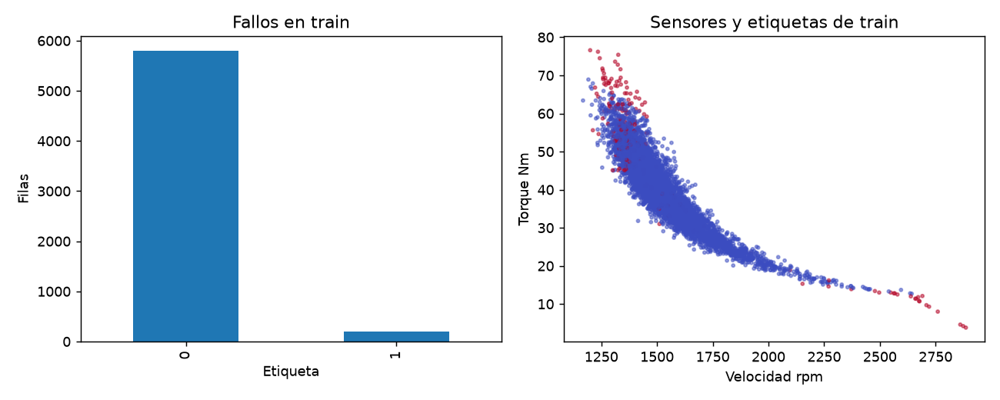
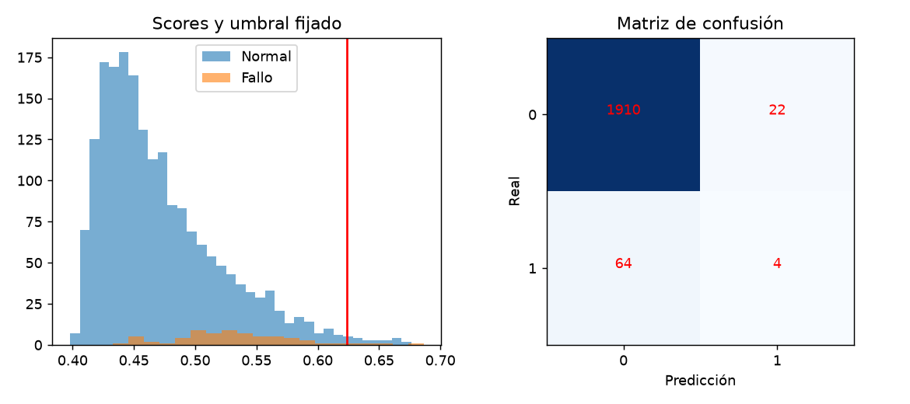

# Informe integral · Anomalías industriales en sensores

Generado: 2026-10-07T16:39:06.635187+00:00 (UTC).

Estado del informe: **Resultados actualizados por etapas**. Estado del último maestro: **completado**.

Este documento reúne los archivos guardados; no ejecuta modelos ni certifica su utilidad. Las fechas y huellas del manifiesto permiten revisar su procedencia.

Hay archivos de resultados o notebooks actualizados después de la última ejecución completa del maestro. Los resultados corresponden a actualizaciones por etapa; ejecuta 06 para cerrar una nueva pasada completa.

## Objetivo y configuración

Detectar observaciones de sensores compatibles con fallos en el benchmark sintético AI4I y comparar la calidad de las alertas de z-scores e Isolation Forest. Incluye análisis por etapas, comentarios calculados, alertas tabuladas e informe final automático.

| Indicador | Valor |
| --- | --- |
| title | Anomalías industriales en sensores |
| kind | anomaly_tabular |
| seed | 42 |
| source_base | project |
| source | data/raw/AI4I.zip |

## Datos y preparación

Indicadores de [preparacion.json](../../reports/preparacion/preparacion.json):

| Indicador | Valor |
| --- | --- |
| fuente_sintetica | True |
| filas_utilizables | 10000 |
| particiones / train / filas | 6000 |
| particiones / train / fallos | 203 |
| particiones / valid / filas | 2000 |
| particiones / valid / fallos | 68 |
| particiones / test / filas | 2000 |
| particiones / test / fallos | 68 |

### Anomalías industriales en sensores: preparacion

AI4I es un **dataset sintético**, no registros de una planta. Se separan filas 60/20/20 de forma estratificada. Se retiran combinaciones de sensores repetidas para evitar solapamientos. Los IDs, tipo de producto y todas las etiquetas de modos de fallo se excluyen como entradas. No hay fecha que permita afirmar validación temporal.

[Reporte de la etapa](../../reports/preparacion/preparacion.md).

## Hallazgos exploratorios

Indicadores de [eda.json](../../reports/eda/eda.json):

| Indicador | Valor |
| --- | --- |
| filas_train | 6000 |
| fallos | 203 |
| tasa_fallo | 0.0338333 |
| nulos | 0 |

### Anomalías industriales en sensores: eda

Train contiene **6,000 filas**, con **3.38% fallos**. La accuracy mayoritaria ocultaría errores sobre eventos raros; se priorizan precision, recall, F1 y average precision.

[Reporte de la etapa](../../reports/eda/eda.md).

## Baseline

Indicadores de [baseline.json](../../reports/baseline/baseline.json):

| Indicador | Valor |
| --- | --- |
| casos | 2000 |
| precision | 0.24 |
| recall | 0.0882353 |
| f1 | 0.129032 |
| average_precision | 0.217315 |
| alertas | 25 |
| fallos_reales | 68 |

### Anomalías industriales en sensores: baseline

Baseline: máximo z-score absoluto, ajustado **solo con 5,797 filas normales de train**. Umbral fijo en su cuantil 0,99. F1 de validación: **0.1290**.

[Reporte de la etapa](../../reports/baseline/baseline.md).

## Modelo y selección

Indicadores de [modelado.json](../../reports/modelado/modelado.json):

| Indicador | Valor |
| --- | --- |
| criterio | f1_validacion |
| threshold_elegido | 0.623986 |
| quantile_elegido | 0.99 |
| normales_entrenamiento | 5797 |

### Anomalías industriales en sensores: modelado

Isolation Forest se ajusta solo con filas normales. Se elige el umbral **0.6240** por F1 de validación; test no interviene. Esta cadena es **semisupervisada**: utiliza etiquetas para definir normalidad y seleccionar umbrales, aunque el detector no aprende una clasificación supervisada de fallos.

[Reporte de la etapa](../../reports/modelado/modelado.md).

## Evaluación y conclusiones

Indicadores de [evaluacion.json](../../reports/evaluacion/evaluacion.json):

| Indicador | Valor |
| --- | --- |
| baseline / casos | 2000 |
| baseline / precision | 0.15 |
| baseline / recall | 0.0441176 |
| baseline / f1 | 0.0681818 |
| baseline / average_precision | 0.152401 |
| baseline / alertas | 20 |
| baseline / fallos_reales | 68 |
| modelo / casos | 2000 |
| modelo / precision | 0.153846 |
| modelo / recall | 0.0588235 |
| modelo / f1 | 0.0851064 |
| modelo / average_precision | 0.122959 |
| modelo / alertas | 26 |
| modelo / fallos_reales | 68 |

### Anomalías industriales en sensores: evaluacion

En **2,000 filas de test**, Isolation Forest obtiene F1 **0.0851**, precision **15.38%** y recall **5.88%**; **supera** el F1 del baseline. Average precision resume el ranking sin depender del umbral. La fuente es sintética y no demuestra anticipación de averías ni eficacia en producción.

[Reporte de la etapa](../../reports/evaluacion/evaluacion.md).

[Detalle: predicciones_test.csv](../../reports/evaluacion/predicciones_test.csv)

### Comparación automática

- `precision`: baseline **0.15**, modelo **0.153846**; el modelo **mejora** este indicador en la evaluación guardada.
- `recall`: baseline **0.0441176**, modelo **0.0588235**; el modelo **mejora** este indicador en la evaluación guardada.
- `f1`: baseline **0.0681818**, modelo **0.0851064**; el modelo **mejora** este indicador en la evaluación guardada.
- `average_precision`: baseline **0.152401**, modelo **0.122959**; el modelo **no mejora** este indicador en la evaluación guardada.

## Alertas y estado de ejecución

| Notebook | Tipos de aviso registrados |
| --- | --- |
| 00_configuracion_entorno | 0 |
| 01_preparacion_datos | 0 |
| 02_analisis_exploratorio | 0 |
| 03_baseline | 0 |
| 04_modelado | 0 |
| 05_evaluacion | 0 |
| 06_ejecucion_completa | 1 |

| Notebook | Tipo | Apariciones | Significado | Acción sugerida |
| --- | --- | --- | --- | --- |
| 06_ejecucion_completa | DeprecationWarning | 5 | Se está utilizando una función o comportamiento en retirada. | Consultar la alternativa indicada antes de actualizar dependencias. |

Una tabla vacía de warnings no demuestra ausencia de errores o validez del modelo. Consulta [alertas](../alertas/) y [resumen del maestro](../ejecucion/resumen.json).

| Notebook | Celdas ejecutadas guardadas | Última ejecución UTC | Errores guardados |
| --- | --- | --- | --- |
| 01_preparacion_datos.ipynb | 3/3 | 2026-10-07T16:18:51.368450Z | 0 |
| 02_analisis_exploratorio.ipynb | 3/3 | 2026-10-07T16:18:54.620034Z | 0 |
| 03_baseline.ipynb | 3/3 | 2026-10-07T16:18:57.758578Z | 0 |
| 04_modelado.ipynb | 3/3 | 2026-10-07T16:19:04.073566Z | 0 |
| 05_evaluacion.ipynb | 3/3 | 2026-10-07T16:19:07.382323Z | 0 |

## Limitaciones y próximos pasos

AI4I es sintético. Se usan etiquetas para definir train normal y seleccionar umbrales: protocolo semisupervisado, sin fechas ni evidencia de anticipación de averías. El recall bajo exige revisar costes y nuevos experimentos antes de proponer uso operativo.

- Revisar fuentes, protocolo y alertas de la ejecución.
- Incorporar sensores reales con fecha, validar por periodos y estudiar el coste de falsas alarmas y fallos omitidos.

## Evidencia y reproducción

Desde la carpeta de este proyecto, ejecuta `python scripts/generate_report.py` para reunir los resultados guardados, o 06 para ejecutar los análisis y actualizar el informe.

Consulta el [README](../../README.md), la [guía del informe](../../docs/informe_final.md) y el [manifiesto con datos y huellas](informe_final.json). El informe conserva una versión vigente por proyecto.
