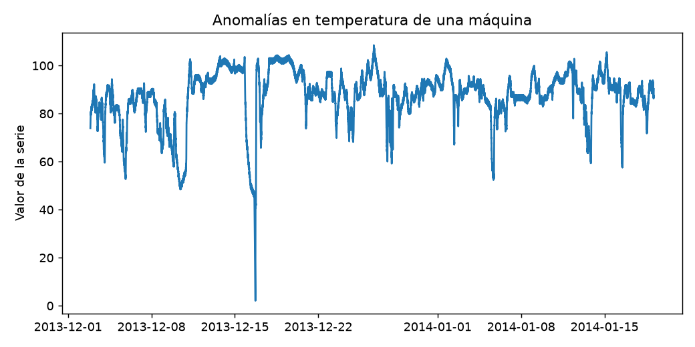
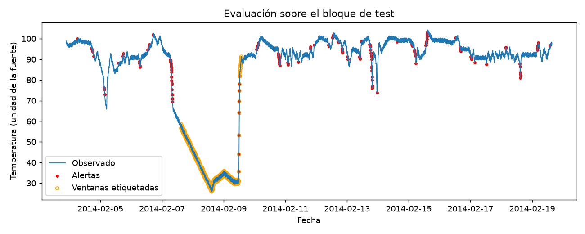

# Informe integral · Anomalías en temperatura de una máquina

Generado: 2026-10-07T16:39:07.933664+00:00 (UTC).

Estado del informe: **Resultados actualizados por etapas**. Estado del último maestro: **completado**.

Este documento reúne los archivos guardados; no ejecuta modelos ni certifica su utilidad. Las fechas y huellas del manifiesto permiten revisar su procedencia.

Hay archivos de resultados o notebooks actualizados después de la última ejecución completa del maestro. Los resultados corresponden a actualizaciones por etapa; ejecuta 06 para cerrar una nueva pasada completa.

## Objetivo y configuración

Detectar desviaciones en una serie de temperatura de máquina del benchmark NAB.

| Indicador | Valor |
| --- | --- |
| title | Anomalías en temperatura de una máquina |
| kind | anomaly |
| source | data/raw/NAB.zip |
| seed | 42 |
| top_n | 10 |
| series | realKnownCause/machine_temperature_system_failure.csv |
| window | 48 |
| source_base | project |

## Datos y preparación

Indicadores de [preparacion.json](../../reports/preparacion/preparacion.json):

| Indicador | Valor |
| --- | --- |
| fuente | data/raw/NAB.zip |
| semilla | 42 |
| filas_originales | 22683 |
| serie | realKnownCause/machine_temperature_system_failure.csv |
| filas_preparadas | 22683 |
| particiones / train / filas | 13609 |
| particiones / valid / filas | 4537 |
| particiones / test / filas | 4537 |

### Anomalías en temperatura de una máquina: preparacion

Se prepararon **22,683 registros**. La fuente y sus huellas se registran en el JSON. Se persistieron train, validación y test según el protocolo documentado.

[Reporte de la etapa](../../reports/preparacion/preparacion.md).

## Hallazgos exploratorios

Indicadores de [eda.json](../../reports/eda/eda.json):

| Indicador | Valor |
| --- | --- |
| poblacion | train |
| filas | 13609 |
| columnas | 3 |
| nulos / timestamp | 0 |
| nulos / value | 0 |
| nulos / label | 0 |

### Anomalías en temperatura de una máquina: eda

El análisis utiliza **13,609 registros de train**, con **0 valores ausentes**. Los cortes y rezagos deben respetar el orden temporal.

[Reporte de la etapa](../../reports/eda/eda.md).

## Baseline

Indicadores de [baseline.json](../../reports/baseline/baseline.json):

| Indicador | Valor |
| --- | --- |
| casos | 4537 |
| precision | 0 |
| recall | 0 |
| f1 | 0 |
| positivos_reales | 567 |

### Anomalías en temperatura de una máquina: baseline

El baseline no genera alertas. Validación contiene **567 puntos dentro de ventanas anómalas**. Las métricas se calculan por punto, no con el evaluador oficial NAB.

[Reporte de la etapa](../../reports/baseline/baseline.md).

## Modelo y selección

Indicadores de [modelado.json](../../reports/modelado/modelado.json):

| Indicador | Valor |
| --- | --- |
| criterio | f1_validacion_por_punto |
| threshold_elegido | 2.64916 |

### Anomalías en temperatura de una máquina: modelado

Se eligió un umbral **2.6492** por F1 de validación. Los candidatos provienen de cuantiles de los scores de train; el detector utiliza solo observaciones anteriores para calcular media y escala. Las ventanas anómalas de test no intervienen en esta elección.

[Reporte de la etapa](../../reports/modelado/modelado.md).

## Evaluación y conclusiones

Indicadores de [evaluacion.json](../../reports/evaluacion/evaluacion.json):

| Indicador | Valor |
| --- | --- |
| baseline / casos | 4537 |
| baseline / precision | 0 |
| baseline / recall | 0 |
| baseline / f1 | 0 |
| baseline / positivos_reales | 567 |
| modelo / casos | 4537 |
| modelo / precision | 0.0806452 |
| modelo / recall | 0.026455 |
| modelo / f1 | 0.0398406 |
| modelo / positivos_reales | 567 |
| threshold | 2.64916 |
| protocolo | Métricas por punto dentro de ventanas; no puntuación NAB oficial. |

### Anomalías en temperatura de una máquina: evaluacion

En test se obtiene **F1 0.0398**, precisión **8.06%** y recall **2.65%**. Hay **567 puntos etiquetados como anómalos**. Métricas por punto dentro de ventanas; no puntuación NAB oficial. La ventana móvil avanza con datos observados, sin consultar etiquetas; un evento puede generar múltiples alertas. Si test no tiene anomalías, recall y F1 se representan como cero por convención y no acreditan capacidad de detección.

[Reporte de la etapa](../../reports/evaluacion/evaluacion.md).

[Detalle: predicciones_test.csv](../../reports/evaluacion/predicciones_test.csv)

### Comparación automática

- `precision`: baseline **0**, modelo **0.0806452**; el modelo **mejora** este indicador en la evaluación guardada.
- `recall`: baseline **0**, modelo **0.026455**; el modelo **mejora** este indicador en la evaluación guardada.
- `f1`: baseline **0**, modelo **0.0398406**; el modelo **mejora** este indicador en la evaluación guardada.

## Alertas y estado de ejecución

| Notebook | Tipos de aviso registrados |
| --- | --- |
| 00_configuracion_entorno | 0 |
| 01_preparacion_datos | 0 |
| 02_analisis_exploratorio | 0 |
| 03_baseline | 0 |
| 04_modelado | 0 |
| 05_evaluacion | 0 |
| 06_ejecucion_completa | 1 |

| Notebook | Tipo | Apariciones | Significado | Acción sugerida |
| --- | --- | --- | --- | --- |
| 06_ejecucion_completa | DeprecationWarning | 5 | Se está utilizando una función o comportamiento en retirada. | Consultar la alternativa indicada antes de actualizar dependencias. |

Una tabla vacía de warnings no demuestra ausencia de errores o validez del modelo. Consulta [alertas](../alertas/) y [resumen del maestro](../ejecucion/resumen.json).

| Notebook | Celdas ejecutadas guardadas | Última ejecución UTC | Errores guardados |
| --- | --- | --- | --- |
| 01_preparacion_datos.ipynb | 3/3 | 2026-10-07T14:44:31.692249Z | 0 |
| 02_analisis_exploratorio.ipynb | 3/3 | 2026-10-07T14:44:37.877263Z | 0 |
| 03_baseline.ipynb | 3/3 | 2026-10-07T14:44:40.937914Z | 0 |
| 04_modelado.ipynb | 3/3 | 2026-10-07T14:44:44.034021Z | 0 |
| 05_evaluacion.ipynb | 3/3 | 2026-10-07T14:44:47.321604Z | 0 |

## Limitaciones y próximos pasos

Las métricas se calculan por punto dentro de ventanas; no son la puntuación oficial NAB. Varias alertas pueden pertenecer al mismo evento.

- Comprobar procedencia, condiciones de uso y disponibilidad temporal de las variables.
- Completar una pasada de 06 y revisar las alertas antes de publicar el informe.
- Ampliar la evaluación temporal con varios cortes; en anomalías, incorporar métricas por evento.

## Evidencia y reproducción

Desde la carpeta de este proyecto, ejecuta `python scripts/generate_report.py` para reunir los resultados guardados, o 06 para ejecutar los análisis y actualizar el informe.

Consulta el [README](../../README.md), la [guía del informe](../../docs/informe_final.md) y el [manifiesto con datos y huellas](informe_final.json). El informe conserva una versión vigente por proyecto.
