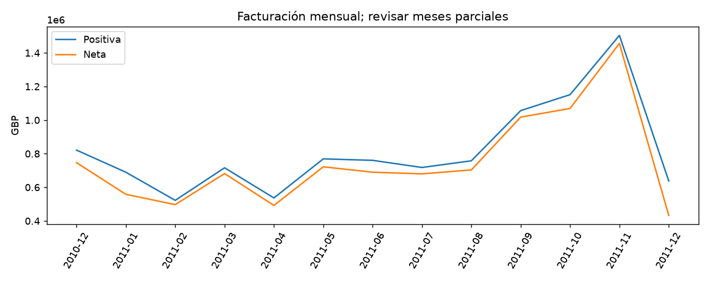

# Informe integral · Indicadores y devoluciones de retail

Generado: 2026-10-07T16:39:09.155246+00:00 (UTC).

Estado del informe: **Resultados actualizados por etapas**. Estado del último maestro: **completado**.

Este documento reúne los archivos guardados; no ejecuta modelos ni certifica su utilidad. Las fechas y huellas del manifiesto permiten revisar su procedencia.

Hay archivos de resultados o notebooks actualizados después de la última ejecución completa del maestro. Los resultados corresponden a actualizaciones por etapa; ejecuta 06 para cerrar una nueva pasada completa.

## Objetivo y configuración

Explicar la facturación de un comercio mediante indicadores reconciliables de importes positivos, ajustes negativos y neta, con evolución mensual y desglose por país. Incluye análisis por etapas, comentarios calculados, alertas tabuladas e informe final automático.

| Indicador | Valor |
| --- | --- |
| title | Indicadores y devoluciones de retail |
| kind | business_intelligence |
| seed | 42 |
| source_base | project |
| source | data/raw/OnlineRetailUCI.zip |

## Datos y preparación

Indicadores de [preparacion.json](../../reports/preparacion/preparacion.json):

| Indicador | Valor |
| --- | --- |
| filas_originales | 541909 |
| duplicados_retirados | 5268 |
| filas_invalidas_retiradas | 2512 |
| filas_preparadas | 534129 |
| fecha_min | 2010-12-01 08:26:00 |
| fecha_max | 2011-12-09 12:50:00 |
| cancelaciones_con_importe_positivo | 0 |
| moneda | GBP |

### Indicadores y devoluciones de retail: preparacion

Se conservan **534,129 líneas válidas** después de retirar duplicados exactos, fechas/cantidades inválidas, precios no positivos y cantidades cero. Los ajustes negativos se mantienen; importes positivos y negativos se clasifican por signo. La moneda de la fuente es GBP. Los IDs de cliente faltantes permanecen en el análisis de facturación y se excluyen solo de recuentos de clientes.

[Reporte de la etapa](../../reports/preparacion/preparacion.md).

## Hallazgos exploratorios

Indicadores de [eda.json](../../reports/eda/eda.json):

| Indicador | Valor |
| --- | --- |
| filas | 534129 |
| paises | 38 |
| meses | 13 |
| sin_cliente | 132565 |

### Indicadores y devoluciones de retail: eda

La cobertura incluye **13 meses** y **38 países**. Meses parciales según extremos observados: **2011-12**. Los totales parciales no deben compararse directamente con meses completos. La cobertura de fechas tampoco garantiza integridad de la operación.

[Reporte de la etapa](../../reports/eda/eda.md).

## Baseline

Indicadores de [baseline.json](../../reports/baseline/baseline.json):

| Indicador | Valor |
| --- | --- |
| mes_referencia | 2011-10 |
| mes_analizado | 2011-11 |
| neta_referencia_gbp | 1.06937e+06 |
| neta_analizada_gbp | 1.45615e+06 |
| variacion_neta | 0.361688 |

### Indicadores y devoluciones de retail: baseline

Referencia descriptiva: **2011-10 → 2011-11**, los últimos dos meses completos por cobertura. La variación de facturación neta es **36.17%**. No es un baseline predictivo ni demuestra una causa del cambio.

[Reporte de la etapa](../../reports/baseline/baseline.md).

## Modelo y selección

Indicadores de [indicadores.json](../../reports/modelado/indicadores.json):

| Indicador | Valor |
| --- | --- |
| moneda | GBP |
| facturacion_positiva | 1.06421e+07 |
| ajustes_negativos_absolutos | 893980 |
| facturacion_neta | 9.74813e+06 |
| ratio_ajustes_sobre_positiva | 0.084004 |
| facturas_positivas | 19960 |
| ticket_medio_factura_positiva | 533.172 |
| clientes_identificados | 4371 |
| filas_sin_cliente | 132565 |
| reconciliacion_gbp | 1.86265e-09 |

Indicadores de [modelado.json](../../reports/modelado/modelado.json):

| Indicador | Valor |
| --- | --- |
| moneda | GBP |
| facturacion_positiva | 1.06421e+07 |
| ajustes_negativos_absolutos | 893980 |
| facturacion_neta | 9.74813e+06 |
| ratio_ajustes_sobre_positiva | 0.084004 |
| facturas_positivas | 19960 |
| ticket_medio_factura_positiva | 533.172 |
| clientes_identificados | 4371 |
| filas_sin_cliente | 132565 |
| reconciliacion_gbp | 1.86265e-09 |

### Indicadores y devoluciones de retail: modelado

Se construye un **modelo de indicadores y tablas agregadas**, no un modelo de machine learning. El dashboard local muestra facturación positiva, ajustes negativos y neta, con detalle mensual y filtro de países. Los ajustes se contabilizan en su fecha de factura; no se enlazan al pedido original ni se calculan beneficios.

[Reporte de la etapa](../../reports/modelado/modelado.md).

[Dashboard local: dashboard.html](../../reports/modelado/dashboard.html)

[Detalle: kpis_mensuales.csv](../../reports/modelado/kpis_mensuales.csv)

[Detalle: kpis_paises.csv](../../reports/modelado/kpis_paises.csv)

## Evaluación y conclusiones

Indicadores de [evaluacion.json](../../reports/evaluacion/evaluacion.json):

| Indicador | Valor |
| --- | --- |
| moneda | GBP |
| facturacion_positiva | 1.06421e+07 |
| ajustes_negativos_absolutos | 893980 |
| facturacion_neta | 9.74813e+06 |
| ratio_ajustes_sobre_positiva | 0.084004 |
| facturas_positivas | 19960 |
| ticket_medio_factura_positiva | 533.172 |
| clientes_identificados | 4371 |
| filas_sin_cliente | 132565 |
| reconciliacion_gbp | 1.86265e-09 |
| reconciliacion_mensual_gbp | 1.86265e-09 |
| reconciliacion_paises_gbp | 0 |
| controles_aprobados | True |
| indicadores_descriptivos | True |

### Indicadores y devoluciones de retail: evaluacion

Facturación neta: **9,748,131.07 GBP** = positiva **10,642,110.80** − ajustes negativos **893,979.73**. Los ajustes representan **8.40%** de la positiva. Las tablas mensual y por país reconcilian con el detalle a un céntimo. Estos controles validan coherencia aritmética, no integridad de datos ni rentabilidad. [Abrir dashboard](../../reports/modelado/dashboard.html).

[Reporte de la etapa](../../reports/evaluacion/evaluacion.md).

[Detalle: resumen_kpis.csv](../../reports/evaluacion/resumen_kpis.csv)

## Alertas y estado de ejecución

| Notebook | Tipos de aviso registrados |
| --- | --- |
| 00_configuracion_entorno | 0 |
| 01_preparacion_datos | 0 |
| 02_analisis_exploratorio | 0 |
| 03_baseline | 0 |
| 04_modelado | 0 |
| 05_evaluacion | 0 |
| 06_ejecucion_completa | 1 |

| Notebook | Tipo | Apariciones | Significado | Acción sugerida |
| --- | --- | --- | --- | --- |
| 06_ejecucion_completa | DeprecationWarning | 5 | Se está utilizando una función o comportamiento en retirada. | Consultar la alternativa indicada antes de actualizar dependencias. |

Una tabla vacía de warnings no demuestra ausencia de errores o validez del modelo. Consulta [alertas](../alertas/) y [resumen del maestro](../ejecucion/resumen.json).

| Notebook | Celdas ejecutadas guardadas | Última ejecución UTC | Errores guardados |
| --- | --- | --- | --- |
| 01_preparacion_datos.ipynb | 3/3 | 2026-10-07T16:21:50.841841Z | 0 |
| 02_analisis_exploratorio.ipynb | 3/3 | 2026-10-07T16:21:53.742808Z | 0 |
| 03_baseline.ipynb | 3/3 | 2026-10-07T16:21:56.214285Z | 0 |
| 04_modelado.ipynb | 3/3 | 2026-10-07T16:21:58.757833Z | 0 |
| 05_evaluacion.ipynb | 3/3 | 2026-10-07T16:22:01.146282Z | 0 |

## Limitaciones y próximos pasos

Indicadores descriptivos de facturación en GBP; no rentabilidad ni causalidad. Meses parciales se señalan por cobertura observada. Ajustes negativos se contabilizan en su fecha y no se enlazan al pedido original; clientes ausentes se conservan en importes. Reconciliación valida aritmética, no integridad operativa.

- Revisar fuentes, protocolo y alertas de la ejecución.
- Validar definiciones de facturación con el negocio y vincular ajustes a sus pedidos originales cuando existan esas relaciones.

## Evidencia y reproducción

Desde la carpeta de este proyecto, ejecuta `python scripts/generate_report.py` para reunir los resultados guardados, o 06 para ejecutar los análisis y actualizar el informe.

Consulta el [README](../../README.md), la [guía del informe](../../docs/informe_final.md) y el [manifiesto con datos y huellas](informe_final.json). El informe conserva una versión vigente por proyecto.
