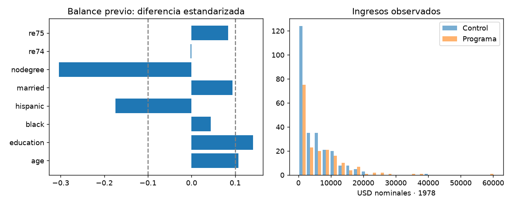

# Efecto de capacitación sobre ingresos
  

Estimar el efecto de la asignación a un programa de capacitación sobre ingresos de 1978, usando una muestra experimental histórica y métodos explícitos de incertidumbre.

Proyecto independiente de `CausalInference`, con notebooks por etapa, comentarios calculados, alertas tabuladas y un informe integral automático.

## Fuente y protocolo

[Página de datos de Dehejia en NBER](https://users.nber.org/~rdehejia/data/.nswdata2.html). Se descargan nswre74_treated.txt y nswre74_control.txt de esa página, la submuestra experimental con RE74. Se conservan los TXT y se crea un CSV combinado con el orden de variables publicado. La atribución corresponde a LaLonde y al trabajo de Dehejia–Wahba descrito por la fuente. No se presupone una licencia distinta de las condiciones publicadas; revisar atribución y redistribución antes de publicar originales.

Consulta la [metodología](docs/metodologia.md) para interpretar el resultado y la [guía de fuentes](docs/fuentes.md) para recuperar entradas. El análisis utiliza todo el experimento; no hay partición predictiva ni accuracy.

## Ejecutar

Desde esta carpeta, crea un entorno con Python 3.10 o superior e instala requisitos:

```powershell
python -m venv .venv
.\.venv\Scripts\python -m pip install -r requirements.txt
```

Selecciona ese Python como kernel. Ejecuta [00_configuracion_entorno](notebooks/00_configuracion_entorno.ipynb) y después las tres celdas de [06_ejecucion_completa](notebooks/06_ejecucion_completa.ipynb). Si 00 instala bibliotecas, reinicia el kernel y repite 00. Guarda y cierra 01–05 antes del maestro; un error detiene la secuencia.

| Notebook | Función |
| --- | --- |
| 01_preparacion_datos | Fuentes, controles y preparación |
| 02_analisis_exploratorio | Distribuciones y diagnósticos |
| 03_baseline | Diferencia experimental sin ajuste |
| 04_modelado | Ajuste por covariables previas y errores HC3 |
| 05_evaluacion | Bootstrap e interpretación causal |



Desde terminal, con el mismo entorno: `python scripts/execute_notebooks.py`. Para los controles locales: `python -m unittest discover -s tests -v`.

## Resultados

- [Verificación de autonomía](docs/verificacion.json): cinco etapas recalculadas en copia independiente y tests locales.
- [Informe integral](reports/informe_final/informe_final.md): entrada principal a resultados y conclusiones.
- `reports/ejecucion/resumen.json`: estado y tiempos de las cinco etapas.
- `reports/alertas`: avisos originales agrupados y explicados.
- `reports/preparacion`, `eda`, `baseline`, `modelado`, `evaluacion`: cifras, comentarios y evidencia por etapa.
- `reports/evaluacion/`: estimaciones.csv y réplicas bootstrap.

Para reunir reportes guardados sin repetir el análisis, utiliza `python scripts/generate_report.py`. La [guía del informe](docs/informe_final.md) explica estados y actualización. Reejecutar conserva una única versión vigente; las cifras de una primera revisión son históricas.

## Autonomía y límites

El proyecto conserva `src/training_program_impact`, scripts, tests, configuración, fuentes y modelos propios. Puedes copiar o renombrar esta carpeta con sus datos locales, instalarla y ejecutarla sin los demás proyectos. Para otra máquina, crea un entorno nuevo y recupera las fuentes según la guía local.

Efecto de asignación en una submuestra experimental histórica; condicionado a comparabilidad, consistencia y ausencia de interferencia. No efecto por completar capacitación ni generalización a programas actuales. El ajuste y bootstrap expresan incertidumbre, no un efecto verdadero conocido.
