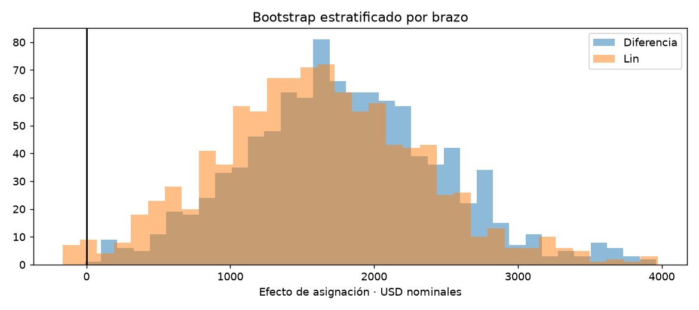

# Informe integral · Efecto de capacitación sobre ingresos

Generado: 2026-10-07T22:33:54.372204+00:00 (UTC).

Estado del informe: **Evidencia disponible**. Estado del último maestro: **completado**.

Este documento reúne los archivos guardados; no ejecuta modelos ni certifica su utilidad. Las fechas y huellas del manifiesto permiten revisar su procedencia.

## Objetivo y configuración

Estimar el efecto de la asignación a un programa de capacitación sobre ingresos de 1978, usando una muestra experimental histórica y métodos explícitos de incertidumbre.

| Indicador | Valor |
| --- | --- |
| title | Efecto de capacitación sobre ingresos |
| kind | causal_inference |
| seed | 42 |
| source_base | project |
| source | data/raw/nsw_dw.csv |
| bootstrap_repetitions | 1000 |
| confidence_level | 0.95 |

## Datos y preparación

Indicadores de [preparacion.json](../../reports/preparacion/preparacion.json):

| Indicador | Valor |
| --- | --- |
| fuente | https://users.nber.org/~rdehejia/data/.nswdata2.html |
| filas | 445 |
| asignados_programa | 185 |
| controles | 260 |
| resultado | re78: ingresos anuales de 1978 en USD nominales |
| muestra | Submuestra experimental NSW Dehejia–Wahba; no se incluyen controles CPS/PSID |
| particion_predictiva | No aplica: estimación causal sobre la muestra experimental completa |

### Efecto de capacitación sobre ingresos: preparacion

Se conservan **445 participantes**, **185 asignados al programa** y **260 controles**, sin deduplicar participantes por atributos. Resultado: ingresos de 1978 en USD nominales. Solo se incluyen covariables previas. Es una submuestra experimental histórica; no se mezclan controles observacionales ni se crean splits predictivos. El estimando es el efecto de **asignación al programa en esta muestra**, no el efecto entre quienes completaron la capacitación.

[Reporte de la etapa](../../reports/preparacion/preparacion.md).

## Hallazgos exploratorios

Indicadores de [eda.json](../../reports/eda/eda.json):

| Indicador | Valor |
| --- | --- |
| max_diferencia_estandarizada_absoluta | 0.303986 |
| covariables_sobre_01 | 4 |
| proporcion_ingresos_cero | 0.307865 |

### Efecto de capacitación sobre ingresos: eda

Hay **4 covariables** con diferencia estandarizada absoluta > 0,10, una referencia descriptiva. El **30.79%** tiene ingresos cero en 1978. El balance finito puede variar por azar; estas cifras no prueban ni invalidan la asignación aleatoria. No se eligen ajustes según su significancia o el resultado observado.

[Reporte de la etapa](../../reports/eda/eda.md).

[Detalle: balance_pretratamiento.csv](../../reports/eda/balance_pretratamiento.csv)

## Baseline

Indicadores de [baseline.json](../../reports/baseline/baseline.json):

| Indicador | Valor |
| --- | --- |
| efecto_usd | 1794.34 |
| error_estandar | 670.997 |
| ci_inferior | 474.01 |
| ci_superior | 3114.67 |
| confidence_level | 0.95 |

### Efecto de capacitación sobre ingresos: baseline

Diferencia de medias programa − control: **1,794.34 USD**, IC 95% **[474.01, 3,114.67]** mediante Welch. Es una estimación experimental sin ajuste, no un baseline de clasificación o predicción.

[Reporte de la etapa](../../reports/baseline/baseline.md).

## Modelo y selección

Indicadores de [modelado.json](../../reports/modelado/modelado.json):

| Indicador | Valor |
| --- | --- |
| efecto_usd | 1621.58 |
| error_estandar_hc3 | 716.873 |
| ci_inferior | 212.544 |
| ci_superior | 3030.62 |
| confidence_level | 0.95 |
| parametros | 18 |
| metodo | OLS Lin con interacciones y errores HC3 |

### Efecto de capacitación sobre ingresos: modelado

Ajuste preespecificado por covariables previas e interacciones: **1,621.58 USD**, IC 95% HC3 **[212.54, 3,030.62]**. El coeficiente de asignación se interpreta respecto a covariables centradas en esta muestra. No se selecciona el estimador por producir un efecto mayor o un intervalo que excluya cero.

[Reporte de la etapa](../../reports/modelado/modelado.md).

## Evaluación y conclusiones

Indicadores de [evaluacion.json](../../reports/evaluacion/evaluacion.json):

| Indicador | Valor |
| --- | --- |
| sin_ajuste / efecto_usd | 1794.34 |
| sin_ajuste / error_estandar | 670.997 |
| sin_ajuste / ci_inferior | 474.01 |
| sin_ajuste / ci_superior | 3114.67 |
| sin_ajuste / confidence_level | 0.95 |
| ajustado / efecto_usd | 1621.58 |
| ajustado / error_estandar_hc3 | 716.873 |
| ajustado / ci_inferior | 212.544 |
| ajustado / ci_superior | 3030.62 |
| ajustado / confidence_level | 0.95 |
| ajustado / parametros | 18 |
| ajustado / metodo | OLS Lin con interacciones y errores HC3 |
| bootstrap_replicas_validas | 1000 |
| bootstrap_replicas_solicitadas | 1000 |
| estimando | Efecto de asignación al programa en la muestra experimental seleccionada |

### Efecto de capacitación sobre ingresos: evaluacion

El IC ajustado HC3 **excluye cero por el lado positivo**. Se contrastan ambas estimaciones con **1000 réplicas bootstrap**, muestreando participantes dentro de cada brazo y recalculando el centrado. Diferencias entre métodos reflejan ajuste y aproximaciones de incertidumbre; no se comparan mediante accuracy ni se conoce un efecto verdadero con el que medir error. Interpretación causal condicionada a la asignación experimental, consistencia, ausencia de interferencia y selección de la submuestra. No se generaliza a todos los trabajadores, programas actuales ni efectos por cumplimiento.

[Reporte de la etapa](../../reports/evaluacion/evaluacion.md).

[Detalle: bootstrap.csv](../../reports/evaluacion/bootstrap.csv)

[Detalle: estimaciones.csv](../../reports/evaluacion/estimaciones.csv)

## Alertas y estado de ejecución

| Notebook | Tipos de aviso registrados |
| --- | --- |
| 00_configuracion_entorno | 0 |
| 01_preparacion_datos | 0 |
| 02_analisis_exploratorio | 0 |
| 03_baseline | 0 |
| 04_modelado | 0 |
| 05_evaluacion | 0 |
| 06_ejecucion_completa | 1 |

| Notebook | Tipo | Apariciones | Significado | Acción sugerida |
| --- | --- | --- | --- | --- |
| 06_ejecucion_completa | DeprecationWarning | 5 | Se está utilizando una función o comportamiento en retirada. | Consultar la alternativa indicada antes de actualizar dependencias. |

Una tabla vacía de warnings no demuestra ausencia de errores o validez del modelo. Consulta [alertas](../alertas/) y [resumen del maestro](../ejecucion/resumen.json).

| Notebook | Celdas ejecutadas guardadas | Última ejecución UTC | Errores guardados |
| --- | --- | --- | --- |
| 01_preparacion_datos.ipynb | 3/3 | 2026-10-07T22:24:26.378067Z | 0 |
| 02_analisis_exploratorio.ipynb | 3/3 | 2026-10-07T22:24:29.297612Z | 0 |
| 03_baseline.ipynb | 3/3 | 2026-10-07T22:24:32.122068Z | 0 |
| 04_modelado.ipynb | 3/3 | 2026-10-07T22:24:37.200598Z | 0 |
| 05_evaluacion.ipynb | 3/3 | 2026-10-07T22:24:41.934558Z | 0 |

## Limitaciones y próximos pasos

Efecto de asignación en una submuestra experimental histórica; condicionado a comparabilidad, consistencia y ausencia de interferencia. No efecto por completar capacitación ni generalización a programas actuales. El ajuste y bootstrap expresan incertidumbre, no un efecto verdadero conocido.

- Revisar fuentes, supuestos y alertas.
- Estudiar sensibilidad e influencia, y definir otra población experimental antes de generalizar.

## Evidencia y reproducción

Desde la carpeta de este proyecto, ejecuta `python scripts/generate_report.py` para reunir los resultados guardados, o 06 para ejecutar los análisis y actualizar el informe.

Consulta el [README](../../README.md), la [guía del informe](../../docs/informe_final.md) y el [manifiesto con datos y huellas](informe_final.json). El informe conserva una versión vigente por proyecto.
