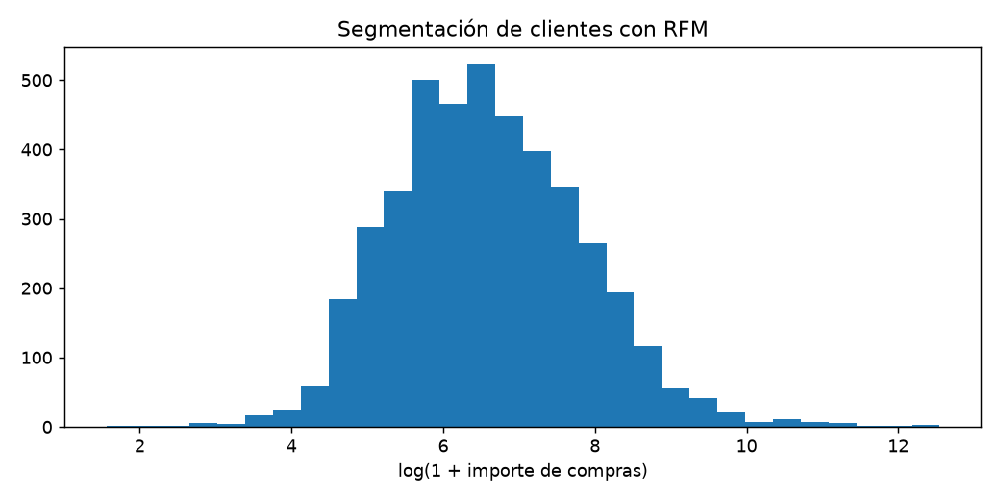
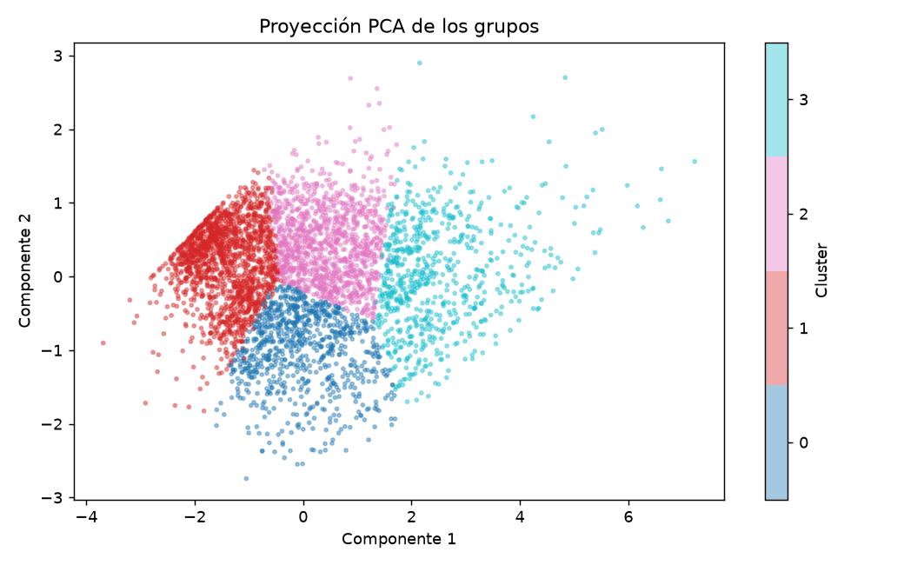

# Informe integral · Segmentación de clientes con RFM

Generado: 2026-10-07T16:39:15.525957+00:00 (UTC).

Estado del informe: **Resultados actualizados por etapas**. Estado del último maestro: **completado**.

Este documento reúne los archivos guardados; no ejecuta modelos ni certifica su utilidad. Las fechas y huellas del manifiesto permiten revisar su procedencia.

Hay archivos de resultados o notebooks actualizados después de la última ejecución completa del maestro. Los resultados corresponden a actualizaciones por etapa; ejecuta 06 para cerrar una nueva pasada completa.

## Objetivo y configuración

Describir grupos de clientes a partir de recencia, frecuencia e importe de sus compras.

| Indicador | Valor |
| --- | --- |
| title | Segmentación de clientes con RFM |
| kind | cluster_customers |
| source | data/raw/OnlineRetailUCI.zip |
| seed | 42 |
| top_n | 10 |
| source_base | project |

## Datos y preparación

Indicadores de [preparacion.json](../../reports/preparacion/preparacion.json):

| Indicador | Valor |
| --- | --- |
| fuente | OnlineRetailUCI.zip |
| semilla | 42 |
| filas_originales | 541909 |
| politica_ventas | Compras positivas; excluye cancelaciones, devoluciones, precios no positivos y duplicados exactos. No mide ingresos netos. |
| fecha_referencia | 2011-12-10T00:00:00 |
| filas_preparadas | 4338 |

### Segmentación de clientes con RFM: preparacion

Se prepararon **4,338 registros**. La fuente y sus huellas se registran en el JSON. Esta etapa construye un catálogo o una población descriptiva; no implica una evaluación supervisada.

[Reporte de la etapa](../../reports/preparacion/preparacion.md).

## Hallazgos exploratorios

Indicadores de [eda.json](../../reports/eda/eda.json):

| Indicador | Valor |
| --- | --- |
| poblacion | catalogo |
| filas | 4338 |
| columnas | 5 |
| nulos / CustomerID | 0 |
| nulos / last_date | 0 |
| nulos / frequency | 0 |
| nulos / monetary | 0 |
| nulos / recency | 0 |

### Segmentación de clientes con RFM: eda

El análisis utiliza **4,338 registros de catalogo**, con **0 valores ausentes**. RFM describe compras positivas observadas y no beneficios ni ingresos netos de devoluciones.

[Reporte de la etapa](../../reports/eda/eda.md).

## Baseline

Indicadores de [baseline.json](../../reports/baseline/baseline.json):

| Indicador | Valor |
| --- | --- |
| regla | Tres grupos por terciles de importe (desempates por orden de cliente). |
| silhouette | 0.188322 |

### Segmentación de clientes con RFM: baseline

Baseline descriptivo: Tres grupos por terciles de importe (desempates por orden de cliente). La silhouette mide separación en el espacio estandarizado; no valida por sí sola la utilidad de los grupos.

[Reporte de la etapa](../../reports/baseline/baseline.md).

## Modelo y selección

Indicadores de [modelado.json](../../reports/modelado/modelado.json):

| Indicador | Valor |
| --- | --- |
| criterio | silhouette_descriptiva |
| k_elegido | 4 |

### Segmentación de clientes con RFM: modelado

Se eligió **k=4** por silhouette en la población descriptiva. Este análisis no utiliza etiquetas de verdad ni representa validación predictiva fuera de muestra.

[Reporte de la etapa](../../reports/modelado/modelado.md).

## Evaluación y conclusiones

Indicadores de [evaluacion.json](../../reports/evaluacion/evaluacion.json):

| Indicador | Valor |
| --- | --- |
| k | 4 |
| ari_entre_semillas | 0.998759 |
| varianza_pca_2d | 0.938663 |
| baseline | 0.188322 |

### Segmentación de clientes con RFM: evaluacion

La segmentación es **similar** entre las dos semillas revisadas (ARI **0.9988**; corte descriptivo 0,8). La proyección de dos componentes conserva **93.87%** de la varianza. Los perfiles están expresados en las unidades originales. Los números de cluster no tienen significado ordinal ni equivalen a segmentos de negocio validados.

[Reporte de la etapa](../../reports/evaluacion/evaluacion.md).

[Detalle: perfiles_clusters.csv](../../reports/evaluacion/perfiles_clusters.csv)

## Alertas y estado de ejecución

| Notebook | Tipos de aviso registrados |
| --- | --- |
| 00_configuracion_entorno | 0 |
| 01_preparacion_datos | 0 |
| 02_analisis_exploratorio | 0 |
| 03_baseline | 0 |
| 04_modelado | 0 |
| 05_evaluacion | 0 |
| 06_ejecucion_completa | 1 |

| Notebook | Tipo | Apariciones | Significado | Acción sugerida |
| --- | --- | --- | --- | --- |
| 06_ejecucion_completa | DeprecationWarning | 5 | Se está utilizando una función o comportamiento en retirada. | Consultar la alternativa indicada antes de actualizar dependencias. |

Una tabla vacía de warnings no demuestra ausencia de errores o validez del modelo. Consulta [alertas](../alertas/) y [resumen del maestro](../ejecucion/resumen.json).

| Notebook | Celdas ejecutadas guardadas | Última ejecución UTC | Errores guardados |
| --- | --- | --- | --- |
| 01_preparacion_datos.ipynb | 0/3 | No disponible | 0 |
| 02_analisis_exploratorio.ipynb | 2/3 | 2026-10-07T14:26:10.057670Z | 0 |
| 03_baseline.ipynb | 0/3 | No disponible | 0 |
| 04_modelado.ipynb | 0/3 | No disponible | 0 |
| 05_evaluacion.ipynb | 2/3 | 2026-10-07T14:26:13.464112Z | 0 |

## Limitaciones y próximos pasos

Los perfiles descriptivos y su estabilidad no demuestran impacto comercial ni beneficios netos.

- Comprobar procedencia, condiciones de uso y disponibilidad temporal de las variables.
- Completar una pasada de 06 y revisar las alertas antes de publicar el informe.
- Validar los perfiles con el uso previsto y estudiar sensibilidad a atributos, escalamiento y muestras.

## Evidencia y reproducción

Desde la carpeta de este proyecto, ejecuta `python scripts/generate_report.py` para reunir los resultados guardados, o 06 para ejecutar los análisis y actualizar el informe.

Consulta el [README](../../README.md), la [guía del informe](../../docs/informe_final.md) y el [manifiesto con datos y huellas](informe_final.json). El informe conserva una versión vigente por proyecto.
