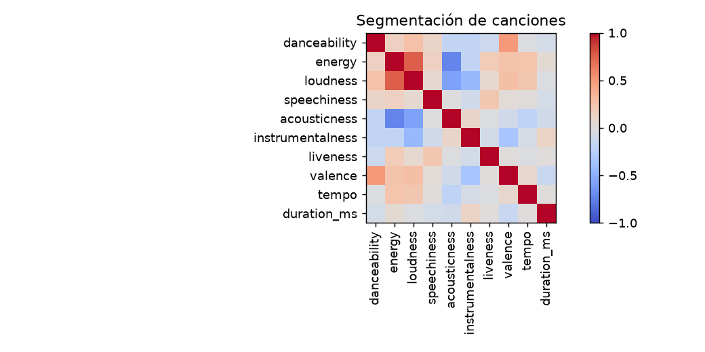
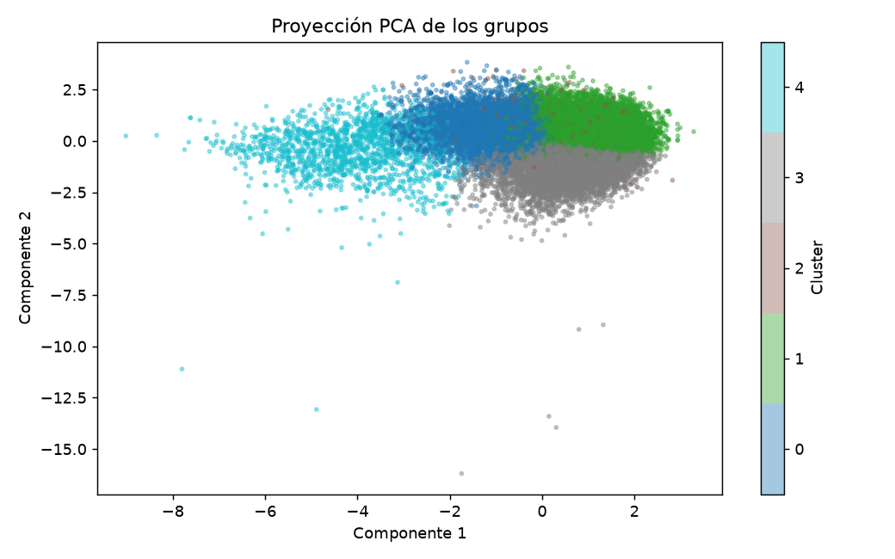

# Informe integral · Segmentación de canciones

Generado: 2026-10-07T16:39:16.822343+00:00 (UTC).

Estado del informe: **Resultados actualizados por etapas**. Estado del último maestro: **completado**.

Este documento reúne los archivos guardados; no ejecuta modelos ni certifica su utilidad. Las fechas y huellas del manifiesto permiten revisar su procedencia.

Hay archivos de resultados o notebooks actualizados después de la última ejecución completa del maestro. Los resultados corresponden a actualizaciones por etapa; ejecuta 06 para cerrar una nueva pasada completa.

## Objetivo y configuración

Explorar grupos musicales por características de canciones.

| Indicador | Valor |
| --- | --- |
| title | Segmentación de canciones |
| kind | cluster_music |
| source | data/raw/Spotify Tracks Dataset.zip |
| seed | 42 |
| top_n | 10 |
| max_tracks | 20000 |
| source_base | project |

## Datos y preparación

Indicadores de [preparacion.json](../../reports/preparacion/preparacion.json):

| Indicador | Valor |
| --- | --- |
| fuente | Spotify Tracks Dataset.zip |
| semilla | 42 |
| filas_originales | 114000 |
| duplicados_track_id | 24259 |
| filas_preparadas | 20000 |

### Segmentación de canciones: preparacion

Se prepararon **20,000 registros**. La fuente y sus huellas se registran en el JSON. Esta etapa construye un catálogo o una población descriptiva; no implica una evaluación supervisada.

[Reporte de la etapa](../../reports/preparacion/preparacion.md).

## Hallazgos exploratorios

Indicadores de [eda.json](../../reports/eda/eda.json):

| Indicador | Valor |
| --- | --- |
| poblacion | catalogo |
| filas | 20000 |
| columnas | 20 |
| nulos / track_id | 0 |
| nulos / artists | 0 |
| nulos / album_name | 0 |
| nulos / track_name | 0 |
| nulos / popularity | 0 |
| nulos / duration_ms | 0 |
| nulos / explicit | 0 |
| nulos / danceability | 0 |
| nulos / energy | 0 |
| nulos / key | 0 |
| nulos / loudness | 0 |
| nulos / mode | 0 |
| nulos / speechiness | 0 |
| nulos / acousticness | 0 |
| nulos / instrumentalness | 0 |
| nulos / liveness | 0 |
| nulos / valence | 0 |
| nulos / tempo | 0 |
| nulos / time_signature | 0 |
| nulos / track_genre | 0 |
| correlacion_destacada / pearson | 0.755541 |

El archivo enlazado contiene el detalle restante.

### Segmentación de canciones: eda

El análisis utiliza **20,000 registros de catalogo**, con **0 valores ausentes**. La mayor correlación absoluta es energy / loudness: **r=0.756**, asociación alta según los umbrales descriptivos del proyecto. No demuestra causalidad ni significancia estadística.

[Reporte de la etapa](../../reports/eda/eda.md).

## Baseline

Indicadores de [baseline.json](../../reports/baseline/baseline.json):

| Indicador | Valor |
| --- | --- |
| regla | Tres grupos por energía: <=0.33, (0.33,0.66], >0.66. |
| silhouette | 0.092035 |

### Segmentación de canciones: baseline

Baseline descriptivo: Tres grupos por energía: <=0.33, (0.33,0.66], >0.66. La silhouette mide separación en el espacio estandarizado; no valida por sí sola la utilidad de los grupos.

[Reporte de la etapa](../../reports/baseline/baseline.md).

## Modelo y selección

Indicadores de [modelado.json](../../reports/modelado/modelado.json):

| Indicador | Valor |
| --- | --- |
| criterio | silhouette_descriptiva |
| k_elegido | 5 |

### Segmentación de canciones: modelado

Se eligió **k=5** por silhouette en la población descriptiva. Este análisis no utiliza etiquetas de verdad ni representa validación predictiva fuera de muestra.

[Reporte de la etapa](../../reports/modelado/modelado.md).

## Evaluación y conclusiones

Indicadores de [evaluacion.json](../../reports/evaluacion/evaluacion.json):

| Indicador | Valor |
| --- | --- |
| k | 5 |
| ari_entre_semillas | 1 |
| varianza_pca_2d | 0.438754 |
| baseline | 0.092035 |

### Segmentación de canciones: evaluacion

La segmentación es **similar** entre las dos semillas revisadas (ARI **1.0000**; corte descriptivo 0,8). La proyección de dos componentes conserva **43.88%** de la varianza. Los perfiles están expresados en las unidades originales. Los números de cluster no tienen significado ordinal ni equivalen a segmentos de negocio validados.

[Reporte de la etapa](../../reports/evaluacion/evaluacion.md).

[Detalle: perfiles_clusters.csv](../../reports/evaluacion/perfiles_clusters.csv)

## Alertas y estado de ejecución

| Notebook | Tipos de aviso registrados |
| --- | --- |
| 00_configuracion_entorno | 0 |
| 01_preparacion_datos | 0 |
| 02_analisis_exploratorio | 0 |
| 03_baseline | 0 |
| 04_modelado | 0 |
| 05_evaluacion | 0 |
| 06_ejecucion_completa | 1 |

| Notebook | Tipo | Apariciones | Significado | Acción sugerida |
| --- | --- | --- | --- | --- |
| 06_ejecucion_completa | DeprecationWarning | 5 | Se está utilizando una función o comportamiento en retirada. | Consultar la alternativa indicada antes de actualizar dependencias. |

Una tabla vacía de warnings no demuestra ausencia de errores o validez del modelo. Consulta [alertas](../alertas/) y [resumen del maestro](../ejecucion/resumen.json).

| Notebook | Celdas ejecutadas guardadas | Última ejecución UTC | Errores guardados |
| --- | --- | --- | --- |
| 01_preparacion_datos.ipynb | 0/3 | No disponible | 0 |
| 02_analisis_exploratorio.ipynb | 2/3 | 2026-10-07T14:26:21.950757Z | 0 |
| 03_baseline.ipynb | 0/3 | No disponible | 0 |
| 04_modelado.ipynb | 0/3 | No disponible | 0 |
| 05_evaluacion.ipynb | 2/3 | 2026-10-07T14:26:25.490634Z | 0 |

## Limitaciones y próximos pasos

Silhouette y estabilidad describen el espacio de atributos; no validan géneros ni utilidad para usuarios.

- Comprobar procedencia, condiciones de uso y disponibilidad temporal de las variables.
- Completar una pasada de 06 y revisar las alertas antes de publicar el informe.
- Validar los perfiles con el uso previsto y estudiar sensibilidad a atributos, escalamiento y muestras.

## Evidencia y reproducción

Desde la carpeta de este proyecto, ejecuta `python scripts/generate_report.py` para reunir los resultados guardados, o 06 para ejecutar los análisis y actualizar el informe.

Consulta el [README](../../README.md), la [guía del informe](../../docs/informe_final.md) y el [manifiesto con datos y huellas](informe_final.json). El informe conserva una versión vigente por proyecto.
