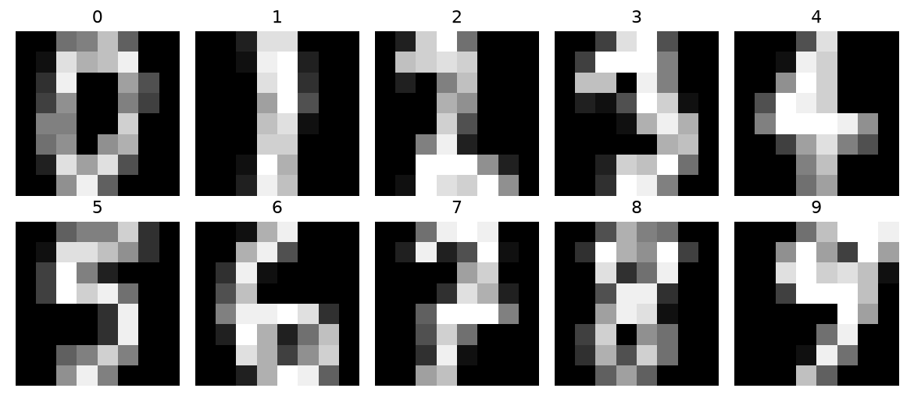
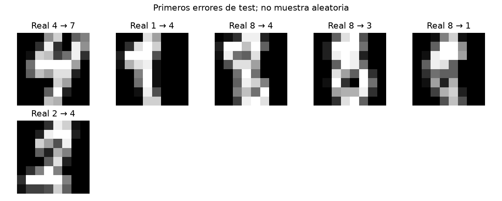

# Informe integral · Reconocimiento de dígitos escritos

Generado: 2026-10-26T14:22:16.782994+00:00 (UTC).

Estado del informe: **Evidencia disponible**. Estado del último maestro: **completado**.

Este documento reúne los archivos guardados; no ejecuta modelos ni certifica su utilidad. Las fechas y huellas del manifiesto permiten revisar su procedencia.

## Objetivo y configuración

Reconocer dígitos escritos a mano y estudiar los errores y la sensibilidad del clasificador ante un pequeño desplazamiento de las imágenes. Incluye análisis por etapas, comentarios calculados, alertas tabuladas e informe final automático.

| Indicador | Valor |
| --- | --- |
| title | Reconocimiento de dígitos escritos |
| kind | vision_classification |
| seed | 42 |
| source_base | project |
| source | data/raw/digits.npz |

## Datos y preparación

Indicadores de [preparacion.json](../../reports/preparacion/preparacion.json):

| Indicador | Valor |
| --- | --- |
| filas_originales | 1797 |
| duplicados_retirados | 0 |
| particiones / train / filas | 1078 |
| particiones / valid / filas | 359 |
| particiones / test / filas | 360 |

### Reconocimiento de dígitos escritos: preparacion

Se usa la copia **load_digits de scikit-learn: imágenes de 8×8**, no el MNIST de 28×28. Se deduplica contenido y divide 60/20/20 estratificado. No hay IDs de escritor para comprobar independencia por persona. El conjunto procede de una parte del dataset UCI; este split propio no replica su protocolo oficial.

[Reporte de la etapa](../../reports/preparacion/preparacion.md).

## Hallazgos exploratorios

Indicadores de [eda.json](../../reports/eda/eda.json):

| Indicador | Valor |
| --- | --- |
| filas_train | 1078 |
| clases / 0 | 107 |
| clases / 1 | 109 |
| clases / 2 | 106 |
| clases / 3 | 110 |
| clases / 4 | 109 |
| clases / 5 | 109 |
| clases / 6 | 109 |
| clases / 7 | 107 |
| clases / 8 | 104 |
| clases / 9 | 108 |
| alto | 8 |
| ancho | 8 |

### Reconocimiento de dígitos escritos: eda

EDA sobre **1078 imágenes de train**. Diez categorías de dígitos con resolución 8×8. La baja resolución y la falta de independencia por escritor limitan la generalización a documentos reales.

[Reporte de la etapa](../../reports/eda/eda.md).

## Baseline

Indicadores de [baseline.json](../../reports/baseline/baseline.json):

| Indicador | Valor |
| --- | --- |
| casos | 359 |
| accuracy | 0.883008 |
| f1_macro | 0.882493 |

### Reconocimiento de dígitos escritos: baseline

Baseline de centroide más cercano sobre intensidad: F1 macro de validación **0.8825**. No utiliza gradientes ni consulta test.

[Reporte de la etapa](../../reports/baseline/baseline.md).

## Modelo y selección

Indicadores de [modelado.json](../../reports/modelado/modelado.json):

| Indicador | Valor |
| --- | --- |
| criterio | f1_macro_validacion |
| C_elegido | 10 |
| features | 192 |

### Reconocimiento de dígitos escritos: modelado

SVM RBF sobre **192 atributos**: intensidad y dos gradientes por píxel. Se elige C **10** en validación; el escalamiento se ajusta solo en train. Es reconocimiento con atributos visuales y SVM, no una CNN ni un sistema OCR completo.

[Reporte de la etapa](../../reports/modelado/modelado.md).

## Evaluación y conclusiones

Indicadores de [evaluacion.json](../../reports/evaluacion/evaluacion.json):

| Indicador | Valor |
| --- | --- |
| baseline / casos | 360 |
| baseline / accuracy | 0.858333 |
| baseline / f1_macro | 0.857843 |
| modelo / casos | 360 |
| modelo / accuracy | 0.983333 |
| modelo / f1_macro | 0.983262 |
| robustez_desplazamiento_1px / casos | 360 |
| robustez_desplazamiento_1px / accuracy | 0.311111 |
| robustez_desplazamiento_1px / f1_macro | 0.289431 |

### Reconocimiento de dígitos escritos: evaluacion

Test: **360 imágenes**; accuracy **98.33%**, F1 macro **0.9833** frente a **0.8578** del baseline. Al desplazar artificialmente un píxel a la derecha, la accuracy es **31.11%**. Este ensayo describe sensibilidad a una perturbación concreta, no robustez general ni una evaluación en documentos reales. No se seleccionan parámetros a partir de test.

[Reporte de la etapa](../../reports/evaluacion/evaluacion.md).

[Detalle: predicciones_test.csv](../../reports/evaluacion/predicciones_test.csv)

### Comparación automática

- `accuracy`: baseline **0.858333**, modelo **0.983333**; el modelo **mejora** este indicador en la evaluación guardada.
- `f1_macro`: baseline **0.857843**, modelo **0.983262**; el modelo **mejora** este indicador en la evaluación guardada.

## Alertas y estado de ejecución

| Notebook | Tipos de aviso registrados |
| --- | --- |
| 00_configuracion_entorno | 0 |
| 01_preparacion_datos | 0 |
| 02_analisis_exploratorio | 0 |
| 03_baseline | 1 |
| 04_modelado | 0 |
| 05_evaluacion | 0 |
| 06_ejecucion_completa | 1 |

| Notebook | Tipo | Apariciones | Significado | Acción sugerida |
| --- | --- | --- | --- | --- |
| 03_baseline | UserWarning | 1 | La biblioteca señala una condición que conviene revisar. | Leer el detalle original y comprobar cómo afecta esta etapa del análisis. |
| 06_ejecucion_completa | DeprecationWarning | 5 | Se está utilizando una función o comportamiento en retirada. | Consultar la alternativa indicada antes de actualizar dependencias. |

Una tabla vacía de warnings no demuestra ausencia de errores o validez del modelo. Consulta [alertas](../alertas/) y [resumen del maestro](../ejecucion/resumen.json).

| Notebook | Celdas ejecutadas guardadas | Última ejecución UTC | Errores guardados |
| --- | --- | --- | --- |
| 01_preparacion_datos.ipynb | 3/3 | 2026-10-26T14:22:03.774632Z | 0 |
| 02_analisis_exploratorio.ipynb | 3/3 | 2026-10-26T14:22:06.135690Z | 0 |
| 03_baseline.ipynb | 3/3 | 2026-10-26T14:22:08.437842Z | 0 |
| 04_modelado.ipynb | 3/3 | 2026-10-26T14:22:10.767306Z | 0 |
| 05_evaluacion.ipynb | 3/3 | 2026-10-26T14:22:13.193850Z | 0 |

## Limitaciones y próximos pasos

Benchmark cerrado con imágenes 8×8 e intensidades 0–16. Intensidad y gradientes con SVM no constituyen OCR completo. No se puede verificar independencia por escritor. El desplazamiento artificial mide sensibilidad concreta y no robustez general.

- Revisar fuentes, protocolo y alertas de la ejecución.
- Estudiar centrado y aumento de imágenes usando train y validación; reservar una evaluación nueva para las siguientes decisiones.

## Evidencia y reproducción

Desde la carpeta de este proyecto, ejecuta `python scripts/generate_report.py` para reunir los resultados guardados, o 06 para ejecutar los análisis y actualizar el informe.

Consulta el [README](../../README.md), la [guía del informe](../../docs/informe_final.md) y el [manifiesto con datos y huellas](informe_final.json). El informe conserva una versión vigente por proyecto.
