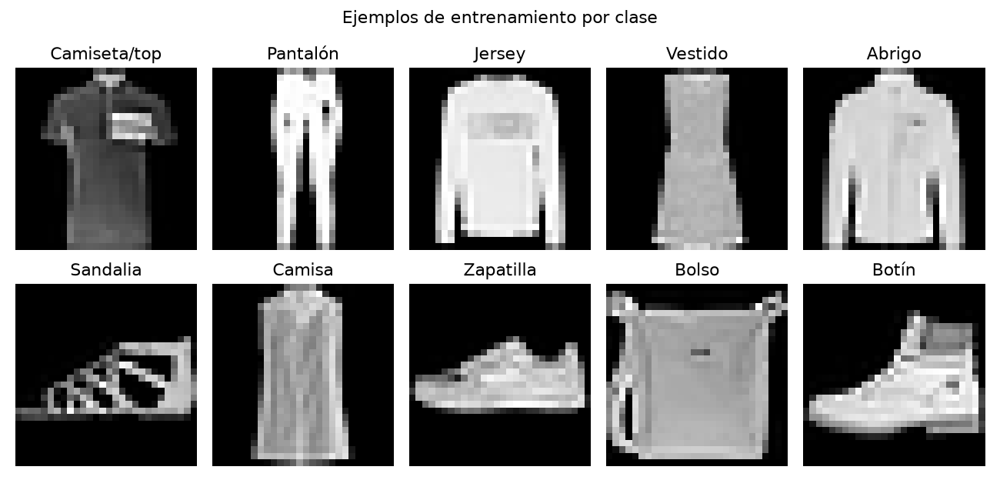
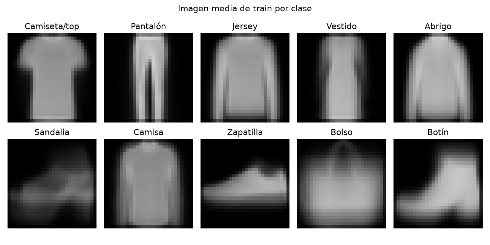
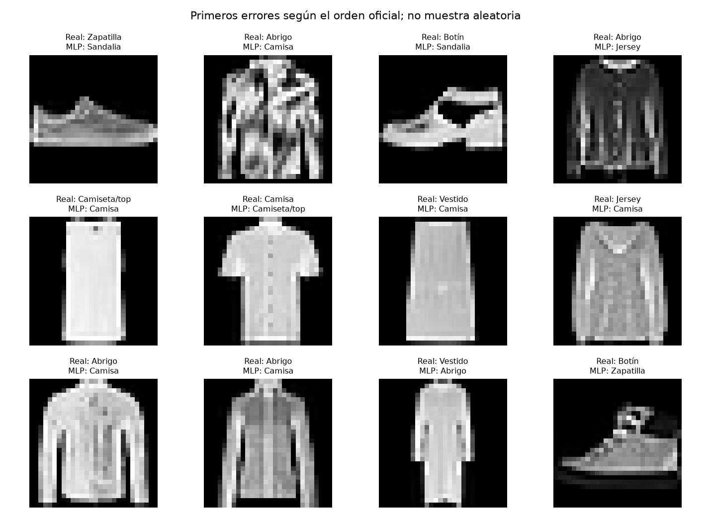
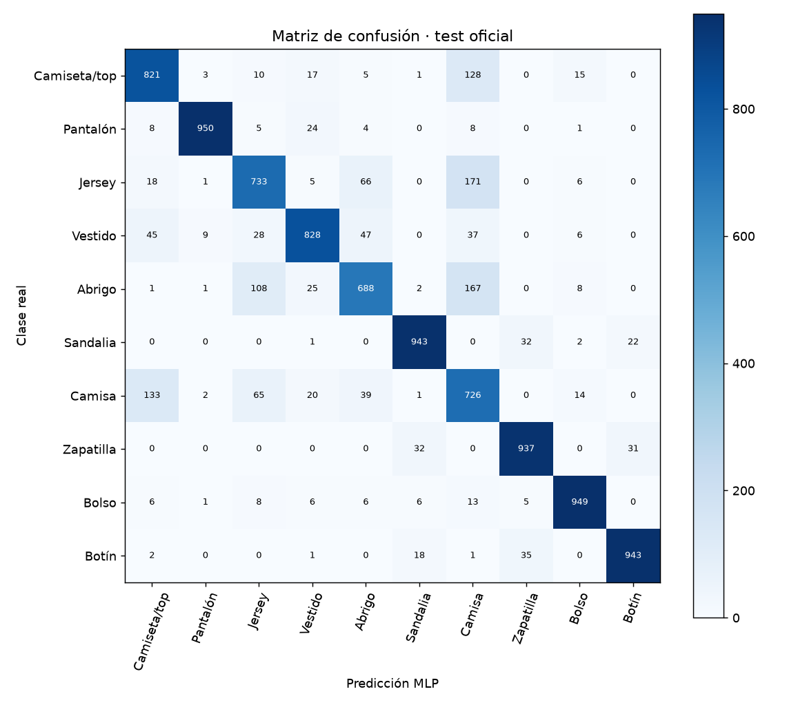

# Informe integral · Clasificación visual de prendas

Generado: 2026-10-07T16:39:19.295077+00:00 (UTC).

Estado del informe: **Resultados actualizados por etapas**. Estado del último maestro: **completado**.

Este documento reúne los archivos guardados; no ejecuta modelos ni certifica su utilidad. Las fechas y huellas del manifiesto permiten revisar su procedencia.

Hay archivos de resultados o notebooks actualizados después de la última ejecución completa del maestro. Los resultados corresponden a actualizaciones por etapa; ejecuta 06 para cerrar una nueva pasada completa.

## Objetivo y configuración

Identificar diez categorías de prendas a partir de imágenes en gris de 28×28 píxeles. El proyecto compara un clasificador lineal con una red neuronal densa y estudia qué clases confunde.

| Indicador | Valor |
| --- | --- |
| title | Clasificación visual de prendas |
| kind | vision_classification |
| seed | 42 |
| valid_fraction | 0.2 |
| train_limit | 12000 |
| valid_limit | 3000 |
| hidden_units | 64 |
| max_iter | 40 |
| threads | 2 |
| source_base | project |

## Datos y preparación

Indicadores de [preparacion.json](../../reports/preparacion/preparacion.json):

| Indicador | Valor |
| --- | --- |
| desarrollo_original | 60000 |
| repeticiones_retiradas | 0 |
| grupos_ambiguos | 0 |
| filas_coincidentes_test | 0 |
| desarrollo_deduplicado | 60000 |
| train_antes_muestreo | 48000 |
| valid_antes_muestreo | 12000 |
| particiones / train / filas | 12000 |
| particiones / valid / filas | 3000 |
| particiones / test / filas | 10000 |

### Clasificación visual de prendas: preparacion

Se preparan **12,000 imágenes de train**, **3,000 de validación** y el **test oficial completo de 10,000 imágenes**. Desarrollo se deduplica por contenido; se retiran grupos ambiguos y coincidencias exactas con test, conservando test intacto. El muestreo estratificado y sus límites se declaran en config.json. Los píxeles se normalizan por la constante 255, sin ajustar transformaciones con test.

[Reporte de la etapa](../../reports/preparacion/preparacion.md).

## Hallazgos exploratorios

Indicadores de [eda.json](../../reports/eda/eda.json):

| Indicador | Valor |
| --- | --- |
| poblacion | train |
| filas | 12000 |
| alto | 28 |
| ancho | 28 |
| canales | 1 |
| clases / Camiseta/top | 1200 |
| clases / Pantalón | 1200 |
| clases / Jersey | 1200 |
| clases / Vestido | 1200 |
| clases / Abrigo | 1200 |
| clases / Sandalia | 1200 |
| clases / Camisa | 1200 |
| clases / Zapatilla | 1200 |
| clases / Bolso | 1200 |
| clases / Botín | 1200 |
| proporcion_pixeles_cero | 0.502046 |

### Clasificación visual de prendas: eda

El EDA usa solo **12,000 imágenes de entrenamiento**, de **28×28 píxeles y un canal**. Las clases tienen entre **1200 y 1200 ejemplos**; el **50.20%** de los píxeles vale cero. Los ejemplos y promedios permiten inspeccionar formas; no prueban separación predictiva ni representan fotos reales.

[Reporte de la etapa](../../reports/eda/eda.md).

## Baseline

Indicadores de [baseline.json](../../reports/baseline/baseline.json):

| Indicador | Valor |
| --- | --- |
| casos | 3000 |
| accuracy | 0.833 |
| f1_macro | 0.828884 |
| particion | valid |
| modelo | SGDClassifier lineal con log_loss |

### Clasificación visual de prendas: baseline

El baseline lineal obtiene **accuracy 83.30%** y **F1 macro 0.8289 en validación**. Usa los 784 píxeles normalizados; es una referencia fija, sin seleccionar parámetros con test.

[Reporte de la etapa](../../reports/baseline/baseline.md).

## Modelo y selección

Indicadores de [modelado.json](../../reports/modelado/modelado.json):

| Indicador | Valor |
| --- | --- |
| criterio | f1_macro_validacion; accuracy desempata |
| alpha_elegido | 0.001 |
| neuronas_ocultas | 64 |
| max_iter | 40 |
| particion_seleccion | valid |

### Clasificación visual de prendas: modelado

Se selecciona una **MLP de 64 neuronas ocultas**, con **alpha 0.001**, por F1 macro de validación. No se reentrena con validación ni se consulta test para elegir. Es una red densa sobre píxeles aplanados, **no una CNN**; no incorpora convoluciones ni aumento de datos. Las alertas de convergencia deben revisarse, sin asumir que alcanzar el máximo de iteraciones implica convergencia.

[Reporte de la etapa](../../reports/modelado/modelado.md).

## Evaluación y conclusiones

Indicadores de [evaluacion.json](../../reports/evaluacion/evaluacion.json):

| Indicador | Valor |
| --- | --- |
| particion | test_oficial |
| baseline / casos | 10000 |
| baseline / accuracy | 0.8101 |
| baseline / f1_macro | 0.803985 |
| modelo / casos | 10000 |
| modelo / accuracy | 0.8518 |
| modelo / f1_macro | 0.853632 |

### Clasificación visual de prendas: evaluacion

En el **test oficial de 10,000 imágenes**, la MLP obtiene **accuracy 85.18%** y **F1 macro 0.8536**: **supera** el F1 macro del baseline (**0.8040**). La clase con menor recall es **Abrigo: 68.80%**. Hay **1,482 errores**. La confusión más frecuente es **Jersey → Camisa (171 casos)**. Estos resultados describen un benchmark de prendas pequeñas en gris; no acreditan desempeño con fotografías reales. Test se usa para evaluación y diagnóstico, no para elegir alpha ni iteraciones.

[Reporte de la etapa](../../reports/evaluacion/evaluacion.md).

[Detalle: predicciones_test.csv](../../reports/evaluacion/predicciones_test.csv)

### Comparación automática

- `accuracy`: baseline **0.8101**, modelo **0.8518**; el modelo **mejora** este indicador en la evaluación guardada.
- `f1_macro`: baseline **0.803985**, modelo **0.853632**; el modelo **mejora** este indicador en la evaluación guardada.

## Alertas y estado de ejecución

| Notebook | Tipos de aviso registrados |
| --- | --- |
| 00_configuracion_entorno | 0 |
| 01_preparacion_datos | 0 |
| 02_analisis_exploratorio | 0 |
| 03_baseline | 1 |
| 04_modelado | 1 |
| 05_evaluacion | 0 |
| 06_ejecucion_completa | 1 |

| Notebook | Tipo | Apariciones | Significado | Acción sugerida |
| --- | --- | --- | --- | --- |
| 03_baseline | ConvergenceWarning | 1 | El algoritmo terminó sin alcanzar el criterio de convergencia solicitado. | Revisar escalamiento, tolerancia y número de iteraciones antes de interpretar el modelo. |
| 04_modelado | ConvergenceWarning | 2 | El algoritmo terminó sin alcanzar el criterio de convergencia solicitado. | Revisar escalamiento, tolerancia y número de iteraciones antes de interpretar el modelo. |
| 06_ejecucion_completa | DeprecationWarning | 5 | Se está utilizando una función o comportamiento en retirada. | Consultar la alternativa indicada antes de actualizar dependencias. |

Una tabla vacía de warnings no demuestra ausencia de errores o validez del modelo. Consulta [alertas](../alertas/) y [resumen del maestro](../ejecucion/resumen.json).

| Notebook | Celdas ejecutadas guardadas | Última ejecución UTC | Errores guardados |
| --- | --- | --- | --- |
| 01_preparacion_datos.ipynb | 3/3 | 2026-10-07T15:52:36.485430Z | 0 |
| 02_analisis_exploratorio.ipynb | 3/3 | 2026-10-07T15:52:39.834092Z | 0 |
| 03_baseline.ipynb | 3/3 | 2026-10-07T15:52:49.113789Z | 0 |
| 04_modelado.ipynb | 3/3 | 2026-10-07T15:52:57.801834Z | 0 |
| 05_evaluacion.ipynb | 3/3 | 2026-10-07T15:53:01.312898Z | 0 |

## Limitaciones y próximos pasos

Imágenes de 28×28 en gris de un benchmark cerrado. Una MLP sobre píxeles no es una CNN y no acredita desempeño con fotografías reales. La muestra de desarrollo limita comparaciones con benchmarks que usan todo el entrenamiento oficial.

- Comprobar procedencia, condiciones de uso y disponibilidad temporal de las variables.
- Completar una pasada de 06 y revisar las alertas antes de publicar el informe.
- Revisar métricas por clase y errores frecuentes; ajustar decisiones en validación, conservando test independiente.
- Estudiar convergencia y alternativas CNN usando validación; conservar un test independiente para nuevas decisiones.

## Evidencia y reproducción

Desde la carpeta de este proyecto, ejecuta `python scripts/generate_report.py` para reunir los resultados guardados, o 06 para ejecutar los análisis y actualizar el informe.

Consulta el [README](../../README.md), la [guía del informe](../../docs/informe_final.md) y el [manifiesto con datos y huellas](informe_final.json). El informe conserva una versión vigente por proyecto.
