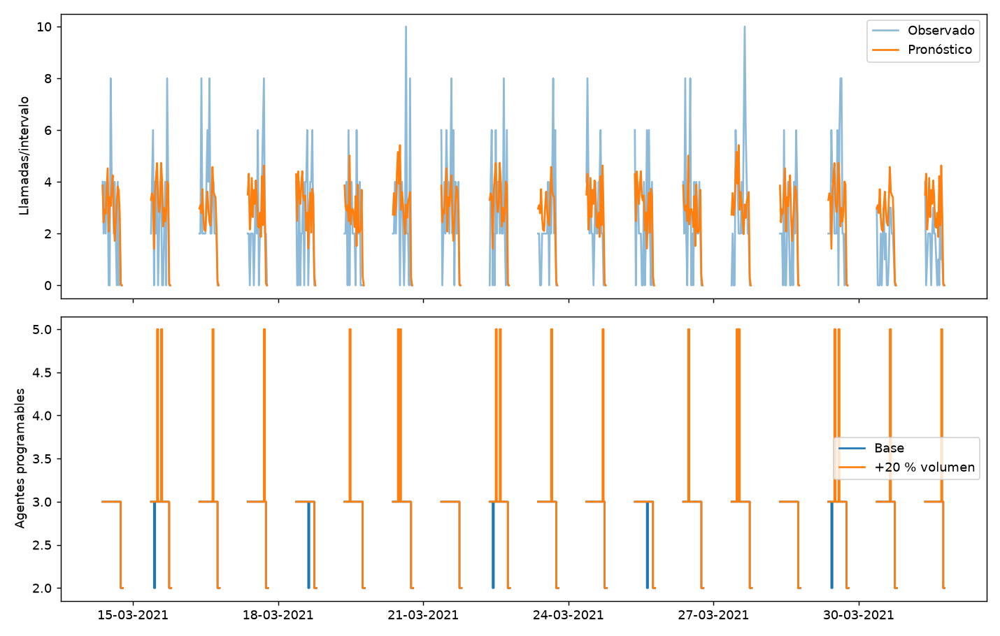

# Demanda y dotación de call center
  

Pronosticar llamadas por media hora y convertir esa demanda en escenarios de agentes por intervalo mediante Erlang C, haciendo explícitos los supuestos operativos. Incluye análisis por etapas, comentarios calculados, alertas tabuladas e informe final automático.

Call Center Dataset, publicado en Kaggle por akash1vishwakarma. ZIP con 01 Call-Center-Dataset.xlsx: 5.000 llamadas entre enero y marzo de 2021, fecha, hora, atención Y/N y duración de conversación. El archivo no acredita procedencia operativa ni que contenga todas las llamadas. No se añaden llamadas simuladas. La disponibilidad pública no acredita permisos de redistribución; revisar las condiciones vigentes antes de publicar el archivo original.

## Ejecutar

Abre esta carpeta como proyecto y selecciona su entorno de Python. Python 3.10 o superior, con versiones compatibles de las dependencias.

```powershell
python -m venv .venv
.\.venv\Scripts\python -m pip install -r requirements.txt
```

Selecciona `.venv` como kernel. Ejecuta [00_configuracion_entorno](notebooks/00_configuracion_entorno.ipynb) para comprobar bibliotecas y preparar la fuente. Después ejecuta [06_ejecucion_completa](notebooks/06_ejecucion_completa.ipynb): sus tres celdas recorren 01–05 en orden. Si 00 instala dependencias, reinicia el kernel antes de continuar. Desde terminal también puedes usar `python scripts/execute_notebooks.py` con ese mismo entorno.

| Notebook | Función |
| --- | --- |
| 01_preparacion_datos | Limpieza, controles y datos locales |
| 02_analisis_exploratorio | Distribuciones y gráficos |
| 03_baseline | Referencia inicial |
| 04_modelado | Ajuste y selección con validación |
| 05_evaluacion | Evaluación reservada y limitaciones |

## Resultados y documentación

- [Informe integral](reports/informe_final/informe_final.md): entrada principal con cifras y conclusiones vigentes.
- [Metodología](docs/metodologia.md): protocolo, supuestos y alcance.
- [Fuentes](docs/fuentes.md): procedencia y recuperación.
- [Guía de ejecución local](docs/ejecucion.md) y [registro de la última pasada](docs/ejecuciones.md).
- [Cómo actualizar el informe](docs/informe_final.md).
- `reports/ejecucion/resumen.json`: estado y tiempos de los cinco notebooks.
- `reports/alertas/`: avisos de Python agrupados, con significado genérico y detalle original.
- `reports/evaluacion/`: métricas, predicciones y evidencia gráfica.



Los comentarios se generan con las métricas de cada ejecución. Un error detiene el maestro y el informe identifica etapas incompletas; ausencia de avisos no equivale a validación. Reejecutar reemplaza la versión vigente, por lo que conviene conservar una versión concreta mediante Git antes de cambiar configuración o fuentes.

## Estructura e independencia

`src/call_center_staffing` contiene todas las funciones del proyecto; `scripts` sus entradas de ejecución; `tests` los controles; `data/raw` las fuentes; `data/processed` las transformaciones; `models` los modelos propios. `reports` se divide en entorno, preparación, EDA, baseline, modelado, evaluación, alertas, ejecución e informe final. Los notebooks se pueden abrir desde la carpeta del proyecto o desde notebooks.

Puedes copiar o renombrar esta carpeta con sus datos locales. No requiere otros proyectos, la carpeta temática ni `back`. Para comprobar controles: `python -m unittest discover -s tests`. Para reunir reportes existentes sin repetir el análisis: `python scripts/generate_report.py`.
