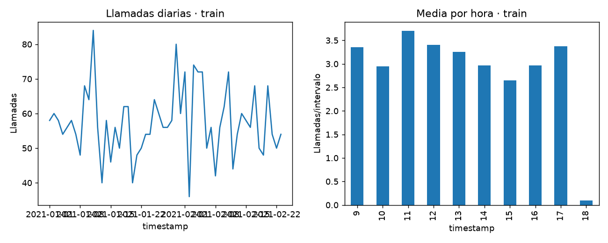

# Informe integral · Demanda y dotación de call center

Generado: 2026-10-07T16:39:20.541352+00:00 (UTC).

Estado del informe: **Resultados actualizados por etapas**. Estado del último maestro: **completado**.

Este documento reúne los archivos guardados; no ejecuta modelos ni certifica su utilidad. Las fechas y huellas del manifiesto permiten revisar su procedencia.

Hay archivos de resultados o notebooks actualizados después de la última ejecución completa del maestro. Los resultados corresponden a actualizaciones por etapa; ejecuta 06 para cerrar una nueva pasada completa.

## Objetivo y configuración

Pronosticar llamadas por media hora y convertir esa demanda en escenarios de agentes por intervalo mediante Erlang C, haciendo explícitos los supuestos operativos. Incluye análisis por etapas, comentarios calculados, alertas tabuladas e informe final automático.

| Indicador | Valor |
| --- | --- |
| title | Demanda y dotación de call center |
| kind | callcenter_forecast |
| seed | 42 |
| source_base | project |
| source | data/raw/CallCenterKaggle.zip |
| source_mode | kaggle_practice |
| interval_minutes | 30 |
| target_service_level | 0.8 |
| target_wait_seconds | 20 |
| max_occupancy | 0.85 |
| shrinkage | 0.3 |
| open_hour | 9 |
| close_hour | 19 |
| wrapup_assumed_seconds | 30 |

## Datos y preparación

Indicadores de [preparacion.json](../../reports/preparacion/preparacion.json):

| Indicador | Valor |
| --- | --- |
| fuente | https://www.kaggle.com/datasets/akash1vishwakarma/call-center-dataset |
| llamadas | 5000 |
| intervalos | 1800 |
| intervalo_minutos | 30 |
| horario_asumido | 09:00–19:00 todos los días |
| fecha_min | 2021-01-01 |
| fecha_max | 2021-03-31 |
| aht_estimado_solo_train_segundos | 256.842 |
| wrapup_asumido_segundos | 30 |
| origen_operativo_no_acreditado | True |
| particiones / train / filas | 1080 |
| particiones / valid / filas | 360 |
| particiones / test / filas | 360 |

### Demanda y dotación de call center: preparacion

Se agregan **5,000 registros de Kaggle** en **1,800 intervalos de 30 minutos**. Se incluyen llamadas no atendidas y ceros en el horario operativo configurado, cuya cobertura se asume completa. Split cronológico por días 60/20/20. AHT estimado exclusivamente en train: **256.8 segundos**, conversación atendida más **30 segundos supuestos de trabajo posterior**. La fuente no acredita cobertura de una operación real completa; no se generan llamadas sintéticas adicionales.

[Reporte de la etapa](../../reports/preparacion/preparacion.md).

## Hallazgos exploratorios

Indicadores de [eda.json](../../reports/eda/eda.json):

| Indicador | Valor |
| --- | --- |
| intervalos_train | 1080 |
| media_llamadas_intervalo | 2.87037 |
| proporcion_intervalos_cero | 0.286111 |

### Demanda y dotación de call center: eda

Train tiene **1080 intervalos**, con una media de **2.87 llamadas**. El **28.61%** está vacío. La baja carga observada y los ceros dependen de asumir que el archivo cubre todas las llamadas y días del horario definido.

[Reporte de la etapa](../../reports/eda/eda.md).

## Baseline

Indicadores de [baseline.json](../../reports/baseline/baseline.json):

| Indicador | Valor |
| --- | --- |
| casos | 360 |
| mae | 1.91498 |
| rmse | 2.55605 |

### Demanda y dotación de call center: baseline

Baseline de media histórica por día de semana y franja, calculada solo en train. MAE de validación **1.915 llamadas/intervalo**. No incorpora observaciones reales de validación o test al avanzar.

[Reporte de la etapa](../../reports/baseline/baseline.md).

## Modelo y selección

Indicadores de [modelado.json](../../reports/modelado/modelado.json):

| Indicador | Valor |
| --- | --- |
| criterio | mae_validacion |
| max_leaf_nodes_elegido | 30 |
| atributos | Solo calendario conocido a futuro; sin AHT ni respuestas futuras |

### Demanda y dotación de call center: modelado

Se elige HistGradientBoosting con **30 hojas** por MAE de validación. La pérdida Poisson modela conteos; los atributos son solo calendario. Test se pronostica desde el mismo origen fijo posterior a train, sin actualizar modelos ni usar duraciones o volúmenes reales futuros.

[Reporte de la etapa](../../reports/modelado/modelado.md).

## Evaluación y conclusiones

Indicadores de [evaluacion.json](../../reports/evaluacion/evaluacion.json):

| Indicador | Valor |
| --- | --- |
| baseline / casos | 360 |
| baseline / mae | 1.60704 |
| baseline / rmse | 2.15567 |
| modelo / casos | 360 |
| modelo / mae | 1.61178 |
| modelo / rmse | 2.14263 |
| aht_estimado_train_segundos | 256.842 |
| target_service_level | 0.8 |
| target_wait_seconds | 20 |
| max_occupancy | 0.85 |
| shrinkage | 0.3 |
| agentes_programables_maximo | 3 |
| proporcion_intervalos_sl_teorico_bajo_objetivo | 0.122222 |
| escenario_mas20pct_maximo | 5 |

### Demanda y dotación de call center: evaluacion

En **360 intervalos de test**, MAE **1.612**, frente a **1.607** del baseline: el modelo **no mejora** ese error. Erlang C estima hasta **3 agentes programables por intervalo**, y **5** bajo +20 % de volumen. El **12.22%** de intervalos queda bajo el objetivo teórico al sustituir el volumen por el observado. Eso es un diagnóstico del modelo de colas, **no un SLA medido**. AHT fijo, horario y shrinkage son supuestos; no se optimizan turnos, descansos ni rutas por habilidad. Erlang C no incluye abandono, aunque el archivo contiene llamadas no atendidas.

[Reporte de la etapa](../../reports/evaluacion/evaluacion.md).

[Detalle: dotacion_intervalos.csv](../../reports/evaluacion/dotacion_intervalos.csv)

### Comparación automática

- `mae`: baseline **1.60704**, modelo **1.61178**; el modelo **no mejora** este indicador en la evaluación guardada.
- `rmse`: baseline **2.15567**, modelo **2.14263**; el modelo **mejora** este indicador en la evaluación guardada.

## Alertas y estado de ejecución

| Notebook | Tipos de aviso registrados |
| --- | --- |
| 00_configuracion_entorno | 0 |
| 01_preparacion_datos | 0 |
| 02_analisis_exploratorio | 0 |
| 03_baseline | 0 |
| 04_modelado | 0 |
| 05_evaluacion | 0 |
| 06_ejecucion_completa | 1 |

| Notebook | Tipo | Apariciones | Significado | Acción sugerida |
| --- | --- | --- | --- | --- |
| 06_ejecucion_completa | DeprecationWarning | 5 | Se está utilizando una función o comportamiento en retirada. | Consultar la alternativa indicada antes de actualizar dependencias. |

Una tabla vacía de warnings no demuestra ausencia de errores o validez del modelo. Consulta [alertas](../alertas/) y [resumen del maestro](../ejecucion/resumen.json).

| Notebook | Celdas ejecutadas guardadas | Última ejecución UTC | Errores guardados |
| --- | --- | --- | --- |
| 01_preparacion_datos.ipynb | 3/3 | 2026-10-07T16:25:03.628249Z | 0 |
| 02_analisis_exploratorio.ipynb | 3/3 | 2026-10-07T16:25:09.328953Z | 0 |
| 03_baseline.ipynb | 3/3 | 2026-10-07T16:25:12.415774Z | 0 |
| 04_modelado.ipynb | 3/3 | 2026-10-07T16:25:15.733919Z | 0 |
| 05_evaluacion.ipynb | 3/3 | 2026-10-07T16:25:21.947572Z | 0 |

## Limitaciones y próximos pasos

Registros descargados de Kaggle; origen operativo y cobertura completa no acreditados. Horario 09–19 todos los días, wrap-up, servicio objetivo y shrinkage son supuestos. Erlang C supone estacionariedad por intervalo, llegadas Poisson, atención exponencial y ausencia de abandono. No optimiza turnos ni garantiza un SLA real.

- Revisar fuentes, protocolo y alertas de la ejecución.
- Incluir el baseline como candidato, ampliar cortes temporales y validar cobertura, horarios y supuestos de Erlang C con una operación real.

## Evidencia y reproducción

Desde la carpeta de este proyecto, ejecuta `python scripts/generate_report.py` para reunir los resultados guardados, o 06 para ejecutar los análisis y actualizar el informe.

Consulta el [README](../../README.md), la [guía del informe](../../docs/informe_final.md) y el [manifiesto con datos y huellas](informe_final.json). El informe conserva una versión vigente por proyecto.
