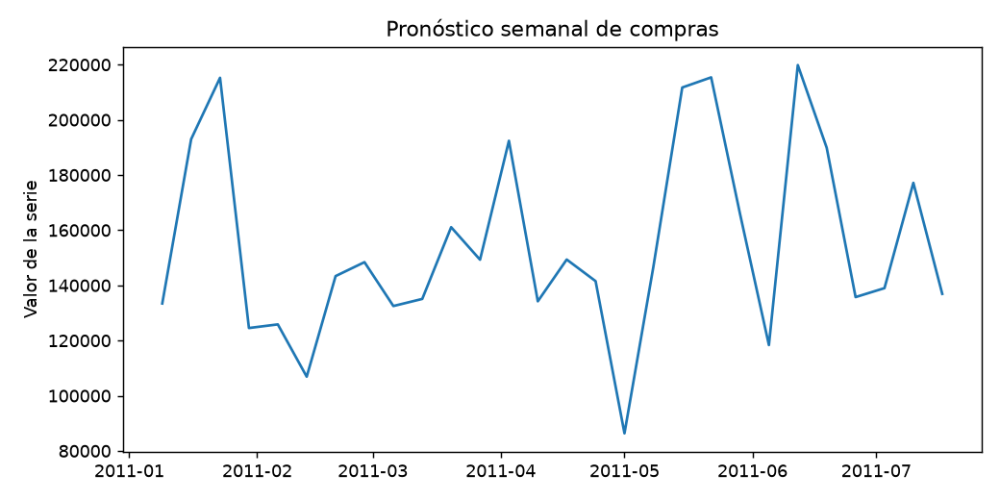
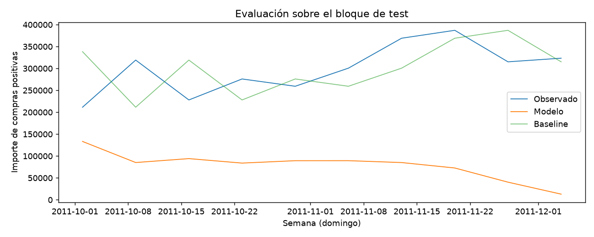

# Informe integral · Pronóstico semanal de compras

Generado: 2026-10-07T16:39:21.841125+00:00 (UTC).

Estado del informe: **Resultados actualizados por etapas**. Estado del último maestro: **completado**.

Este documento reúne los archivos guardados; no ejecuta modelos ni certifica su utilidad. Las fechas y huellas del manifiesto permiten revisar su procedencia.

Hay archivos de resultados o notebooks actualizados después de la última ejecución completa del maestro. Los resultados corresponden a actualizaciones por etapa; ejecuta 06 para cerrar una nueva pasada completa.

## Objetivo y configuración

Predecir el importe de compras positivas de la próxima semana.

| Indicador | Valor |
| --- | --- |
| title | Pronóstico semanal de compras |
| kind | forecast |
| source | data/raw/OnlineRetailUCI.zip |
| seed | 42 |
| top_n | 10 |
| source_base | project |

## Datos y preparación

Indicadores de [preparacion.json](../../reports/preparacion/preparacion.json):

| Indicador | Valor |
| --- | --- |
| fuente | OnlineRetailUCI.zip |
| semilla | 42 |
| filas_originales | 541909 |
| politica_ventas | Compras positivas; excluye cancelaciones, devoluciones, precios no positivos y duplicados exactos. No mide ingresos netos. |
| unidad | Importe semanal de compras positivas, en moneda de la fuente (confirmar GBP). |
| filas_preparadas | 52 |
| particiones / train / filas | 28 |
| particiones / valid / filas | 10 |
| particiones / test / filas | 10 |

### Pronóstico semanal de compras: preparacion

Se prepararon **52 registros**. La fuente y sus huellas se registran en el JSON. Se persistieron train, validación y test según el protocolo documentado.

[Reporte de la etapa](../../reports/preparacion/preparacion.md).

## Hallazgos exploratorios

Indicadores de [eda.json](../../reports/eda/eda.json):

| Indicador | Valor |
| --- | --- |
| poblacion | train |
| filas | 28 |
| columnas | 9 |
| nulos / timestamp | 0 |
| nulos / value | 0 |
| nulos / lag_1 | 0 |
| nulos / lag_2 | 0 |
| nulos / lag_3 | 0 |
| nulos / lag_4 | 0 |
| nulos / media_4 | 0 |
| nulos / sin_semana | 0 |
| nulos / cos_semana | 0 |

### Pronóstico semanal de compras: eda

El análisis utiliza **28 registros de train**, con **0 valores ausentes**. Los cortes y rezagos deben respetar el orden temporal.

[Reporte de la etapa](../../reports/eda/eda.md).

## Baseline

Indicadores de [baseline.json](../../reports/baseline/baseline.json):

| Indicador | Valor |
| --- | --- |
| casos | 10 |
| mae | 33730.4 |
| rmse | 45049.4 |

### Pronóstico semanal de compras: baseline

El baseline predice el importe de la semana anterior. MAE en validación: **33730.42**. Se evalúa a un paso con la semana anterior observada; no es un pronóstico de varias semanas desde un único origen.

[Reporte de la etapa](../../reports/baseline/baseline.md).

## Modelo y selección

Indicadores de [modelado.json](../../reports/modelado/modelado.json):

| Indicador | Valor |
| --- | --- |
| criterio | mae_validacion |
| alpha_elegido | 1 |

### Pronóstico semanal de compras: modelado

Se eligió alpha **1.0** por MAE de validación. Los rezagos y medias móviles se desplazan antes de calcularse; el escalamiento se ajusta solo en train. El histórico es corto para aprender estacionalidad anual.

[Reporte de la etapa](../../reports/modelado/modelado.md).

## Evaluación y conclusiones

Indicadores de [evaluacion.json](../../reports/evaluacion/evaluacion.json):

| Indicador | Valor |
| --- | --- |
| baseline / casos | 10 |
| baseline / mae | 59811.1 |
| baseline / rmse | 71058.6 |
| modelo / casos | 10 |
| modelo / mae | 220296 |
| modelo / rmse | 232499 |

### Pronóstico semanal de compras: evaluacion

El modelo **no mejora** el MAE del baseline: **220296.11** frente a **59811.14**, en **10 semanas de test**. El protocolo es a un paso; incorpora ventas reales previas al avanzar. Mide compras positivas, no ventas netas ni beneficios. Un único bloque corto no permite concluir robustez entre temporadas.

[Reporte de la etapa](../../reports/evaluacion/evaluacion.md).

[Detalle: predicciones_test.csv](../../reports/evaluacion/predicciones_test.csv)

### Comparación automática

- `mae`: baseline **59811.1**, modelo **220296**; el modelo **no mejora** este indicador en la evaluación guardada.
- `rmse`: baseline **71058.6**, modelo **232499**; el modelo **no mejora** este indicador en la evaluación guardada.

## Alertas y estado de ejecución

| Notebook | Tipos de aviso registrados |
| --- | --- |
| 00_configuracion_entorno | 0 |
| 01_preparacion_datos | 0 |
| 02_analisis_exploratorio | 0 |
| 03_baseline | 0 |
| 04_modelado | 0 |
| 05_evaluacion | 0 |
| 06_ejecucion_completa | 1 |

| Notebook | Tipo | Apariciones | Significado | Acción sugerida |
| --- | --- | --- | --- | --- |
| 06_ejecucion_completa | DeprecationWarning | 5 | Se está utilizando una función o comportamiento en retirada. | Consultar la alternativa indicada antes de actualizar dependencias. |

Una tabla vacía de warnings no demuestra ausencia de errores o validez del modelo. Consulta [alertas](../alertas/) y [resumen del maestro](../ejecucion/resumen.json).

| Notebook | Celdas ejecutadas guardadas | Última ejecución UTC | Errores guardados |
| --- | --- | --- | --- |
| 01_preparacion_datos.ipynb | 0/3 | No disponible | 0 |
| 02_analisis_exploratorio.ipynb | 2/3 | 2026-10-07T14:26:35.414038Z | 0 |
| 03_baseline.ipynb | 0/3 | No disponible | 0 |
| 04_modelado.ipynb | 0/3 | No disponible | 0 |
| 05_evaluacion.ipynb | 2/3 | 2026-10-07T14:26:38.597070Z | 0 |

## Limitaciones y próximos pasos

El protocolo evalúa un paso con valores previos observados; no un pronóstico multisemana. Las compras positivas no representan ventas netas. El histórico corto limita las conclusiones entre temporadas.

- Comprobar procedencia, condiciones de uso y disponibilidad temporal de las variables.
- Completar una pasada de 06 y revisar las alertas antes de publicar el informe.
- Ampliar la evaluación temporal con varios cortes; en anomalías, incorporar métricas por evento.

## Evidencia y reproducción

Desde la carpeta de este proyecto, ejecuta `python scripts/generate_report.py` para reunir los resultados guardados, o 06 para ejecutar los análisis y actualizar el informe.

Consulta el [README](../../README.md), la [guía del informe](../../docs/informe_final.md) y el [manifiesto con datos y huellas](informe_final.json). El informe conserva una versión vigente por proyecto.
