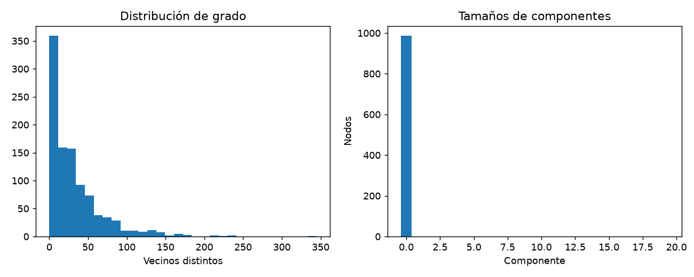
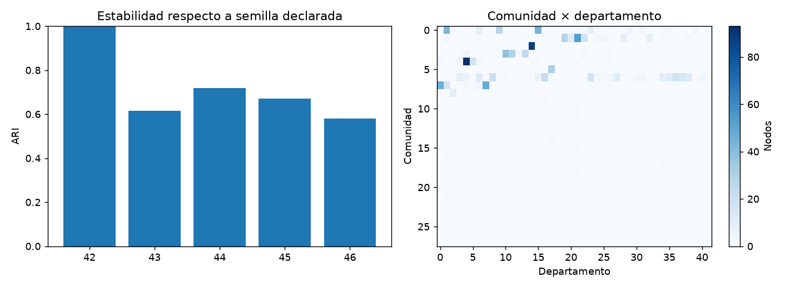

# Informe integral · Red de comunicación y comunidades

Generado: 2026-10-08T12:38:56.280632+00:00 (UTC).

Estado del informe: **Evidencia disponible**. Estado del último maestro: **completado**.

Este documento reúne los archivos guardados; no ejecuta modelos ni certifica su utilidad. Las fechas y huellas del manifiesto permiten revisar su procedencia.

## Objetivo y configuración

Explorar estructura de comunicación, detectar comunidades y contrastar su estabilidad y correspondencia con departamentos.

| Indicador | Valor |
| --- | --- |
| title | Red de comunicación y comunidades |
| kind | graph_analysis |
| seed | 42 |
| source_base | project |
| source | data/raw/email-Eu-core.txt.gz |
| labels_source | data/raw/email-Eu-core-department-labels.txt.gz |
| louvain_resolution | 1 |
| null_permutations | 100 |

## Datos y preparación

Indicadores de [preparacion.json](../../reports/preparacion/preparacion.json):

| Indicador | Valor |
| --- | --- |
| nodos | 1005 |
| departamentos | 42 |
| aristas_originales | 25571 |
| aristas_dirigidas_sin_bucles | 24929 |
| bucles_retirados | 642 |
| duplicados_retirados | 0 |
| fuente_sha256 | 4b47acdb80197b085fe63c819c357ae488131ee904ed93d1b219a68b0f9e245f |
| etiquetas_sha256 | e5abe5b4581a480032a63adcf2576c161785f45692642c6ebb0b1276f0f33669 |
| particion | Grafo completo descriptivo; sin partición predictiva |

### Red de comunicación y comunidades: preparacion

Se conservan **1005 nodos**, incluidos aislados, y **24929 aristas dirigidas** después de retirar 642 bucles y duplicados. Para comunidades se proyecta a grafo no dirigido y sin pesos; una arista significa existencia de comunicación, no volumen. Los departamentos no se utilizan para elegir partición ni parámetros.

[Reporte de la etapa](../../reports/preparacion/preparacion.md).

## Hallazgos exploratorios

Indicadores de [eda.json](../../reports/eda/eda.json):

| Indicador | Valor |
| --- | --- |
| aristas_no_dirigidas | 16064 |
| componentes | 20 |
| componente_mayor | 986 |
| aislados | 19 |
| densidad | 0.0318408 |
| reciprocidad_dirigida | 0.71122 |

### Red de comunicación y comunidades: eda

La proyección tiene **20 componentes**, con **986 nodos** en la mayor y **19 aislados**. PageRank describe posición estructural en la red dirigida; no demuestra influencia causal, productividad ni calidad de trabajo.

[Reporte de la etapa](../../reports/eda/eda.md).

[Detalle: centralidad.csv](../../reports/eda/centralidad.csv)

## Baseline

Indicadores de [baseline.json](../../reports/baseline/baseline.json):

| Indicador | Valor |
| --- | --- |
| comunidades | 20 |
| modularidad | 0 |

### Red de comunicación y comunidades: baseline

Referencia: componentes conexas, **20 grupos**. Identifica conectividad, pero una componente grande puede reunir varios departamentos. Modularidad **0.000**, calculada sobre la proyección no dirigida.

[Reporte de la etapa](../../reports/baseline/baseline.md).

## Modelo y selección

Indicadores de [modelado.json](../../reports/modelado/modelado.json):

| Indicador | Valor |
| --- | --- |
| comunidades | 28 |
| modularidad | 0.413021 |
| resolucion_fija | 1 |
| semilla_declarada | 42 |
| criterio | Louvain con parámetros fijados sin consultar departamentos |

### Red de comunicación y comunidades: modelado

Louvain produce **28 comunidades** y modularidad **0.413**. Resolución 1.0 y semilla 42 declaradas; la modularidad es el objetivo del método, no evidencia independiente de utilidad ni garantía de óptimo global.

[Reporte de la etapa](../../reports/modelado/modelado.md).

## Evaluación y conclusiones

Indicadores de [evaluacion.json](../../reports/evaluacion/evaluacion.json):

| Indicador | Valor |
| --- | --- |
| baseline / ari_departamentos | -0.000731996 |
| baseline / nmi_departamentos | 0.0329187 |
| modelo / ari_departamentos | 0.350454 |
| modelo / nmi_departamentos | 0.594642 |
| ari_estabilidad_medio_otras_semillas | 0.646249 |
| ari_nulo_media | -0.000132993 |
| ari_nulo_percentil95 | 0.00180068 |
| permutaciones | 100 |
| protocolo | Diagnóstico transductivo en la misma red; no accuracy ni evaluación fuera de muestra |

### Red de comunicación y comunidades: evaluacion

Coincidencia con departamentos: ARI **0.350**, NMI **0.595**. Estabilidad media frente a otras semillas: ARI **0.646**. La referencia permutada tiene ARI medio **-0.000**. Departamentos y comunidades describen agrupaciones distintas; el contraste se realiza en la misma red y no acredita predicción de nuevos nodos. Las permutaciones son una referencia descriptiva, no validación causal.

[Reporte de la etapa](../../reports/evaluacion/evaluacion.md).

[Detalle: comunidades_departamentos.csv](../../reports/evaluacion/comunidades_departamentos.csv)

[Detalle: estabilidad_semillas.csv](../../reports/evaluacion/estabilidad_semillas.csv)

[Detalle: referencia_permutada.csv](../../reports/evaluacion/referencia_permutada.csv)

## Alertas y estado de ejecución

| Notebook | Tipos de aviso registrados |
| --- | --- |
| 00_configuracion_entorno | 0 |
| 01_preparacion_datos | 0 |
| 02_analisis_exploratorio | 0 |
| 03_baseline | 0 |
| 04_modelado | 0 |
| 05_evaluacion | 0 |
| 06_ejecucion_completa | 1 |

| Notebook | Tipo | Apariciones | Significado | Acción sugerida |
| --- | --- | --- | --- | --- |
| 06_ejecucion_completa | DeprecationWarning | 5 | Se está utilizando una función o comportamiento en retirada. | Consultar la alternativa indicada antes de actualizar dependencias. |

Una tabla vacía de warnings no demuestra ausencia de errores o validez del modelo. Consulta [alertas](../alertas/) y [resumen del maestro](../ejecucion/resumen.json).

| Notebook | Celdas ejecutadas guardadas | Última ejecución UTC | Errores guardados |
| --- | --- | --- | --- |
| 01_preparacion_datos.ipynb | 3/3 | 2026-10-08T12:21:35.482235Z | 0 |
| 02_analisis_exploratorio.ipynb | 3/3 | 2026-10-08T12:21:41.707347Z | 0 |
| 03_baseline.ipynb | 3/3 | 2026-10-08T12:21:44.889026Z | 0 |
| 04_modelado.ipynb | 3/3 | 2026-10-08T12:21:48.192717Z | 0 |
| 05_evaluacion.ipynb | 3/3 | 2026-10-08T12:21:52.108948Z | 0 |

## Limitaciones y próximos pasos

Red estática interna, sin contenido, volumen ni cronología de correos. Comunidades y centralidad son descriptivas; departamentos solo se usan al evaluar. No hay test predictivo ni inferencia de productividad.

- Estudiar proyecciones y resoluciones alternativas con un protocolo declarado.
- Ampliar fuentes de comunicación; conservar evaluación descriptiva explícita.

## Evidencia y reproducción

Desde la carpeta de este proyecto, ejecuta `python scripts/generate_report.py` para reunir los resultados guardados, o 06 para ejecutar los análisis y actualizar el informe.

Consulta el [README](../../README.md), la [guía del informe](../../docs/informe_final.md) y el [manifiesto con datos y huellas](informe_final.json). El informe conserva una versión vigente por proyecto.
