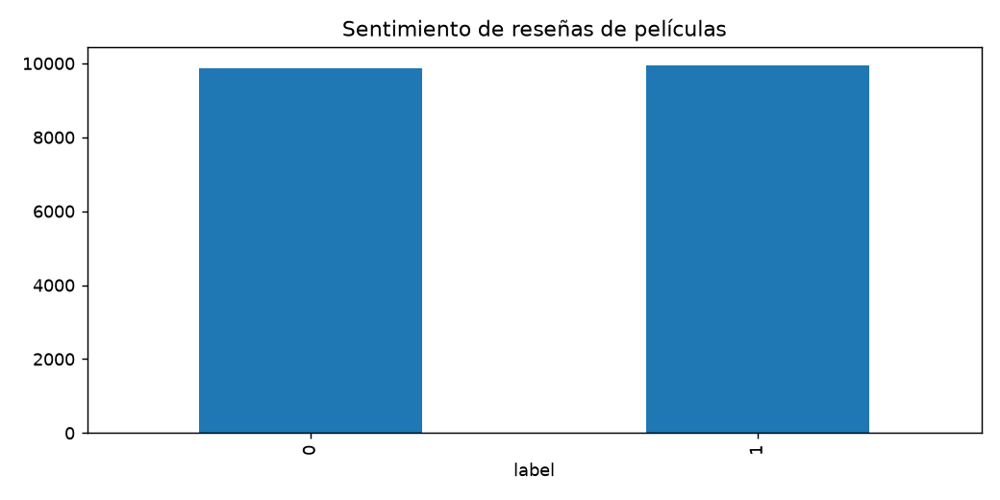

# Informe integral · Sentimiento de reseñas de películas

Generado: 2026-10-07T16:39:23.132048+00:00 (UTC).

Estado del informe: **Resultados actualizados por etapas**. Estado del último maestro: **completado**.

Este documento reúne los archivos guardados; no ejecuta modelos ni certifica su utilidad. Las fechas y huellas del manifiesto permiten revisar su procedencia.

Hay archivos de resultados o notebooks actualizados después de la última ejecución completa del maestro. Los resultados corresponden a actualizaciones por etapa; ejecuta 06 para cerrar una nueva pasada completa.

## Objetivo y configuración

Clasificar reseñas en inglés como positivas o negativas.

| Indicador | Valor |
| --- | --- |
| title | Sentimiento de reseñas de películas |
| kind | text_sentiment |
| source | data/raw/train.parquet |
| seed | 42 |
| top_n | 10 |
| test_source | data/raw/test.parquet |
| source_base | project |

## Datos y preparación

Indicadores de [preparacion.json](../../reports/preparacion/preparacion.json):

| Indicador | Valor |
| --- | --- |
| fuente | datasets/IMDb/train.parquet |
| semilla | 42 |
| filas_originales | 50000 |
| sha256_test | b52e26e2f872d282ffac460bf9770b25ac6f102cda0e6ca7158df98c94e8b3da |
| filas_preparadas | 49578 |
| particiones / train / filas | 19823 |
| particiones / valid / filas | 4956 |
| particiones / test / filas | 24799 |
| textos_compartidos | 0 |

### Sentimiento de reseñas de películas: preparacion

Se prepararon **49,578 registros**. La fuente y sus huellas se registran en el JSON. Se persistieron train, validación y test según el protocolo documentado.

[Reporte de la etapa](../../reports/preparacion/preparacion.md).

## Hallazgos exploratorios

Indicadores de [eda.json](../../reports/eda/eda.json):

| Indicador | Valor |
| --- | --- |
| poblacion | train |
| filas | 19823 |
| columnas | 3 |
| nulos / text | 0 |
| nulos / label | 0 |
| nulos / text_key | 0 |
| balance / 0 | 9869 |
| balance / 1 | 9954 |

### Sentimiento de reseñas de películas: eda

El análisis utiliza **19,823 registros de train**, con **0 valores ausentes**. La clase mayoritaria representa **50.21%** de esta partición. Las métricas finales deben acompañarse de resultados por clase.

[Reporte de la etapa](../../reports/eda/eda.md).

## Baseline

Indicadores de [baseline.json](../../reports/baseline/baseline.json):

| Indicador | Valor |
| --- | --- |
| casos | 4956 |
| accuracy | 0.50222 |
| f1_macro | 0.334318 |
| etiquetas_fuera_vocabulario_train | 0 |

### Sentimiento de reseñas de películas: baseline

El baseline predice la clase mayoritaria o las categorías más frecuentes de train. Su F1 macro en validación es **0.3343**. No se ajustó con textos de validación o test.

[Reporte de la etapa](../../reports/baseline/baseline.md).

## Modelo y selección

Indicadores de [modelado.json](../../reports/modelado/modelado.json):

| Indicador | Valor |
| --- | --- |
| criterio | f1_macro_validacion |
| C_elegido | 2 |

### Sentimiento de reseñas de películas: modelado

Se compararon dos valores de C y se eligió **2.0** por F1 macro de validación. TF-IDF y los clasificadores se ajustaron solo con train; no se reentrena con validación. Las categorías ausentes de train se contabilizan por separado.

[Reporte de la etapa](../../reports/modelado/modelado.md).

## Evaluación y conclusiones

Indicadores de [evaluacion.json](../../reports/evaluacion/evaluacion.json):

| Indicador | Valor |
| --- | --- |
| baseline / casos | 24799 |
| baseline / accuracy | 0.501593 |
| baseline / f1_macro | 0.33404 |
| baseline / etiquetas_fuera_vocabulario_train | 0 |
| modelo / casos | 24799 |
| modelo / accuracy | 0.879995 |
| modelo / f1_macro | 0.879994 |
| modelo / etiquetas_fuera_vocabulario_train | 0 |

### Sentimiento de reseñas de películas: evaluacion

En **24,799 textos de test**, el modelo obtiene **F1 macro 0.8800** y supera el baseline (0.3340). Consulta la matriz de confusión y las métricas por clase; el desempeño mide sentimiento de reseñas en inglés, no gusto personal por películas.

[Reporte de la etapa](../../reports/evaluacion/evaluacion.md).

### Comparación automática

- `accuracy`: baseline **0.501593**, modelo **0.879995**; el modelo **mejora** este indicador en la evaluación guardada.
- `f1_macro`: baseline **0.33404**, modelo **0.879994**; el modelo **mejora** este indicador en la evaluación guardada.

## Alertas y estado de ejecución

| Notebook | Tipos de aviso registrados |
| --- | --- |
| 00_configuracion_entorno | 0 |
| 01_preparacion_datos | 0 |
| 02_analisis_exploratorio | 0 |
| 03_baseline | 0 |
| 04_modelado | 0 |
| 05_evaluacion | 0 |
| 06_ejecucion_completa | 1 |

| Notebook | Tipo | Apariciones | Significado | Acción sugerida |
| --- | --- | --- | --- | --- |
| 06_ejecucion_completa | DeprecationWarning | 5 | Se está utilizando una función o comportamiento en retirada. | Consultar la alternativa indicada antes de actualizar dependencias. |

Una tabla vacía de warnings no demuestra ausencia de errores o validez del modelo. Consulta [alertas](../alertas/) y [resumen del maestro](../ejecucion/resumen.json).

| Notebook | Celdas ejecutadas guardadas | Última ejecución UTC | Errores guardados |
| --- | --- | --- | --- |
| 01_preparacion_datos.ipynb | 0/3 | No disponible | 0 |
| 02_analisis_exploratorio.ipynb | 2/3 | 2026-10-07T14:25:44.282401Z | 0 |
| 03_baseline.ipynb | 0/3 | No disponible | 0 |
| 04_modelado.ipynb | 0/3 | No disponible | 0 |
| 05_evaluacion.ipynb | 2/3 | 2026-10-07T14:25:49.813795Z | 0 |

## Limitaciones y próximos pasos

El alcance es sentimiento de reseñas en inglés. Un resultado en el test disponible no acredita robustez en otros dominios o idiomas.

- Comprobar procedencia, condiciones de uso y disponibilidad temporal de las variables.
- Completar una pasada de 06 y revisar las alertas antes de publicar el informe.
- Revisar métricas por clase y errores frecuentes; ajustar decisiones en validación, conservando test independiente.

## Evidencia y reproducción

Desde la carpeta de este proyecto, ejecuta `python scripts/generate_report.py` para reunir los resultados guardados, o 06 para ejecutar los análisis y actualizar el informe.

Consulta el [README](../../README.md), la [guía del informe](../../docs/informe_final.md) y el [manifiesto con datos y huellas](informe_final.json). El informe conserva una versión vigente por proyecto.
