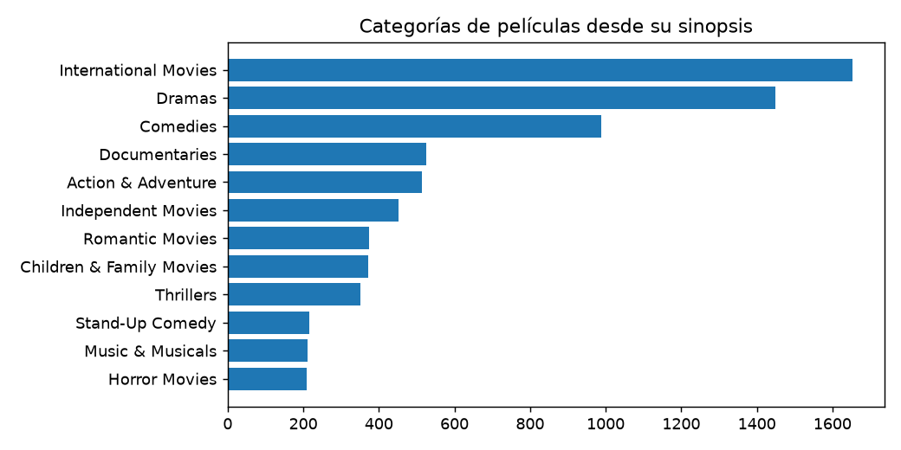

# Informe integral · Categorías de películas desde su sinopsis

Generado: 2026-10-07T16:39:24.482243+00:00 (UTC).

Estado del informe: **Resultados actualizados por etapas**. Estado del último maestro: **completado**.

Este documento reúne los archivos guardados; no ejecuta modelos ni certifica su utilidad. Las fechas y huellas del manifiesto permiten revisar su procedencia.

Hay archivos de resultados o notebooks actualizados después de la última ejecución completa del maestro. Los resultados corresponden a actualizaciones por etapa; ejecuta 06 para cerrar una nueva pasada completa.

## Objetivo y configuración

Predecir varias categorías de catálogo para una película desde su sinopsis.

| Indicador | Valor |
| --- | --- |
| title | Categorías de películas desde su sinopsis |
| kind | text_genre |
| source | data/raw/Netflix Movies and TV Shows.zip |
| seed | 42 |
| top_n | 10 |
| source_base | project |

## Datos y preparación

Indicadores de [preparacion.json](../../reports/preparacion/preparacion.json):

| Indicador | Valor |
| --- | --- |
| fuente | Netflix Movies and TV Shows.zip |
| semilla | 42 |
| filas_originales | 8807 |
| filas_preparadas | 6131 |
| particiones / train / filas | 3662 |
| particiones / valid / filas | 1221 |
| particiones / test / filas | 1222 |
| textos_compartidos | 0 |

### Categorías de películas desde su sinopsis: preparacion

Se prepararon **6,131 registros**. La fuente y sus huellas se registran en el JSON. Se persistieron train, validación y test según el protocolo documentado.

[Reporte de la etapa](../../reports/preparacion/preparacion.md).

## Hallazgos exploratorios

Indicadores de [eda.json](../../reports/eda/eda.json):

| Indicador | Valor |
| --- | --- |
| poblacion | train |
| filas | 3662 |
| columnas | 16 |
| nulos / show_id | 0 |
| nulos / type | 0 |
| nulos / title | 0 |
| nulos / director | 111 |
| nulos / cast | 291 |
| nulos / country | 267 |
| nulos / date_added | 0 |
| nulos / release_year | 0 |
| nulos / rating | 0 |
| nulos / duration | 1 |
| nulos / listed_in | 0 |
| nulos / description | 0 |
| nulos / text | 0 |
| nulos / labels | 0 |
| nulos / title_key | 0 |
| nulos / text_key | 0 |
| etiquetas / Documentaries | 525 |
| etiquetas / Comedies | 988 |
| etiquetas / Dramas | 1448 |
| etiquetas / International Movies | 1654 |
| etiquetas / Children & Family Movies | 372 |

El archivo enlazado contiene el detalle restante.

### Categorías de películas desde su sinopsis: eda

El análisis utiliza **3,662 registros de train**, con **670 valores ausentes**. Una película puede tener varias categorías; las frecuencias no suman el número de películas.

[Reporte de la etapa](../../reports/eda/eda.md).

## Baseline

Indicadores de [baseline.json](../../reports/baseline/baseline.json):

| Indicador | Valor |
| --- | --- |
| casos | 1221 |
| exact_match_etiquetas_conocidas | 0 |
| f1_macro | 0 |
| etiquetas_fuera_vocabulario_train | 0 |
| f1_micro | 0 |

### Categorías de películas desde su sinopsis: baseline

El baseline predice la clase mayoritaria o las categorías más frecuentes de train. Su F1 macro en validación es **0.0000**. No se ajustó con textos de validación o test.

[Reporte de la etapa](../../reports/baseline/baseline.md).

## Modelo y selección

Indicadores de [modelado.json](../../reports/modelado/modelado.json):

| Indicador | Valor |
| --- | --- |
| criterio | f1_macro_validacion |
| C_elegido | 2 |

### Categorías de películas desde su sinopsis: modelado

Se compararon dos valores de C y se eligió **2.0** por F1 macro de validación. TF-IDF y los clasificadores se ajustaron solo con train; no se reentrena con validación. Las categorías ausentes de train se contabilizan por separado.

[Reporte de la etapa](../../reports/modelado/modelado.md).

## Evaluación y conclusiones

Indicadores de [evaluacion.json](../../reports/evaluacion/evaluacion.json):

| Indicador | Valor |
| --- | --- |
| baseline / casos | 1222 |
| baseline / exact_match_etiquetas_conocidas | 0 |
| baseline / f1_macro | 0 |
| baseline / etiquetas_fuera_vocabulario_train | 0 |
| baseline / f1_micro | 0 |
| modelo / casos | 1222 |
| modelo / exact_match_etiquetas_conocidas | 0.10802 |
| modelo / f1_macro | 0.171649 |
| modelo / etiquetas_fuera_vocabulario_train | 0 |
| modelo / f1_micro | 0.435125 |

### Categorías de películas desde su sinopsis: evaluacion

En **1,222 textos de test**, el modelo obtiene **F1 macro 0.1716** y supera el baseline (0.0000). Hay **0 asignaciones de categorías fuera del vocabulario de train** y **8 categorías presentes en test con recall cero**. Las métricas solo cubren categorías conocidas; deben interpretarse junto con esos conteos y el detalle por categoría. Superar el baseline no acredita que el modelo detecte adecuadamente todas las categorías. Las entradas contienen exclusivamente sinopsis.

[Reporte de la etapa](../../reports/evaluacion/evaluacion.md).

### Comparación automática

- `f1_micro`: baseline **0**, modelo **0.435125**; el modelo **mejora** este indicador en la evaluación guardada.
- `f1_macro`: baseline **0**, modelo **0.171649**; el modelo **mejora** este indicador en la evaluación guardada.

## Alertas y estado de ejecución

| Notebook | Tipos de aviso registrados |
| --- | --- |
| 00_configuracion_entorno | 0 |
| 01_preparacion_datos | 0 |
| 02_analisis_exploratorio | 0 |
| 03_baseline | 0 |
| 04_modelado | 0 |
| 05_evaluacion | 0 |
| 06_ejecucion_completa | 1 |

| Notebook | Tipo | Apariciones | Significado | Acción sugerida |
| --- | --- | --- | --- | --- |
| 06_ejecucion_completa | DeprecationWarning | 5 | Se está utilizando una función o comportamiento en retirada. | Consultar la alternativa indicada antes de actualizar dependencias. |

Una tabla vacía de warnings no demuestra ausencia de errores o validez del modelo. Consulta [alertas](../alertas/) y [resumen del maestro](../ejecucion/resumen.json).

| Notebook | Celdas ejecutadas guardadas | Última ejecución UTC | Errores guardados |
| --- | --- | --- | --- |
| 01_preparacion_datos.ipynb | 0/3 | No disponible | 0 |
| 02_analisis_exploratorio.ipynb | 2/3 | 2026-10-07T14:25:58.325399Z | 0 |
| 03_baseline.ipynb | 0/3 | No disponible | 0 |
| 04_modelado.ipynb | 0/3 | No disponible | 0 |
| 05_evaluacion.ipynb | 2/3 | 2026-10-07T14:26:01.428420Z | 0 |

## Limitaciones y próximos pasos

Las categorías no aprendidas y la evaluación multietiqueta requieren revisar soportes y recall por clase.

- Comprobar procedencia, condiciones de uso y disponibilidad temporal de las variables.
- Completar una pasada de 06 y revisar las alertas antes de publicar el informe.
- Revisar métricas por clase y errores frecuentes; ajustar decisiones en validación, conservando test independiente.

## Evidencia y reproducción

Desde la carpeta de este proyecto, ejecuta `python scripts/generate_report.py` para reunir los resultados guardados, o 06 para ejecutar los análisis y actualizar el informe.

Consulta el [README](../../README.md), la [guía del informe](../../docs/informe_final.md) y el [manifiesto con datos y huellas](informe_final.json). El informe conserva una versión vigente por proyecto.
