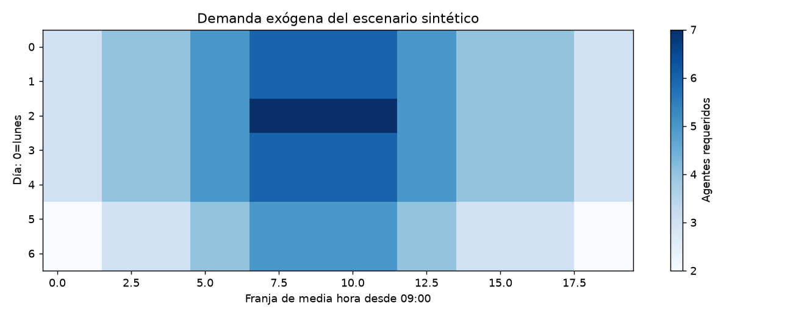
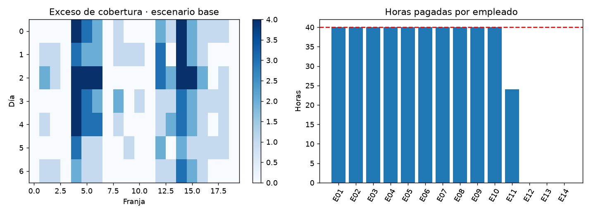
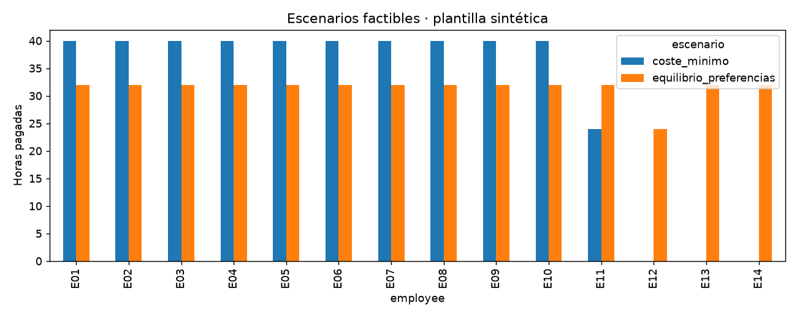

# Informe integral · Optimización de turnos y cobertura

Generado: 2026-10-08T12:44:39.694634+00:00 (UTC).

Estado del informe: **Evidencia disponible**. Estado del último maestro: **completado**.

Este documento reúne los archivos guardados; no ejecuta modelos ni certifica su utilidad. Las fechas y huellas del manifiesto permiten revisar su procedencia.

## Objetivo y configuración

Asignar turnos y pausas para cubrir requisitos semanales al menor coste, respetando disponibilidad, horas máximas y días consecutivos en un escenario sintético.

| Indicador | Valor |
| --- | --- |
| title | Optimización de turnos y cobertura |
| kind | optimization |
| seed | 42 |
| source_base | project |
| source | data/raw/demand.csv |
| employees_source | data/raw/employees.csv |
| interval_minutes | 30 |
| open_hour | 9 |
| close_hour | 19 |
| shift_hours | 8 |
| max_weekly_hours | 40 |
| max_consecutive_days | 4 |
| solver_time_limit_seconds | 60 |
| solver_relative_gap | 0.01 |
| preferences_source | data/raw/preferences.csv |
| balanced_extra_cost_ratio | 0.1 |
| balance_hours_weight | 1 |
| preference_miss_weight | 0.25 |

## Datos y preparación

Indicadores de [preparacion.json](../../reports/preparacion/preparacion.json):

| Indicador | Valor |
| --- | --- |
| origen | Escenario didáctico sintético; no datos de operación ni pronóstico |
| fuente_sha256 | 38aa8e71618f2b91f1268f4852e44879fc2b4bca96888416e3daf1225b73bc0e |
| empleados_sha256 | 4807349031c2fa5563bc69d8cf43e166fa6dc893229ff2c6ed20f8c63d740f8d |
| empleados | 14 |
| intervalos | 140 |
| demanda_agente_horas | 297.5 |
| particiones | No aplica: optimización de un escenario fijo, sin aprendizaje predictivo |

### Optimización de turnos y cobertura: preparacion

Escenario de **14 empleados ficticios** y **140 franjas** de una semana hipotética. Demanda requerida: **297.5 agente-horas**. Las entradas son **sintéticas y locales**, claramente identificadas; no se generan pronósticos, llamadas ni requisitos mediante Erlang C. La optimización consume requisitos de cobertura ya definidos y no depende de otros proyectos.

[Reporte de la etapa](../../reports/preparacion/preparacion.md).

## Hallazgos exploratorios

Indicadores de [eda.json](../../reports/eda/eda.json):

| Indicador | Valor |
| --- | --- |
| demanda_minima | 2 |
| demanda_maxima | 7 |
| agente_horas_requeridas | 297.5 |

### Optimización de turnos y cobertura: eda

Cobertura requerida entre **2 y 7 agentes** por franja. Estos conteos son entradas del escenario, no estimaciones de volumen ni dotación calculada desde llamadas. Los costes son unidades monetarias arbitrarias; no se interpretan como salarios de un país.

[Reporte de la etapa](../../reports/eda/eda.md).

## Baseline

Indicadores de [baseline.json](../../reports/baseline/baseline.json):

| Indicador | Valor |
| --- | --- |
| restricciones_laborales_cumplidas | True |
| cobertura_completa | False |
| deficit_agente_intervalos | 1 |
| coste_unidades | 7222.4 |
| turnos | 63 |
| horas_pagadas | 504 |
| exceso_agente_horas | 144 |

### Optimización de turnos y cobertura: baseline

Heurística secuencial por día: asigna el patrón con mayor cobertura pendiente por coste, respetando disponibilidad, horas y días consecutivos. Coste **7,222.40 unidades**; **deja 1 agente-intervalos sin cubrir**. Una solución incompleta no se considera una alternativa factible aunque su coste sea menor.

[Reporte de la etapa](../../reports/baseline/baseline.md).

## Modelo y selección

Indicadores de [modelado.json](../../reports/modelado/modelado.json):

| Indicador | Valor |
| --- | --- |
| solver_status | 0 |
| solver_message | Optimization terminated successfully. (HiGHS Status 7: Optimal) |
| gap_relativo | 0 |
| cota_inferior_coste | 5904 |
| objetivo_coste | 5904 |
| variables_binarias | 3360 |
| tolerancia_gap | 0.01 |
| restricciones_laborales_cumplidas | True |
| cobertura_completa | True |
| deficit_agente_intervalos | 0 |
| coste_unidades | 5904 |
| turnos | 53 |
| horas_pagadas | 424 |
| exceso_agente_horas | 73.5 |
| escenario_equilibrio / solver_status | 1 |
| escenario_equilibrio / solver_message | Time limit reached. (HiGHS Status 13: Time limit reached) |
| escenario_equilibrio / gap_objetivo_equilibrio | 0.22 |
| escenario_equilibrio / objetivo_puntuacion | 12.5 |
| escenario_equilibrio / tope_coste_unidades | 6494.4 |
| escenario_equilibrio / coste_referencia_unidades | 5904 |
| escenario_equilibrio / rango_horas | 8 |
| escenario_equilibrio / preferencias_incumplidas | 18 |
| escenario_equilibrio / restricciones_laborales_cumplidas | True |
| escenario_equilibrio / cobertura_completa | True |

El archivo enlazado contiene el detalle restante.

### Optimización de turnos y cobertura: modelado

MILP binario minimiza coste pagado sujeto a cobertura, un turno diario por empleado, disponibilidad, máximo **40 horas semanales** y **4 días consecutivos**. Cada turno dura 8 horas y contiene dos pausas de 30 minutos sin cobertura. El solver **terminó dentro de la tolerancia configurada**; gap relativo **0.00%**, coste **5,904.00 unidades**. Se audita la solución fuera del solver. La certificación depende de la tolerancia y los patrones disponibles; no se afirma un óptimo exacto si el gap no es cero. El escenario de equilibrio terminó **por límite de tiempo, con plan factible y sin certificar optimalidad**, con gap de su objetivo **22.00%**.

[Reporte de la etapa](../../reports/modelado/modelado.md).

## Evaluación y conclusiones

Indicadores de [equilibrio.json](../../reports/evaluacion/equilibrio.json):

| Indicador | Valor |
| --- | --- |
| incremento_coste_relativo | 0.0856369 |
| tope_incremento_relativo | 0.1 |
| equilibrio_solver_status | 1 |
| equilibrio_gap_objetivo | 0.22 |

Indicadores de [evaluacion.json](../../reports/evaluacion/evaluacion.json):

| Indicador | Valor |
| --- | --- |
| baseline / restricciones_laborales_cumplidas | True |
| baseline / cobertura_completa | False |
| baseline / deficit_agente_intervalos | 1 |
| baseline / coste_unidades | 7222.4 |
| baseline / turnos | 63 |
| baseline / horas_pagadas | 504 |
| baseline / exceso_agente_horas | 144 |
| optimizado / restricciones_laborales_cumplidas | True |
| optimizado / cobertura_completa | True |
| optimizado / deficit_agente_intervalos | 0 |
| optimizado / coste_unidades | 5904 |
| optimizado / turnos | 53 |
| optimizado / horas_pagadas | 424 |
| optimizado / exceso_agente_horas | 73.5 |
| gap_relativo | 0 |
| escenario_mas20pct_deficit_agente_intervalos | 87 |
| escenario_mas20pct_intervalos_sin_cobertura | 69 |
| ahorro_frente_baseline_factible | No disponible |
| incremento_coste_relativo | 0.0856369 |
| tope_incremento_relativo | 0.1 |
| equilibrio_solver_status | 1 |
| equilibrio_gap_objetivo | 0.22 |

#### Equilibrio y preferencias

Ambos planes cubren la demanda. El escenario alternativo reduce o intercambia rango de horas y preferencias bajo un tope de coste: rango **40 → 8 horas**, preferencias incumplidas **39 → 18**, coste **6,409.60 unidades** (**+8.56%** respecto al plan de coste mínimo). La función objetivo pondera rango de horas y turnos fuera del inicio preferido; su gap corresponde a esa puntuación, no a minimizar coste. Preferencias y reglas son sintéticas; equilibrar horas es una medida específica y no certifica equidad laboral.

El solver alternativo **alcanzó el límite de tiempo con una solución factible; no se certifica optimalidad**; gap de su objetivo **22.00%**.

[Reporte de la etapa](../../reports/evaluacion/equilibrio.md).

### Optimización de turnos y cobertura: evaluacion

El plan optimizado supera cobertura y restricciones estructurales en las **140 franjas**. El baseline no cubre toda la demanda; su menor coste, si lo hubiera, no demuestra ahorro comparable. Al mantener los turnos y aumentar los requisitos un 20 % (redondeo al entero superior), **69 franjas** quedan cortas, con **87 agente-intervalos** de déficit. El escenario de estrés no se reoptimiza ni es una garantía probabilística. Son reglas didácticas, no un calendario de una empresa, cumplimiento de legislación laboral ni SLA. No se modelan habilidades, vacaciones ni rotación entre semanas.

#### Equilibrio y preferencias

Ambos planes cubren la demanda. El escenario alternativo reduce o intercambia rango de horas y preferencias bajo un tope de coste: rango **40 → 8 horas**, preferencias incumplidas **39 → 18**, coste **6,409.60 unidades** (**+8.56%** respecto al plan de coste mínimo). La función objetivo pondera rango de horas y turnos fuera del inicio preferido; su gap corresponde a esa puntuación, no a minimizar coste. Preferencias y reglas son sintéticas; equilibrar horas es una medida específica y no certifica equidad laboral.

El solver alternativo **alcanzó el límite de tiempo con una solución factible; no se certifica optimalidad**; gap de su objetivo **22.00%**.

[Reporte de la etapa](../../reports/evaluacion/evaluacion.md).

[Detalle: cobertura_por_intervalo.csv](../../reports/evaluacion/cobertura_por_intervalo.csv)

[Detalle: comparacion_equilibrio.csv](../../reports/evaluacion/comparacion_equilibrio.csv)

[Detalle: horas_comparadas.csv](../../reports/evaluacion/horas_comparadas.csv)

[Detalle: horas_por_empleado.csv](../../reports/evaluacion/horas_por_empleado.csv)

[Detalle: turnos_programados.csv](../../reports/evaluacion/turnos_programados.csv)

## Alertas y estado de ejecución

| Notebook | Tipos de aviso registrados |
| --- | --- |
| 00_configuracion_entorno | 0 |
| 01_preparacion_datos | 0 |
| 02_analisis_exploratorio | 0 |
| 03_baseline | 0 |
| 04_modelado | 1 |
| 05_evaluacion | 0 |
| 06_ejecucion_completa | 1 |

| Notebook | Tipo | Apariciones | Significado | Acción sugerida |
| --- | --- | --- | --- | --- |
| 04_modelado | SolverLimitWarning | 1 | El solver entregó un plan factible, pero terminó sin cerrar el gap solicitado. | Revisar el gap y el plan auditado; aumentar el límite o estudiar otra formulación si se necesita certificar optimalidad. |
| 06_ejecucion_completa | DeprecationWarning | 5 | Se está utilizando una función o comportamiento en retirada. | Consultar la alternativa indicada antes de actualizar dependencias. |

Una tabla vacía de warnings no demuestra ausencia de errores o validez del modelo. Consulta [alertas](../alertas/) y [resumen del maestro](../ejecucion/resumen.json).

| Notebook | Celdas ejecutadas guardadas | Última ejecución UTC | Errores guardados |
| --- | --- | --- | --- |
| 01_preparacion_datos.ipynb | 3/3 | 2026-10-08T12:43:27.319332Z | 0 |
| 02_analisis_exploratorio.ipynb | 3/3 | 2026-10-08T12:43:29.955853Z | 0 |
| 03_baseline.ipynb | 3/3 | 2026-10-08T12:43:33.040319Z | 0 |
| 04_modelado.ipynb | 3/3 | 2026-10-08T12:44:36.101179Z | 0 |
| 05_evaluacion.ipynb | 3/3 | 2026-10-08T12:44:38.981671Z | 0 |

## Limitaciones y próximos pasos

Escenario sintético con requisitos exógenos y costes arbitrarios. No predice llamadas, calcula Erlang C o mide SLA. Optimalidad limitada a patrones y tolerancia; las restricciones didácticas no acreditan legislación laboral ni preferencias reales de empleados.

- Revisar fuentes, supuestos y alertas.
- Incorporar preferencias, habilidades y datos operativos; verificar factibilidad con las reglas reales.

## Evidencia y reproducción

Desde la carpeta de este proyecto, ejecuta `python scripts/generate_report.py` para reunir los resultados guardados, o 06 para ejecutar los análisis y actualizar el informe.

Consulta el [README](../../README.md), la [guía del informe](../../docs/informe_final.md) y el [manifiesto con datos y huellas](informe_final.json). El informe conserva una versión vigente por proyecto.
