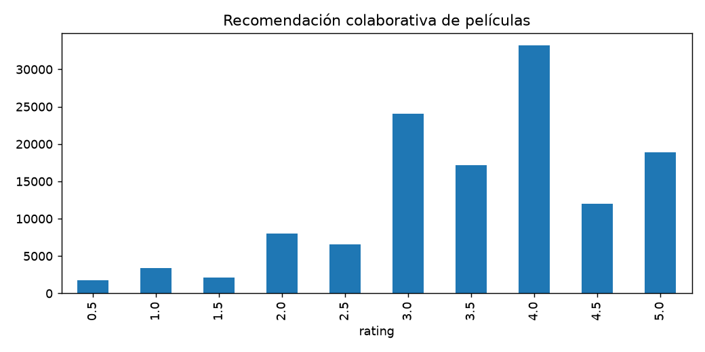

# Recomendación colaborativa de películas
  

Ordenar películas para usuarios existentes de una muestra de MovieLens 32M.

## Método y alcance

800 usuarios muestreados con semilla 42. Últimas dos valoraciones por usuario para valid/test; positivos >=4; vecinos de usuarios y baseline de popularidad.

Hit rate y NDCG@10 sobre un objetivo positivo retenido por usuario. Los objetivos de ítems sin historial cuentan como fallos. Corte por usuario, sin corte global; no evalúa nuevos usuarios.

## Cómo ejecutar

Abre [00 · Entorno](notebooks/00_configuracion_entorno.ipynb) desde la carpeta del proyecto y selecciona tu Python. Tras comprobar el entorno, guarda y cierra 01–05 y ejecuta [06 · Maestro](notebooks/06_ejecucion_completa.ipynb). También puedes ejecutar las etapas por separado y en orden. El maestro tiene tres celdas de código.

La fuente está definida en [config.json](config.json) y se lee desde su propio `data/raw/`. Este proyecto incluye su propio `pyproject.toml` y `requirements.txt`. Los datos preparados y modelos se guardan dentro del proyecto.

## Evidencia

Las etapas generan JSON y Markdown con cifras y conclusiones automáticas: `preparacion`, `eda`, `baseline`, `modelado` y `evaluacion`. Se añade una figura de EDA, alertas por notebook y resumen de ejecución del maestro. La última [evaluación](reports/evaluacion/evaluacion.md) y el [resumen de ejecución](reports/ejecucion/resumen.json) estarán disponibles después de ejecutar 01–05; no se inventan resultados antes de correrlos.

Los reportes usan nombres estables. Repetir la ejecución reemplaza esos archivos; un fallo puede dejar reportes de etapas anteriores, así que debe revisarse siempre el resumen del maestro. Los ZIP, datos procesados y modelos no se versionan. La procedencia y condiciones de uso se contrastan con el [inventario](docs/fuentes.md) antes de publicar.

Consulta la [metodología propia](docs/metodologia.md) y la [guía de ejecución local](docs/ejecucion.md).

## Estructura local

Consulta la [estructura y comandos del proyecto](docs/estructura.md). Las funciones se importan desde su propio `src/`; los requisitos se instalan desde esta carpeta. Los datos de entrada están en `data/raw` y sus rutas se declaran en `config.json`.

## Independencia

El proyecto incluye su código, requisitos, datos de entrada e instrucciones. Se puede copiar o renombrar conservando esta carpeta completa; la ejecución no utiliza otros proyectos ni una carpeta temática. Los datos están excluidos del versionado: consulta las [fuentes](docs/fuentes.md) para preparar una copia nueva.

Los reportes están agrupados por etapa. Consulta su [distribución y archivos vigentes](docs/estructura.md#organización-de-reportes).

## Informe integral

Consulta el [informe integral](reports/informe_final/informe_final.md). Se actualiza con 06 y reúne cifras, conclusiones, limitaciones y próximos pasos. Para regenerarlo con resultados existentes usa `python scripts/generate_report.py`. Consulta la [guía del informe](docs/informe_final.md).
