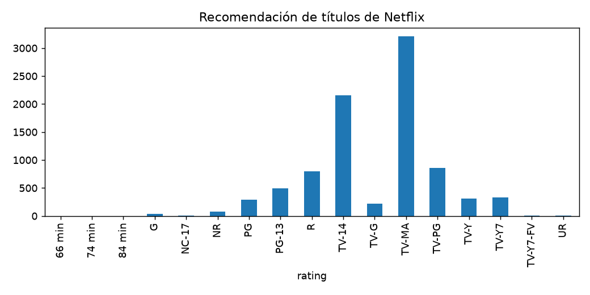

# Informe integral · Recomendación de títulos de Netflix

Generado: 2026-10-07T16:39:27.029078+00:00 (UTC).

Estado del informe: **Resultados actualizados por etapas**. Estado del último maestro: **completado**.

Este documento reúne los archivos guardados; no ejecuta modelos ni certifica su utilidad. Las fechas y huellas del manifiesto permiten revisar su procedencia.

Hay archivos de resultados o notebooks actualizados después de la última ejecución completa del maestro. Los resultados corresponden a actualizaciones por etapa; ejecuta 06 para cerrar una nueva pasada completa.

## Objetivo y configuración

Encontrar películas y series similares por descripción y metadatos.

| Indicador | Valor |
| --- | --- |
| title | Recomendación de títulos de Netflix |
| kind | movie_content |
| source | data/raw/Netflix Movies and TV Shows.zip |
| seed | 42 |
| top_n | 10 |
| source_base | project |

## Datos y preparación

Indicadores de [preparacion.json](../../reports/preparacion/preparacion.json):

| Indicador | Valor |
| --- | --- |
| fuente | Netflix Movies and TV Shows.zip |
| semilla | 42 |
| filas_originales | 8807 |
| filas_preparadas | 8807 |

### Recomendación de títulos de Netflix: preparacion

Se prepararon **8,807 registros**. La fuente y sus huellas se registran en el JSON. Esta etapa construye un catálogo o una población descriptiva; no implica una evaluación supervisada.

[Reporte de la etapa](../../reports/preparacion/preparacion.md).

## Hallazgos exploratorios

Indicadores de [eda.json](../../reports/eda/eda.json):

| Indicador | Valor |
| --- | --- |
| poblacion | catalogo |
| filas | 8807 |
| columnas | 13 |
| nulos / show_id | 0 |
| nulos / type | 0 |
| nulos / title | 0 |
| nulos / director | 2634 |
| nulos / cast | 825 |
| nulos / country | 831 |
| nulos / date_added | 10 |
| nulos / release_year | 0 |
| nulos / rating | 4 |
| nulos / duration | 3 |
| nulos / listed_in | 0 |
| nulos / description | 0 |
| nulos / text | 0 |

### Recomendación de títulos de Netflix: eda

El análisis utiliza **8,807 registros de catalogo**, con **4,307 valores ausentes**. La muestra de usuarios limita el alcance. Las valoraciones posteriores no participan en el ajuste.

[Reporte de la etapa](../../reports/eda/eda.md).

## Baseline

Indicadores de [baseline.json](../../reports/baseline/baseline.json):

| Indicador | Valor |
| --- | --- |
| regla | release_year |
| catalogo | 8807 |

### Recomendación de títulos de Netflix: baseline

El baseline ordena el catálogo por **release_year** y excluye el título consultado. No utiliza interacciones de usuarios.

[Reporte de la etapa](../../reports/baseline/baseline.md).

## Modelo y selección

Indicadores de [modelado.json](../../reports/modelado/modelado.json):

| Indicador | Valor |
| --- | --- |
| filas | 8807 |
| features | 30000 |
| metrica | cosine |

### Recomendación de títulos de Netflix: modelado

Se construyó un índice de **8,807 elementos** con **30,000 características**. El ajuste usa el catálogo disponible y mide similitud de contenido; no implica aprendizaje de preferencias ni accuracy predictiva.

[Reporte de la etapa](../../reports/modelado/modelado.md).

## Evaluación y conclusiones

Indicadores de [evaluacion.json](../../reports/evaluacion/evaluacion.json):

| Indicador | Valor |
| --- | --- |
| baseline / consultas | 30 |
| baseline / top_n_solicitado | 10 |
| baseline / cobertura_catalogo | 0.00113546 |
| baseline / categorias_distintas_promedio | 10 |
| baseline / coincidencia_categoria_descriptiva | 0.31 |
| modelo / consultas | 30 |
| modelo / top_n_solicitado | 10 |
| modelo / cobertura_catalogo | 0.0340638 |
| modelo / categorias_distintas_promedio | 6.7 |
| modelo / coincidencia_categoria_descriptiva | 0.79 |
| limite | Sin interacciones ni juicios independientes de relevancia. La coincidencia de categoría no es accuracy ni satisfacción. En Netflix las categorías también son entradas: su coincidencia no constituye una validación independiente. |

### Recomendación de títulos de Netflix: evaluacion

Se revisaron **30 consultas** con top 10. La cobertura del catálogo fue **3.41%**. Esta cifra depende de las consultas muestreadas. Sin interacciones ni juicios independientes de relevancia. La coincidencia de categoría no es accuracy ni satisfacción. En Netflix las categorías también son entradas: su coincidencia no constituye una validación independiente.

Si el catálogo tiene menos candidatos que el top solicitado, se devuelven los disponibles; se excluye la consulta y los IDs ya se deduplicaron durante preparación.

[Reporte de la etapa](../../reports/evaluacion/evaluacion.md).

### Comparación automática

La coincidencia de categorías y la cobertura son diagnósticos descriptivos; no demuestran satisfacción ni relevancia personal.

## Alertas y estado de ejecución

| Notebook | Tipos de aviso registrados |
| --- | --- |
| 00_configuracion_entorno | 0 |
| 01_preparacion_datos | 0 |
| 02_analisis_exploratorio | 0 |
| 03_baseline | 0 |
| 04_modelado | 0 |
| 05_evaluacion | 0 |
| 06_ejecucion_completa | 1 |

| Notebook | Tipo | Apariciones | Significado | Acción sugerida |
| --- | --- | --- | --- | --- |
| 06_ejecucion_completa | DeprecationWarning | 5 | Se está utilizando una función o comportamiento en retirada. | Consultar la alternativa indicada antes de actualizar dependencias. |

Una tabla vacía de warnings no demuestra ausencia de errores o validez del modelo. Consulta [alertas](../alertas/) y [resumen del maestro](../ejecucion/resumen.json).

| Notebook | Celdas ejecutadas guardadas | Última ejecución UTC | Errores guardados |
| --- | --- | --- | --- |
| 01_preparacion_datos.ipynb | 0/3 | No disponible | 0 |
| 02_analisis_exploratorio.ipynb | 2/3 | 2026-10-07T14:23:12.948617Z | 0 |
| 03_baseline.ipynb | 0/3 | No disponible | 0 |
| 04_modelado.ipynb | 0/3 | No disponible | 0 |
| 05_evaluacion.ipynb | 2/3 | 2026-10-07T14:23:19.283682Z | 0 |

## Limitaciones y próximos pasos

Las categorías forman parte del contenido y de los diagnósticos; su coincidencia no constituye una validación independiente.

- Comprobar procedencia, condiciones de uso y disponibilidad temporal de las variables.
- Completar una pasada de 06 y revisar las alertas antes de publicar el informe.
- Definir relevancia y candidatos, y evaluar ranking con usuarios o interacciones independientes.

## Evidencia y reproducción

Desde la carpeta de este proyecto, ejecuta `python scripts/generate_report.py` para reunir los resultados guardados, o 06 para ejecutar los análisis y actualizar el informe.

Consulta el [README](../../README.md), la [guía del informe](../../docs/informe_final.md) y el [manifiesto con datos y huellas](informe_final.json). El informe conserva una versión vigente por proyecto.
