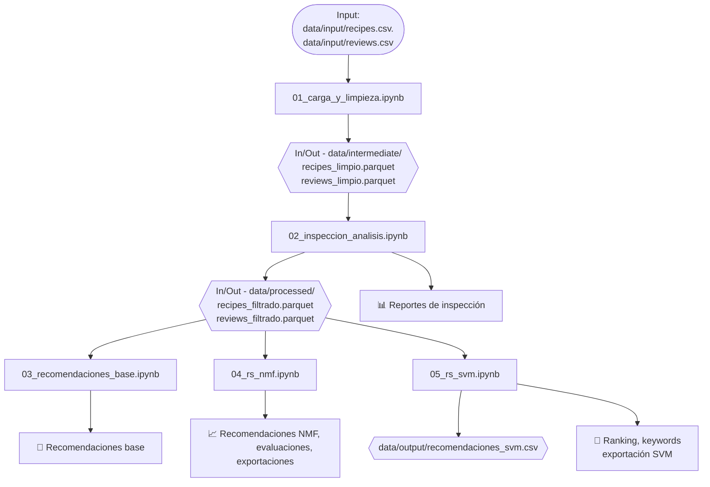

> Documento histórico: conserva los nombres y rutas anteriores. Para la estructura y ejecución vigentes, consulta el [README actual](../../README.md) y la [guía de notebooks](../notebooks.md).


# 📊 Sistema de Recomendación de Recetas con SVM y NMF

## 📝 Resumen del Proyecto

Este proyecto tiene como objetivo construir un sistema de recomendación para el sitio Food.com, utilizando datos de recetas y reseñas de los usuarios.
Se implementan distintos enfoques, como:
- Recomendaciones básicas.
- Filtrado colaborativo con NMF.
- Predicción personalizada con SVM.

El flujo del proyecto considera limpieza, análisis, entrenamiento de modelos y generación de recomendaciones.

## 🎯 Objetivos

- Preparar y limpiar los datos de recetas y reseñas.
- Explorar los datos con funciones visuales y resúmenes.
- Implementar sistemas de recomendación:
  - Basado en promedio y popularidad.
  - Basado en NMF (descomposición de matriz).
  - Basado en perfil de recetas (modelo SVM).
- Exportar resultados y recomendaciones personalizadas.

---
 
## 🔄 Flujo del Proyecto



---

## 📚 Dataset

- **Fuente**: [Food.com Recipes and Reviews](https://www.kaggle.com/datasets/irkaal/foodcom-recipes-and-reviews)
- **Archivos utilizados**: `recipes.csv`, `reviews.csv`
- **Ubicación**: `data/input/`

### 🧾 Dataset de Recetas (`recipes.csv`)

Contiene el detalle de cada receta publicada en Food.com. Cada fila representa una receta.

| Columna                      | Descripción                                                                 |
|-----------------------------|-----------------------------------------------------------------------------|
| `RecipeId`                  | Identificador único de la receta.                                           |
| `Name`                      | Nombre de la receta.                                                        |
| `AuthorId`                  | ID del usuario autor de la receta.                                          |
| `AuthorName`                | Nombre del autor de la receta.                                              |
| `CookTime`                  | Tiempo de cocción (en formato ISO 8601, ej: PT30M).                         |
| `PrepTime`                  | Tiempo de preparación (en formato ISO 8601).                                |
| `TotalTime`                 | Tiempo total estimado (suma de cocción y preparación).                      |
| `DatePublished`             | Fecha en que fue publicada la receta.                                       |
| `Description`               | Descripción breve de la receta.                                             |
| `Images`                    | Lista o enlace(s) a imágenes asociadas con la receta.                       |
| `RecipeCategory`            | Categoría general de la receta (ej: postre, entrada, sopa).                |
| `Keywords`                  | Palabras clave asociadas con la receta (a menudo separadas por comas).     |
| `RecipeIngredientQuantities` | Cantidades específicas de ingredientes (ej: "1 taza", "2 cucharadas").     |
| `RecipeIngredientParts`     | Ingredientes utilizados, en texto plano (ej: "harina", "huevo", etc.).     |
| `AggregatedRating`          | Puntuación promedio otorgada por los usuarios (de 1 a 5).                   |
| `ReviewCount`               | Número total de reseñas recibidas.                                          |
| `Calories`                  | Cantidad estimada de calorías por porción.                                  |
| `FatContent`                | Contenido total de grasas (gramos).                                         |
| `SaturatedFatContent`       | Contenido de grasas saturadas (gramos).                                     |
| `CholesterolContent`        | Contenido de colesterol (miligramos).                                       |
| `SodiumContent`             | Contenido de sodio (miligramos).                                            |
| `CarbohydrateContent`       | Contenido total de carbohidratos (gramos).                                  |
| `FiberContent`              | Contenido de fibra dietética (gramos).                                      |
| `SugarContent`              | Contenido de azúcares (gramos).                                             |
| `ProteinContent`            | Contenido de proteínas (gramos).                                            |
| `RecipeServings`            | Número estimado de porciones que rinde la receta.                           |
| `RecipeYield`               | Descripción textual del rendimiento (formato libre, puede incluir texto).   |
| `RecipeInstructions`        | Lista de instrucciones paso a paso para preparar la receta.                 |


---

### 📝 Dataset de Reseñas (`reviews.csv`)

Contiene las evaluaciones hechas por usuarios sobre distintas recetas.

| Columna          | Descripción                                            |
|------------------|--------------------------------------------------------|
| `ReviewId`       | ID único de la reseña.                                 |
| `RecipeId`       | ID de la receta evaluada.                              |
| `AuthorId`       | ID del usuario que hizo la reseña.                     |
| `AuthorName`     | Nombre del autor de la reseña.                         |
| `Rating`         | Calificación asignada (1 a 5 estrellas).               |
| `Review`         | Comentario textual (puede estar ausente).              |
| `DateSubmitted`  | Fecha de envío de la reseña.                           |
| `DateModified`   | Fecha de última edición de la reseña (si corresponde). |

---

## 🧱 Arquitectura del Proyecto


```text
rs_food_com/
├── 01_carga_y_limpieza.ipynb
├── 02_inspeccion_analisis.ipynb
├── 03_recomendaciones_base.ipynb
├── 04_rs_nmf.ipynb
├── 05_rs_svm.ipynb
├── data/
│   ├── input/
│   │   ├── recipes.csv
│   │   ├── recipes.parquet
│   │   ├── reviews.csv
│   │   └── reviews.parquet
│   ├── intermediate/
│   │   ├── recipes_limpio.parquet
│   │   └── reviews_limpio.parquet
│   ├── output/
│   │   └── recomendaciones_svm.csv
│   └── processed/
│       ├── recipes_filtrado.parquet
│       └── reviews_filtrado.parquet
├── docs/
│   └── Enunciado_Trabajo_final.pdf
├── reportes/
│   ├── recipes/
│   │   └── ...   
│   ├── recipes_filtrado/
│   │   └── ...
│   ├── reviews/
│   │   └── ...
│   └── reviews_filtrado/
│       └── ...
└── utils/
    ├── __init__.py
    ├── diagnostico.py
    ├── inspeccion.py
    ├── inspeccion_md.py
    ├── limpieza.py
    ├── recomendaciones_base.py
    ├── recomendaciones_nmf.py
    ├── recomendaciones_svm.py
    └── reporte.py
```

---

## 🧩 Modelos y Funciones Clave

### ✅ Recomendación Base
- **Archivo**: `03_recomendaciones_base.ipynb`
- **Funciones**: `recomendaciones_base.py`
  - Promedio por receta, popularidad por usuario.

### ✅ NMF (Filtrado colaborativo)
- **Archivo**: `04_rs_nmf.ipynb`
- **Funciones**: `recomendaciones_nmf.py`
  - Similitud entre usuarios (`W`) y recetas (`H.T`).
  - Recomendaciones usando `cosine_similarity`.
  - Exportación de resultados.

### ✅ SVM (Modelo supervisado)
- **Archivo**: `05_rs_svm.ipynb`
- **Funciones**: `recomendaciones_svm.py`
  - Entrenamiento con ingredientes + calorías + categoría.
  - Predicciones por usuario, receta, keywords, calorías.
  - Exportación masiva.

---

## 💡 Recomendaciones Implementadas

- `recomendar_similares_por_receta`: Sugerencias similares usando `LinearSVC`.
- `recomendar_por_ingredientes`: Recomendaciones basadas en texto libre.
- `recomendar_por_calorias`: Ranking de recetas más cercanas en calorías.
- `generar_recomendaciones_svm`: Predicciones por usuario según historial.
- `similitud_recetas_tfidf`: Basado en TF-IDF de ingredientes (recomendaciones similares).

---

## 📁 Archivos Importantes

- **Notebooks**: `01` a `05`
- **Módulos auxiliares**: carpeta `utils/`
- **Exportaciones**: carpeta `data/output/`, `reportes/`

---

## 🧪 Evaluación

- Accuracy del modelo SVM medido con `classification_report` y `confusion_matrix`.
- Métricas de NMF medidas con `mean_squared_error` en muestras aleatorias.

---

## ⚙️ Consideraciones Técnicas

- Se optó por `LinearSVC` por su velocidad y compatibilidad con `decision_function`.
- Se normalizaron scores para rankear recomendaciones.
- Uso de TF-IDF para procesar texto de ingredientes.
- `predict_proba` se evitó por consumo excesivo de recursos.

---

## Ejemplos de recomendaciones

(trabajo pendiente)