# Inspección visual del dataset

Generado: 2026-10-26_11-29-56_673261. Esta versión reemplaza el informe anterior.

```text
recipes
```

## Dimensiones

522.517 filas y 28 columnas.

## Columnas y tipos

Cantidad de columnas: 28

```text
recipeid, name, authorid, authorname, cooktime, preptime, totaltime,
datepublished, description, images, recipecategory, keywords,
recipeingredientquantities, recipeingredientparts, aggregatedrating,
reviewcount, calories, fatcontent, saturatedfatcontent, cholesterolcontent,
sodiumcontent, carbohydratecontent, fibercontent, sugarcontent, proteincontent,
recipeservings, recipeyield, recipeinstructions
```

Tipos de datos:

```text
recipeid                                  float64
name                                       object
authorid                                    int32
authorname                                 object
cooktime                                   object
preptime                                   object
totaltime                                  object
datepublished                 datetime64[us, UTC]
description                                object
images                                     object
recipecategory                             object
keywords                                   object
recipeingredientquantities                 object
recipeingredientparts                      object
aggregatedrating                          float64
reviewcount                               float64
calories                                  float64
fatcontent                                float64
saturatedfatcontent                       float64
cholesterolcontent                        float64
sodiumcontent                             float64
carbohydratecontent                       float64
fibercontent                              float64
sugarcontent                              float64
proteincontent                            float64
recipeservings                            float64
recipeyield                                object
recipeinstructions                         object
```

## Cardinalidad

Cantidad de valores distintos no nulos por columna. Los arrays y listas se cuentan como combinaciones completas.

```text
recipeid                      522517
recipeinstructions            519994
recipeingredientparts         497120
description                   491618
recipeingredientquantities    459572
name                          434868
datepublished                 245540
keywords                      216570
images                        165889
authorid                       57178
authorname                     56541
sodiumcontent                  40455
calories                       30138
recipeyield                    29609
cholesterolcontent              9803
carbohydratecontent             8102
sugarcontent                    6008
fatcontent                      4523
proteincontent                  2581
saturatedfatcontent             2533
totaltime                       1239
fibercontent                    1067
cooktime                         490
reviewcount                      420
preptime                         316
recipecategory                   311
recipeservings                   171
aggregatedrating                   9
```

## Valores nulos

Se cuentan celdas nulas; no los valores nulos dentro de arrays o listas.

```text
                             Nulos  Porcentaje (%)
recipeid                         0            0.00
name                             0            0.00
authorid                         0            0.00
authorname                       0            0.00
cooktime                     82545           15.80
preptime                         0            0.00
totaltime                        0            0.00
datepublished                    0            0.00
description                      5            0.00
images                           1            0.00
recipecategory                 751            0.14
keywords                         0            0.00
recipeingredientquantities       0            0.00
recipeingredientparts            0            0.00
aggregatedrating            253223           48.46
reviewcount                 247489           47.36
calories                         0            0.00
fatcontent                       0            0.00
saturatedfatcontent              0            0.00
cholesterolcontent               0            0.00
sodiumcontent                    0            0.00
carbohydratecontent              0            0.00
fibercontent                     0            0.00
sugarcontent                     0            0.00
proteincontent                   0            0.00
recipeservings              182911           35.01
recipeyield                 348071           66.61
recipeinstructions               0            0.00
```

## Duplicados

Total de filas duplicadas después de la primera aparición: 0 (0.00%).

```text
                            Valores distintos no nulos  Registros  Porcentaje (%)
recipeid                                        522517     522517          100.00
name                                            434868     522517           83.23
authorid                                         57178     522517           10.94
authorname                                       56541     522517           10.82
cooktime                                           490     522517            0.09
preptime                                           316     522517            0.06
totaltime                                         1239     522517            0.24
datepublished                                   245540     522517           46.99
description                                     491618     522517           94.09
images                                          165889     522517           31.75
recipecategory                                     311     522517            0.06
keywords                                        216570     522517           41.45
recipeingredientquantities                      459572     522517           87.95
recipeingredientparts                           497120     522517           95.14
aggregatedrating                                     9     522517            0.00
reviewcount                                        420     522517            0.08
calories                                         30138     522517            5.77
fatcontent                                        4523     522517            0.87
saturatedfatcontent                               2533     522517            0.48
cholesterolcontent                                9803     522517            1.88
sodiumcontent                                    40455     522517            7.74
carbohydratecontent                               8102     522517            1.55
fibercontent                                      1067     522517            0.20
sugarcontent                                      6008     522517            1.15
proteincontent                                    2581     522517            0.49
recipeservings                                     171     522517            0.03
recipeyield                                      29609     522517            5.67
recipeinstructions                              519994     522517           99.52
```

## Primeras filas

```text
  recipeid                              name authorid      authorname cooktime preptime totaltime              datepublished                                                                                                                                                                                                                                                                                                                                       description                                                                                                                                                                                                                                                                                                                                                                                                                                                                                                                                                                                                                                                                                                                                                                                                                                                                            images   recipecategory                                                                                                    keywords                                                                                                      recipeingredientquantities                                                                                                                                                                                                                                                                                                    recipeingredientparts aggregatedrating reviewcount calories fatcontent saturatedfatcontent cholesterolcontent sodiumcontent carbohydratecontent fibercontent sugarcontent proteincontent recipeservings recipeyield                                                                                                                                                                                                                                                                                                                                                                                                                                                                                                                                                                                                                                                                                                                                                                                                                                                                                                                                                                                                                                                                                                                                                                                                                                                                                                                                                                                                                                                                                                                                                            recipeinstructions
0     38.0  lowfat berry blue frozen dessert     1533          dancer    pt24h    pt45m  pt24h45m  1999-08-09 21:46:00+00:00                                                                                                                                                                                                                                                                          make and share this lowfat berry blue frozen dessert recipe from foodcom  ['https://img.sndimg.com/food/image/upload/w_555,h_416,c_fit,fl_progressive,q_95/v1/img/recipes/38/YUeirxMLQaeE1h3v3qnM_229%20berry%20blue%20frzn%20dess.jpg'\n 'https://img.sndimg.com/food/image/upload/w_555,h_416,c_fit,fl_progressive,q_95/v1/img/recipes/38/AFPDDHATWzQ0b1CDpDAT_255%20berry%20blue%20frzn%20dess.jpg'\n 'https://img.sndimg.com/food/image/upload/w_555,h_416,c_fit,fl_progressive,q_95/v1/img/recipes/38/UYgf9nwMT2SGGJCuzILO_228%20berry%20blue%20frzn%20dess.jpg'\n 'https://img.sndimg.com/food/image/upload/w_555,h_416,c_fit,fl_progressive,q_95/v1/img/recipes/38/PeBMJN2TGSaYks2759BA_20140722_202142.jpg'\n 'https://img.sndimg.com/food/image/upload/w_555,h_416,c_fit,fl_progressive,q_95/v1/img/recipes/38/picuaETeN.jpg'\n 'https://img.sndimg.com/food/image/upload/w_555,h_416,c_fit,fl_progressive,q_95/v1/img/recipes/38/pictzvxW5.jpg']  frozen desserts  ['Dessert' 'Low Protein' 'Low Cholesterol' 'Healthy' 'Free Of...' 'Summer'\n 'Weeknight' 'Freezer' 'Easy']                                                                                                             ['4' '1⁄4' '1' '1']                                                                                                                                                                                                                                                        ['blueberries' 'granulated sugar' 'vanilla yogurt' 'lemon juice']              4.5         4.0    170.9        2.5                 1.3                8.0          29.8                37.1          3.6         30.2            3.2            4.0        None                                                                                                                                                                                                                                                                                                                                                                                                                                                                                                                                                                                                                                                                                                                                                                                                                                                                                        ['Toss 2 cups berries with sugar.'\n 'Let stand for 45 minutes, stirring occasionally.'\n 'Transfer berry-sugar mixture to food processor.'\n 'Add yogurt and process until smooth.'\n "Strain through fine sieve. Pour into baking pan (or transfer to ice cream maker and process according to manufacturers' directions). Freeze uncovered until edges are solid but centre is soft.  Transfer to processor and blend until smooth again."\n 'Return to pan and freeze until edges are solid.'\n 'Transfer to processor and blend until smooth again.'\n 'Fold in remaining 2 cups of blueberries.'\n 'Pour into plastic mold and freeze overnight. Let soften slightly to serve.']
1     39.0                           biryani     1567        elly9812    pt25m     pt4h   pt4h25m  1999-08-29 13:12:00+00:00                                                                                                                                                                                                                                                                                                   make and share this biryani recipe from foodcom                                                                                                                                                                                                                                                                                                                                                                                                                                                                                                                                                                                                                                             ['https://img.sndimg.com/food/image/upload/w_555,h_416,c_fit,fl_progressive,q_95/v1/img/recipes/39/picM9Mhnw.jpg'\n 'https://img.sndimg.com/food/image/upload/w_555,h_416,c_fit,fl_progressive,q_95/v1/img/recipes/39/picHv4Ocr.jpg']   chicken breast               ['Chicken Thigh & Leg' 'Chicken' 'Poultry' 'Meat' 'Asian' 'Indian'\n 'Weeknight' 'Stove Top']  ['1' '4' '2' '2' '8' '1⁄4' '8' '1⁄2' '1' '1' '1⁄4' '1⁄4' '1⁄2' '1⁄4' '2'\n '3' None '2' '1' '1' '8' '2' '1⁄3' '1⁄3' '1⁄3' '6']  ['saffron' 'milk' 'hot green chili peppers' 'onions' 'garlic' 'clove'\n 'peppercorns' 'cardamom seed' 'cumin seed' 'poppy seed' 'mace' 'cilantro'\n 'mint leaf' 'fresh lemon juice' 'plain yogurt' 'boneless chicken' 'salt'\n 'ghee' 'onion' 'tomatoes' 'basmati rice' 'long-grain rice' 'raisins'\n 'cashews' 'eggs']              3.0         1.0   1110.7       58.8                16.6              372.8         368.4                84.4          9.0         20.4           63.4            6.0        None                                                                                                                                                                                                                                                                                                                                                                                                ['Soak saffron in warm milk for 5 minutes and puree in blender.'\n 'Add chiles, onions, ginger, garlic, cloves, peppercorns, cardamom seeds, cinnamon, coriander and cumin seeds, poppy seeds, nutmeg, mace, cilantro or mint leaves and lemon juice. Blend into smooth paste. Put paste into large bowl, add yogurt and mix well.'\n 'Marinate chicken in yogurt mixture with salt, covered for at least 2 - 6 hours in refrigerator.'\n 'In skillet. heat oil over medium heat for 1 minute. Add ghee and 15 seconds later add onion and fry for about8 minutes.'\n 'Reserve for garnish.'\n 'In same skillet, cook chicken with its marinade with tomatoes for about 10 minutes over medium heat, uncovered.'\n 'Remove chicken pieces from the sauce and set aside. Add rice to sauce, bring to boil, and cook, covered over low heat for 15 minutes.'\n 'Return chicken and add raisins, cashews and almonds; mix well.'\n 'Simmer, covered for 5 minutes.'\n 'Place chicken, eggs and rice in large serving dish in such a way that yellow of the eggs, the saffron-colored rice, the nuts and the chicken make a colorful display.'\n 'Add reserved onion as garnish.']
2     40.0                     best lemonade     1566  stephen little     pt5m    pt30m     pt35m  1999-09-05 19:52:00+00:00  this is from one of my first good house keeping cookbooks you must use a zester in order to avoid getting any of that bitter rind and when you zest the lemons zest them onto some sugar from the recipe the sugar will catch all of the oils i also advise you from personal experience to use only the best skinned lemons for the best flavor                                                                                                                                                                                                                                                                                                                                                                                                                                                                                                                                                                                                                                             ['https://img.sndimg.com/food/image/upload/w_555,h_416,c_fit,fl_progressive,q_95/v1/img/recipes/40/picJ4Sz3N.jpg'\n 'https://img.sndimg.com/food/image/upload/w_555,h_416,c_fit,fl_progressive,q_95/v1/img/recipes/40/pic23FWio.jpg']        beverages                                            ['Low Protein' 'Low Cholesterol' 'Healthy' 'Summer' '< 60 Mins']                                                                                           ['1 1⁄2' '1' None '1 1⁄2' None '3⁄4']                                                                                                                                                                                                                                         ['sugar' 'lemons, rind of' 'lemon, zest of' 'fresh water'\n 'fresh lemon juice']              4.5        10.0    311.1        0.2                 0.0                0.0           1.8                81.5          0.4         77.2            0.3            4.0        None                                                                                                                                                                                                                                                                                                                                                                                                                                                                                                                                                                                                                                                                                                                                                                                                                                                                                                                                                                                                                                                                                                                                                         ['Into a 1 quart Jar with tight fitting lid, put sugar and lemon peel, or zest;  add 1 1/2 cups very hot water (not from tap!). With lid fitted firmly, shake jar until sugar is dissolved.'\n 'Add lemon juice. Refrigerate until chilled.'\n 'To Serve: Into each 12-ounce glass, over ice cubes, pour 1/4 cup of the lemon syrup.'\n 'Then add chilled club soda or, if you prefer, water.'\n 'Stir to mix well.']
3     41.0      carinas tofuvegetable kebabs     1586         cyclopz    pt20m    pt24h  pt24h20m  1999-09-03 14:54:00+00:00                                                                                                                                                                                                                                            this dish is best prepared a day in advance to allow the ingredients to soak in the marinade overnight                                                                                                                                                                                                                                                                                                                                                                                                                                                                                                                                                                                                                                             ['https://img.sndimg.com/food/image/upload/w_555,h_416,c_fit,fl_progressive,q_95/v1/img/recipes/41/picmbLig8.jpg'\n 'https://img.sndimg.com/food/image/upload/w_555,h_416,c_fit,fl_progressive,q_95/v1/img/recipes/41/picL02w0s.jpg']          soytofu                                    ['Beans' 'Vegetable' 'Low Cholesterol' 'Weeknight' 'Broil/Grill' 'Oven']                                                             ['12' '1' '2' '1' '10' '1' '3' '2' '2' '2' '1' '2' '1⁄2' '1⁄4' '4']                                                                                                        ['extra firm tofu' 'eggplant' 'zucchini' 'mushrooms' 'soy sauce'\n 'low sodium soy sauce' 'olive oil' 'maple syrup' 'honey'\n 'red wine vinegar' 'lemon juice' 'garlic cloves' 'mustard powder'\n 'black pepper']              4.5         2.0    536.1       24.0                 3.8                0.0        1558.6                64.2         17.3         32.1           29.3            2.0    4 kebabs  ['Drain the tofu, carefully squeezing out excess water,  and pat dry with paper towels.'\n 'Cut tofu into one-inch squares.'\n 'Set aside.  Cut  eggplant lengthwise in half, then cut each half into approximately three strips.'\n 'Cut strips crosswise into one-inch cubes.'\n 'Slice zucchini into half-inch thick  slices.'\n 'Cut red pepper in half, removing stem and seeds, and cut each half into  one-inch squares.'\n 'Wipe mushrooms clean with a moist paper towel and remove  stems.'\n 'Thread tofu and vegetables on to barbecue skewers in alternating color  combinations: For example, first a piece of eggplant, then a slice of tofu, then zucchini, then red pepper, baby corn and mushrooms.'\n 'Continue in this way until  all skewers are full.'\n 'Make the marinade by putting all ingredients in a  blender, and blend on high speed for about one minute until mixed.'\n 'Alternatively, put all ingredients in a glass jar, cover tightly with the lid  and shake well until mixed.'\n 'Lay the kebabs in a long, shallow baking pan or on  a non-metal tray, making sure they lie flat. Evenly pour the marinade over the  kebabs, turning them once so that the tofu and vegetables are coated.'\n 'Refrigerate the kebabs for three to eight hours, occasionally spooning the  marinade over them.'\n 'Broil or grill the kebabs at 450 F for 15-20 minutes, or on the grill, until the vegetables are browned.'\n 'Suggestions  This meal can be served over cooked, brown rice. Amounts can easily be doubled to make four servings.']
4     42.0                      cabbage soup     1538       duckie067    pt30m    pt20m     pt50m  1999-09-19 06:19:00+00:00                                                                                                                                                                                                                                                                                              make and share this cabbage soup recipe from foodcom                                                                                                                                                                                                                                                                                                                                                                                                                                                                                                                                                                                                                                                                                                                                                                ['https://img.sndimg.com/food/image/upload/w_555,h_416,c_fit,fl_progressive,q_95/v1/img/recipes/42/picVEMxk8.jpg']        vegetable                           ['Low Protein' 'Vegan' 'Low Cholesterol' 'Healthy' 'Winter' '< 60 Mins'\n 'Easy']                                                                                                          ['46' '4' '1' '2' '1']                                                                                                                                                                                                                                                              ['plain tomato juice' 'cabbage' 'onion' 'carrots' 'celery']              4.5        11.0    103.6        0.4                 0.1                0.0         959.3                25.1          4.8         17.7            4.3            4.0        None                                                                                                                                                                                                                                                                                                                                                                                                                                                                                                                                                                                                                                                                                                                                                                                                                                                                                                                                                                                                                                                                                                                                                                                                                                                                                                                                                                       ['Mix everything together and bring to a boil.'\n 'Reduce heat and simmer for 30 minutes (longer if you prefer your veggies to be soft).'\n 'Refrigerate until cool.' 'Serve chilled with sour cream.']
```

## Información

```text
<class 'pandas.core.frame.DataFrame'>
RangeIndex: 522517 entries, 0 to 522516
Data columns (total 28 columns):
 #   Column                      Non-Null Count   Dtype              
---  ------                      --------------   -----              
 0   recipeid                    522517 non-null  float64            
 1   name                        522517 non-null  object             
 2   authorid                    522517 non-null  int32              
 3   authorname                  522517 non-null  object             
 4   cooktime                    439972 non-null  object             
 5   preptime                    522517 non-null  object             
 6   totaltime                   522517 non-null  object             
 7   datepublished               522517 non-null  datetime64[us, UTC]
 8   description                 522512 non-null  object             
 9   images                      522516 non-null  object             
 10  recipecategory              521766 non-null  object             
 11  keywords                    522517 non-null  object             
 12  recipeingredientquantities  522517 non-null  object             
 13  recipeingredientparts       522517 non-null  object             
 14  aggregatedrating            269294 non-null  float64            
 15  reviewcount                 275028 non-null  float64            
 16  calories                    522517 non-null  float64            
 17  fatcontent                  522517 non-null  float64            
 18  saturatedfatcontent         522517 non-null  float64            
 19  cholesterolcontent          522517 non-null  float64            
 20  sodiumcontent               522517 non-null  float64            
 21  carbohydratecontent         522517 non-null  float64            
 22  fibercontent                522517 non-null  float64            
 23  sugarcontent                522517 non-null  float64            
 24  proteincontent              522517 non-null  float64            
 25  recipeservings              339606 non-null  float64            
 26  recipeyield                 174446 non-null  object             
 27  recipeinstructions          522517 non-null  object             
dtypes: datetime64[us, UTC](1), float64(13), int32(1), object(13)
memory usage: 109.6+ MB
```

## Estadísticas descriptivas

En columnas con arrays o listas, los conteos y frecuencias corresponden a combinaciones completas.

```text
             recipeid          name      authorid       authorname cooktime preptime totaltime                     datepublished                                           description  images recipecategory keywords recipeingredientquantities recipeingredientparts  aggregatedrating    reviewcount       calories     fatcontent  saturatedfatcontent  cholesterolcontent  sodiumcontent  carbohydratecontent   fibercontent   sugarcontent  proteincontent  recipeservings recipeyield                      recipeinstructions
count   522517.000000        522517  5.225170e+05           522517   439972   522517    522517                            522517                                                522512  522516         521766   522517                     522517                522517     269294.000000  275028.000000  522517.000000  522517.000000        522517.000000       522517.000000   5.225170e+05        522517.000000  522517.000000  522517.000000   522517.000000   339606.000000      174446                                  522517
unique            NaN        434868           NaN            56541      490      316      1239                               NaN                                                491618  165889            311   216570                     459572                497120               NaN            NaN            NaN            NaN                  NaN                 NaN            NaN                  NaN            NaN            NaN             NaN             NaN       29609                                  519994
top               NaN  banana bread           NaN  ratherbeswimmin    pt30m    pt10m     pt30m                               NaN  make and share this banana bread recipe from foodcom      ()        dessert  (None,)                  (1, 1, 1)                    ()               NaN            NaN            NaN            NaN                  NaN                 NaN            NaN                  NaN            NaN            NaN             NaN             NaN      2 cups  (Blend all ingredients until smooth.,)
freq              NaN           187           NaN             7742    50715   120265     41590                               NaN                                                    97  356620          62072    17237                        955                  2219               NaN            NaN            NaN            NaN                  NaN                 NaN            NaN                  NaN            NaN            NaN             NaN             NaN        4681                                      32
mean    271821.436970           NaN  4.572585e+07              NaN      NaN      NaN       NaN  2008-01-18 06:34:47.071884+00:00                                                   NaN     NaN            NaN      NaN                        NaN                   NaN          4.632014       5.227784     484.438580      24.614922             9.559457           86.487003   7.672639e+02            49.089092       3.843242      21.878254       17.469510        8.606191         NaN                                     NaN
min         38.000000           NaN  2.700000e+01              NaN      NaN      NaN       NaN         1999-08-06 00:40:00+00:00                                                   NaN     NaN            NaN      NaN                        NaN                   NaN          1.000000       1.000000       0.000000       0.000000             0.000000            0.000000   0.000000e+00             0.000000       0.000000       0.000000        0.000000        1.000000         NaN                                     NaN
25%     137206.000000           NaN  6.947400e+04              NaN      NaN      NaN       NaN         2005-09-13 10:25:00+00:00                                                   NaN     NaN            NaN      NaN                        NaN                   NaN          4.500000       1.000000     174.200000       5.600000             1.500000            3.800000   1.233000e+02            12.800000       0.800000       2.500000        3.500000        4.000000         NaN                                     NaN
50%     271758.000000           NaN  2.389370e+05              NaN      NaN      NaN       NaN         2007-12-13 16:27:00+00:00                                                   NaN     NaN            NaN      NaN                        NaN                   NaN          5.000000       2.000000     317.100000      13.800000             4.700000           42.600000   3.533000e+02            28.200000       2.200000       6.400000        9.100000        6.000000         NaN                                     NaN
75%     406145.000000           NaN  5.658280e+05              NaN      NaN      NaN       NaN         2009-12-31 09:45:00+00:00                                                   NaN     NaN            NaN      NaN                        NaN                   NaN          5.000000       4.000000     529.100000      27.400000            10.800000          107.900000   7.922000e+02            51.100000       4.600000      17.900000       25.000000        8.000000         NaN                                     NaN
max     541383.000000           NaN  2.002886e+09              NaN      NaN      NaN       NaN         2020-12-22 22:12:00+00:00                                                   NaN     NaN            NaN      NaN                        NaN                   NaN          5.000000    3063.000000  612854.600000   64368.100000         26740.600000       130456.400000   1.246921e+06        108294.600000    3012.000000   90682.300000    18396.200000    32767.000000         NaN                                     NaN
std     155495.878422           NaN  2.929714e+08              NaN      NaN      NaN       NaN                               NaN                                                   NaN     NaN            NaN      NaN                        NaN                   NaN          0.641934      20.381347    1397.116649     111.485798            46.622621          301.987009   4.203621e+03           180.822062       8.603163     142.620191       40.128837      114.319809         NaN                                     NaN
```

## Histogramas numéricos

```text
Columna: recipeid
```

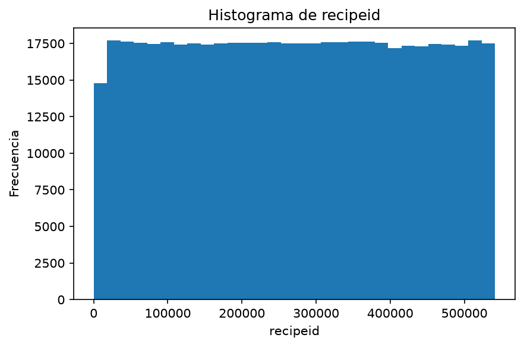

```text
Columna: authorid
```

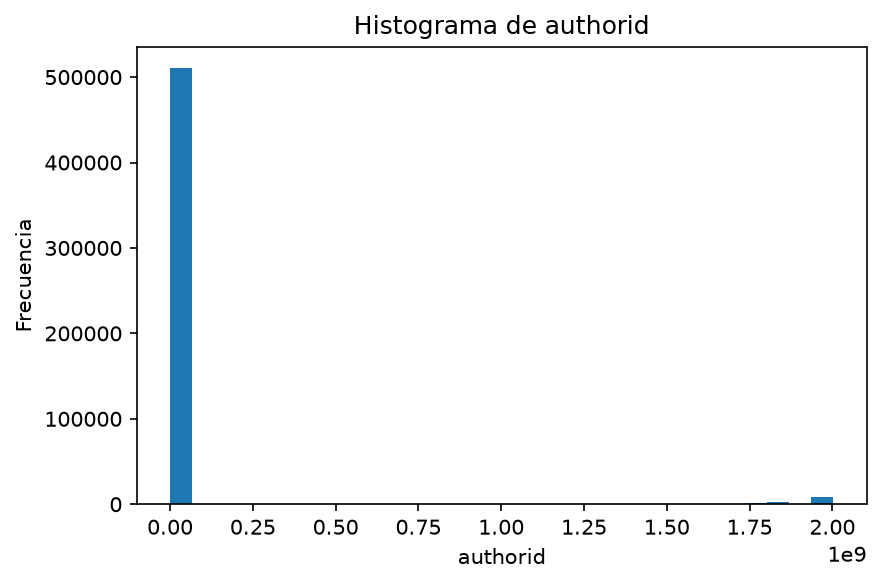

```text
Columna: aggregatedrating
```

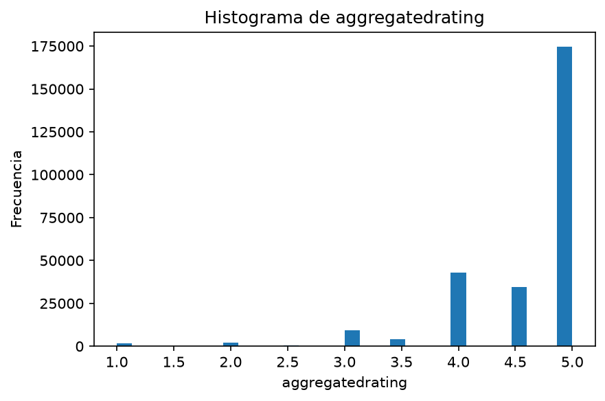

```text
Columna: reviewcount
```

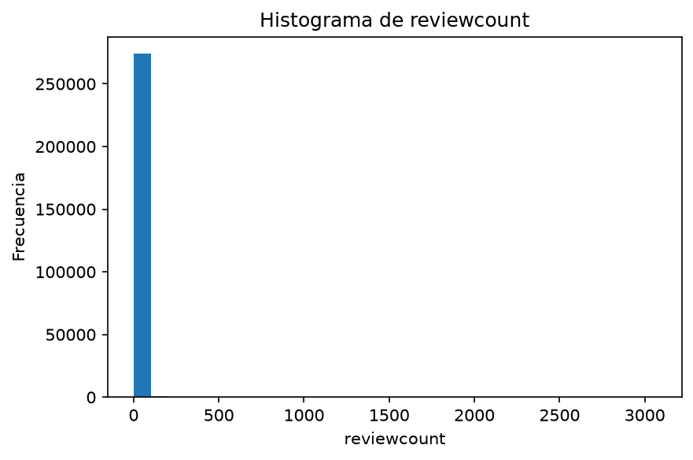

```text
Columna: calories
```

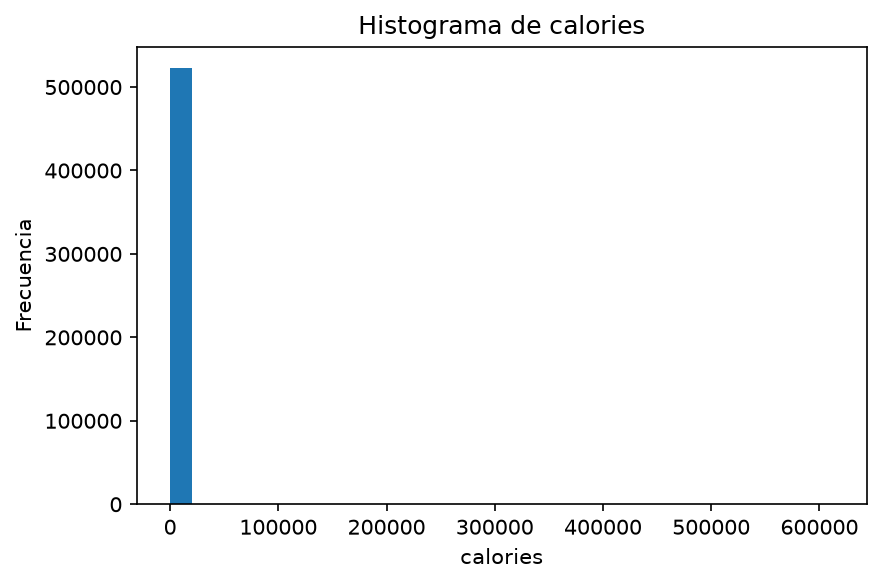

```text
Columna: fatcontent
```

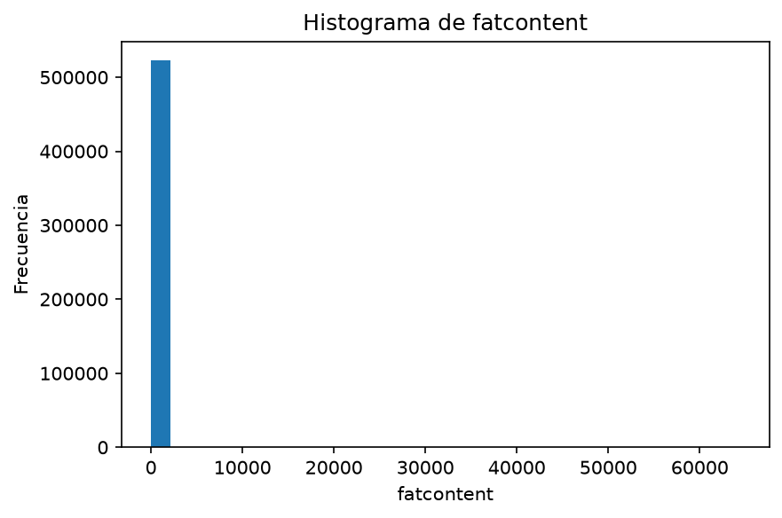

```text
Columna: saturatedfatcontent
```

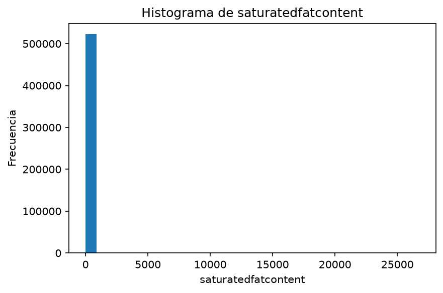

```text
Columna: cholesterolcontent
```

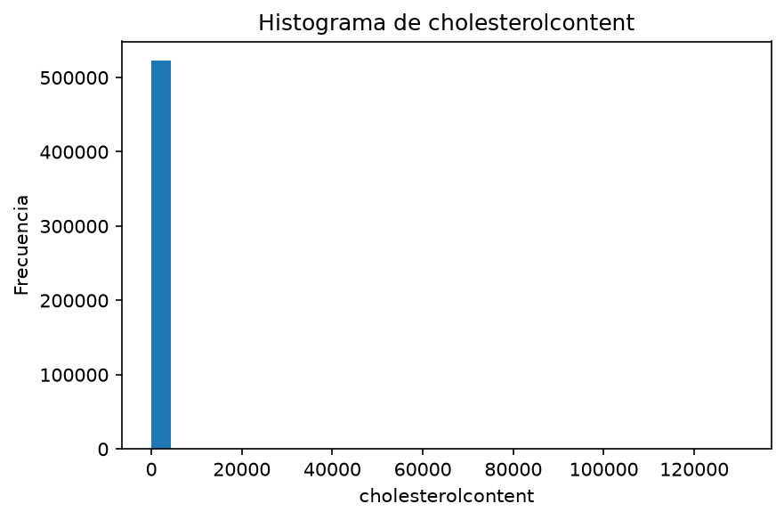

```text
Columna: sodiumcontent
```


```text
Columna: carbohydratecontent
```


```text
Columna: fibercontent
```

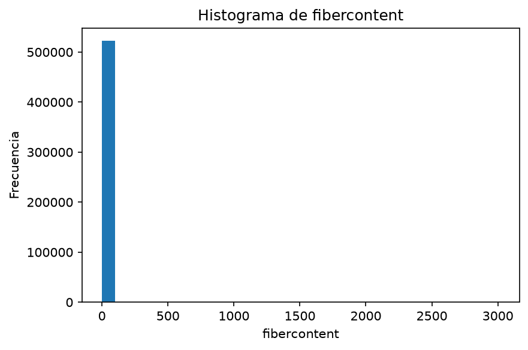

```text
Columna: sugarcontent
```

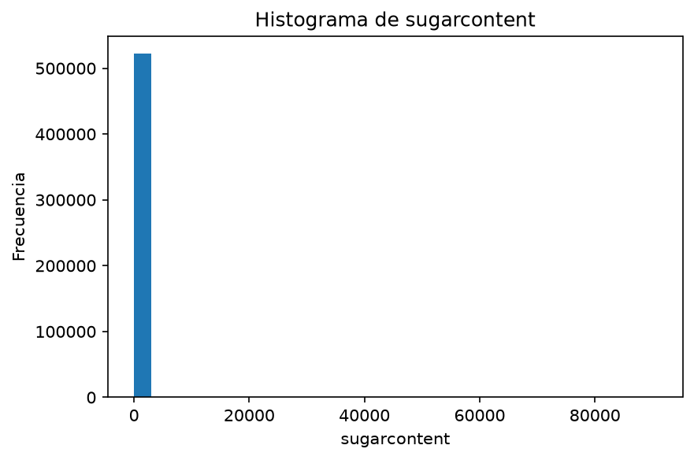

```text
Columna: proteincontent
```

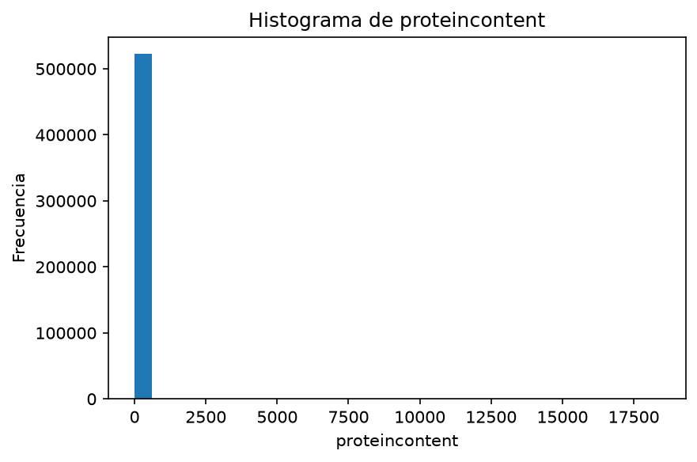

```text
Columna: recipeservings
```

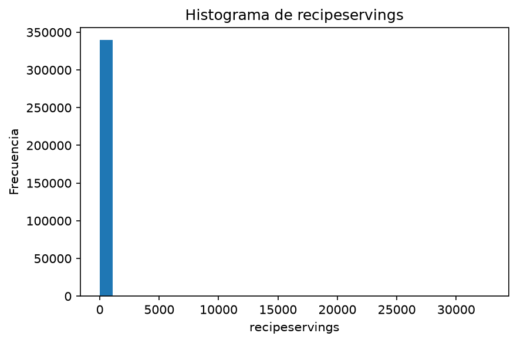

## Matriz de correlación

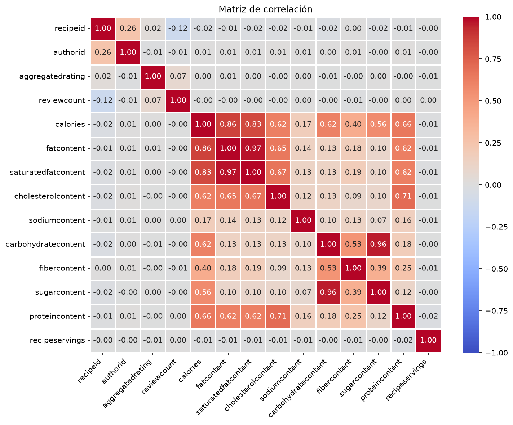

