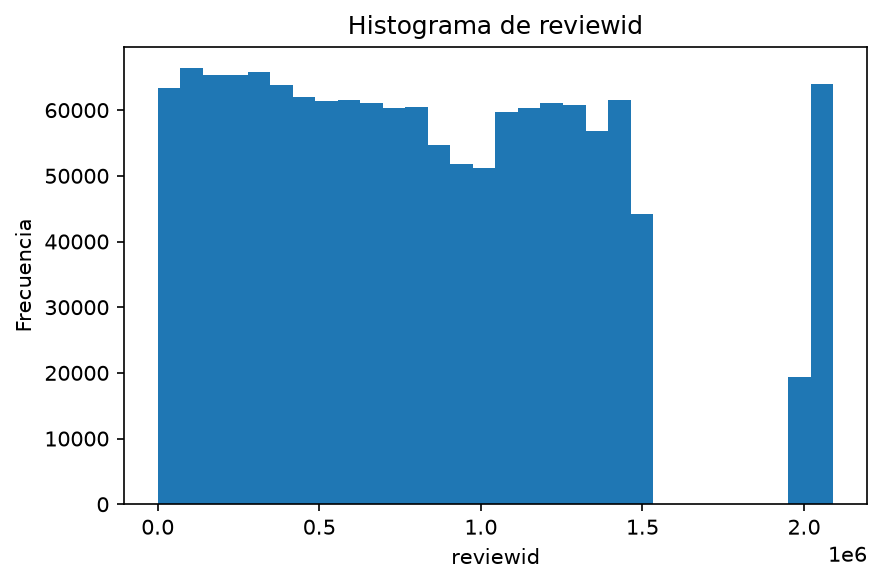
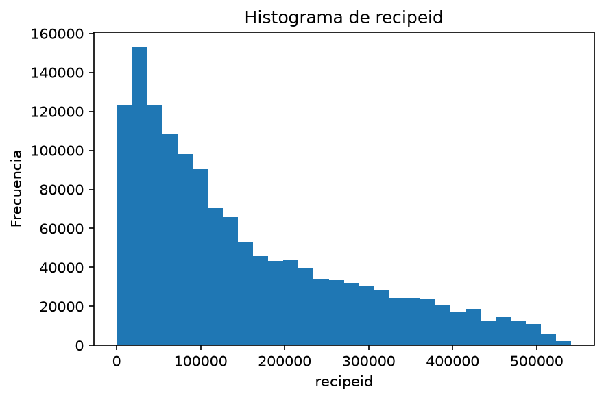
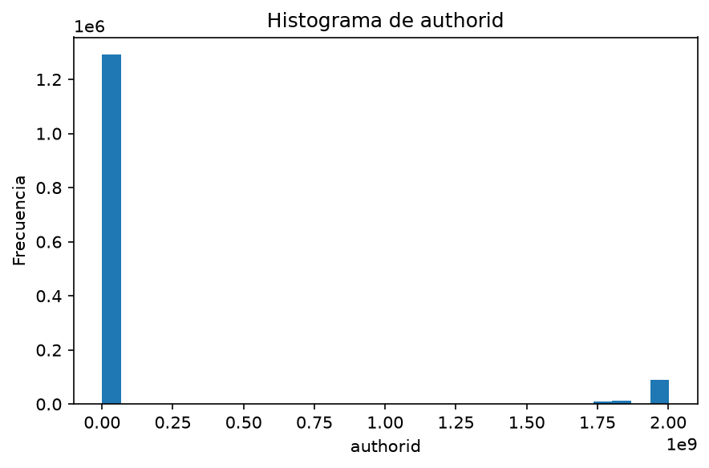
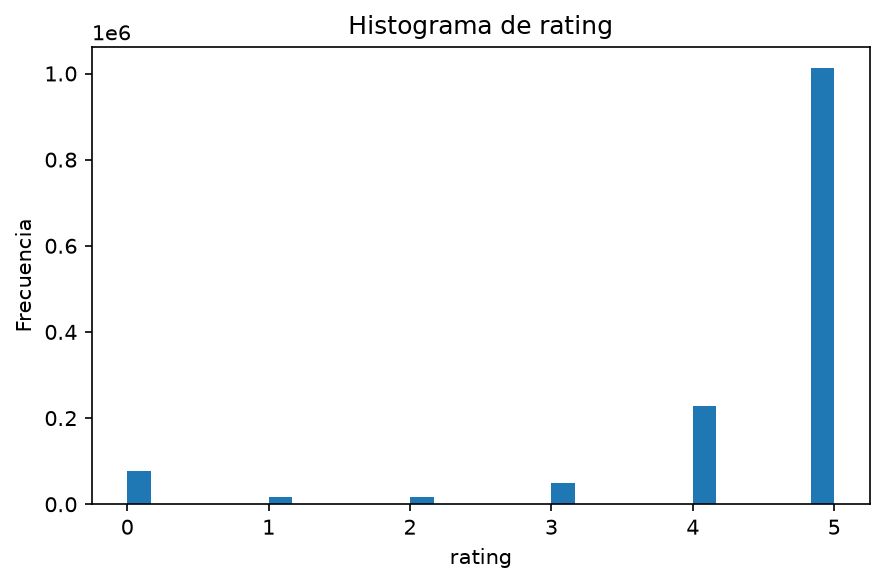
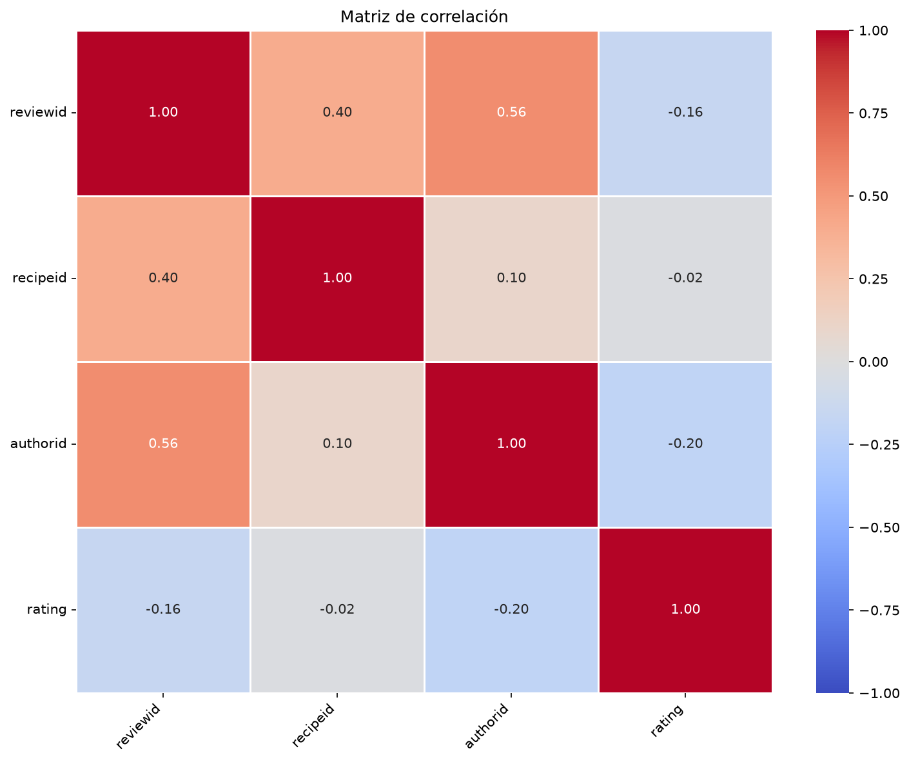

# Inspección visual del dataset

Generado: 2026-10-26_11-29-48_283477. Esta versión reemplaza el informe anterior.

```text
reviews
```

## Dimensiones

1.401.982 filas y 8 columnas.

## Columnas y tipos

Cantidad de columnas: 8

```text
reviewid, recipeid, authorid, authorname, rating, review, datesubmitted,
datemodified
```

Tipos de datos:

```text
reviewid                       int32
recipeid                       int32
authorid                       int32
authorname                    object
rating                         int32
review                        object
datesubmitted    datetime64[us, UTC]
datemodified     datetime64[us, UTC]
```

## Cardinalidad

Cantidad de valores distintos no nulos por columna. Los arrays y listas se cuentan como combinaciones completas.

```text
reviewid         1401982
review           1387058
datesubmitted    1384268
datemodified     1384268
authorid          271907
recipeid          271678
authorname        237640
rating                 6
```

## Valores nulos

Se cuentan celdas nulas; no los valores nulos dentro de arrays o listas.

```text
               Nulos  Porcentaje (%)
reviewid           0             0.0
recipeid           0             0.0
authorid           0             0.0
authorname         0             0.0
rating             0             0.0
review             0             0.0
datesubmitted      0             0.0
datemodified       0             0.0
```

## Duplicados

Total de filas duplicadas después de la primera aparición: 0 (0.00%).

```text
               Valores distintos no nulos  Registros  Porcentaje (%)
reviewid                          1401982    1401982          100.00
recipeid                           271678    1401982           19.38
authorid                           271907    1401982           19.39
authorname                         237640    1401982           16.95
rating                                  6    1401982            0.00
review                            1387058    1401982           98.94
datesubmitted                     1384268    1401982           98.74
datemodified                      1384268    1401982           98.74
```

## Primeras filas

```text
  reviewid recipeid authorid        authorname rating                                                                                                            review              datesubmitted               datemodified
0        2      992     2008         gayg msft      5                                                                       better than any you can get at a restaurant  2000-01-25 21:44:00+00:00  2000-01-25 21:44:00+00:00
1        7     4384     1634     bill hilbrich      4              i cut back on the mayo and made up the difference with sour cream to adjust the stiffness of the dip  2001-10-17 16:49:59+00:00  2001-10-17 16:49:59+00:00
2        9     4523     2046  gay gilmore ckpt      2                        i think i did something wrong because i could taste the cornstarch in the finished product  2000-02-25 09:00:00+00:00  2000-02-25 09:00:00+00:00
3       13     7435     1773     malarkey test      5  easily the best i have ever had juicy flavorful not dry the vegetables retain crispness as well not bland at all  2000-03-13 21:15:00+00:00  2000-03-13 21:15:00+00:00
4       14       44     2085        tony small      5                                                                                                 an excellent dish  2000-03-28 12:51:00+00:00  2000-03-28 12:51:00+00:00
```

## Información

```text
<class 'pandas.core.frame.DataFrame'>
RangeIndex: 1401982 entries, 0 to 1401981
Data columns (total 8 columns):
 #   Column         Non-Null Count    Dtype              
---  ------         --------------    -----              
 0   reviewid       1401982 non-null  int32              
 1   recipeid       1401982 non-null  int32              
 2   authorid       1401982 non-null  int32              
 3   authorname     1401982 non-null  object             
 4   rating         1401982 non-null  int32              
 5   review         1401982 non-null  object             
 6   datesubmitted  1401982 non-null  datetime64[us, UTC]
 7   datemodified   1401982 non-null  datetime64[us, UTC]
dtypes: datetime64[us, UTC](2), int32(4), object(2)
memory usage: 64.2+ MB
```

## Estadísticas descriptivas

En columnas con arrays o listas, los conteos y frecuencias corresponden a combinaciones completas.

```text
            reviewid      recipeid      authorid   authorname        rating     review                     datesubmitted                      datemodified
count   1.401982e+06  1.401982e+06  1.401982e+06      1401982  1.401982e+06    1401982                           1401982                           1401982
unique           NaN           NaN           NaN       237640           NaN    1387058                               NaN                               NaN
top              NaN           NaN           NaN  sydney mike           NaN  delicious                               NaN                               NaN
freq             NaN           NaN           NaN         8842           NaN        805                               NaN                               NaN
mean    8.179739e+05  1.526412e+05  1.558638e+08          NaN  4.407951e+00        NaN  2009-06-06 15:32:03.048556+00:00  2009-06-06 15:32:03.048556+00:00
min     2.000000e+00  3.800000e+01  1.533000e+03          NaN  0.000000e+00        NaN         2000-01-25 21:44:00+00:00         2000-01-25 21:44:00+00:00
25%     3.743862e+05  4.703875e+04  1.336800e+05          NaN  4.000000e+00        NaN  2007-02-13 10:12:46.750000+00:00  2007-02-13 10:12:46.750000+00:00
50%     7.717805e+05  1.093270e+05  3.305450e+05          NaN  5.000000e+00        NaN  2008-12-20 01:44:29.500000+00:00  2008-12-20 01:44:29.500000+00:00
75%     1.204126e+06  2.318768e+05  8.183590e+05          NaN  5.000000e+00        NaN  2011-03-21 18:43:50.750000+00:00  2011-03-21 18:43:50.750000+00:00
max     2.090347e+06  5.412980e+05  2.002902e+09          NaN  5.000000e+00        NaN         2020-12-28 03:23:48+00:00         2020-12-28 03:23:48+00:00
std     5.280821e+05  1.301112e+05  5.305111e+08          NaN  1.272012e+00        NaN                               NaN                               NaN
```

## Histogramas numéricos

```text
Columna: reviewid
```



```text
Columna: recipeid
```



```text
Columna: authorid
```



```text
Columna: rating
```



## Matriz de correlación



