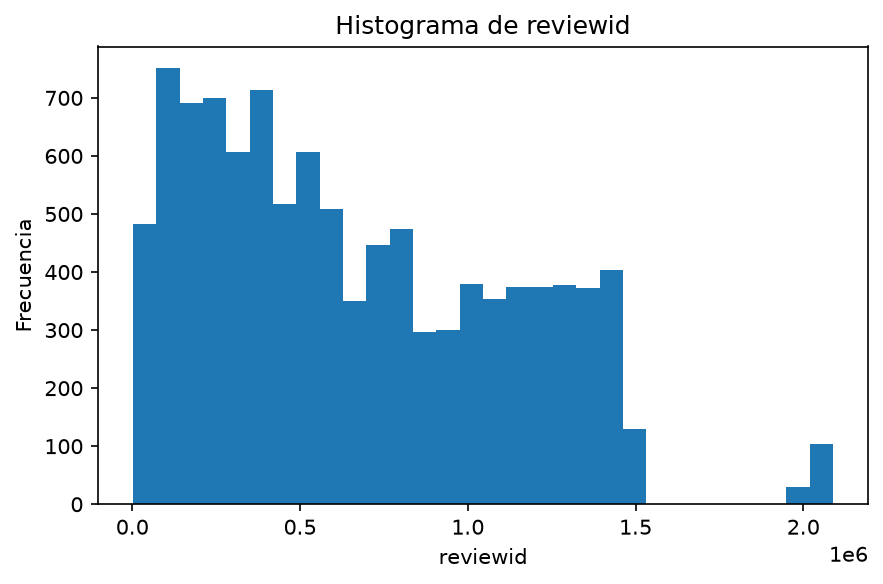
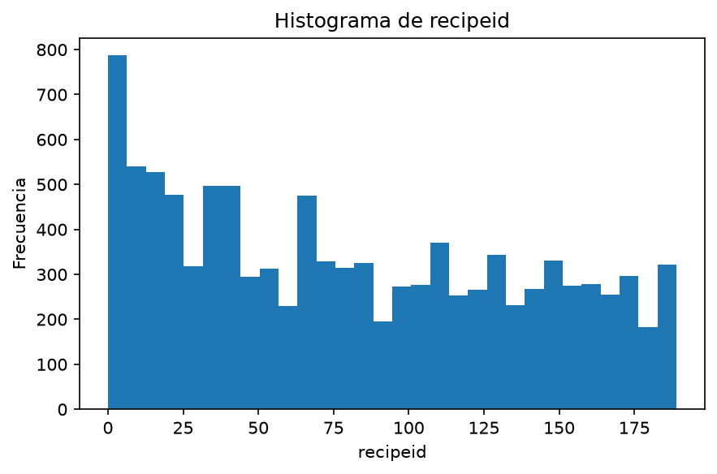
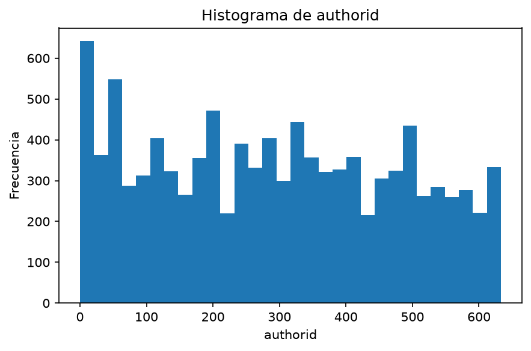
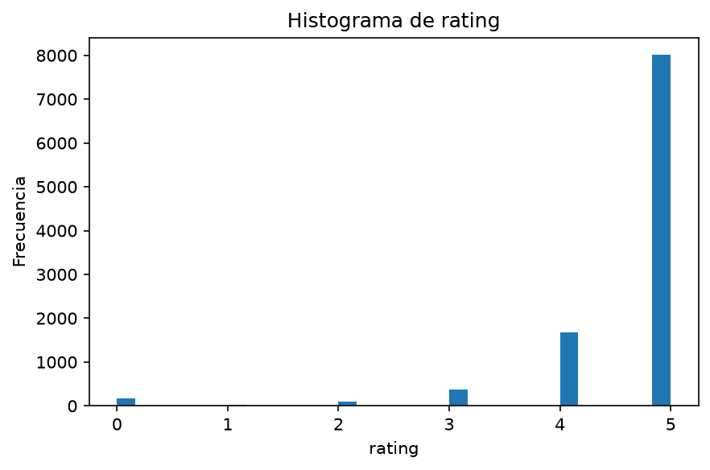
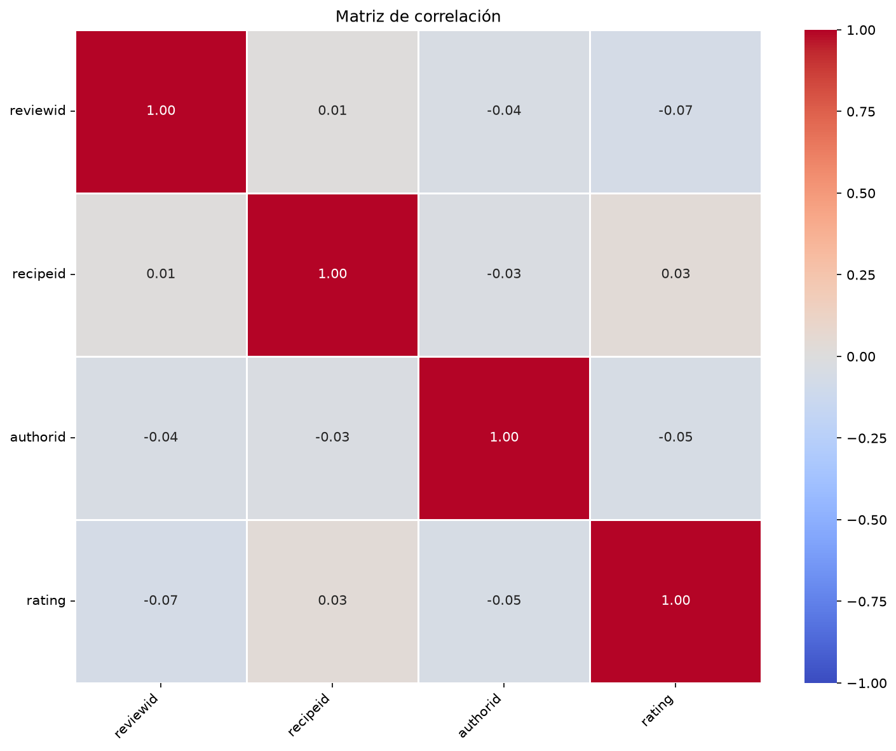

# Inspección visual del dataset

Generado: 2026-10-26_11-30-13_335986. Esta versión reemplaza el informe anterior.

```text
reviews_filtrado
```

## Dimensiones

10.343 filas y 8 columnas.

## Columnas y tipos

Cantidad de columnas: 8

```text
reviewid, recipeid, authorid, authorname, rating, review, datesubmitted,
datemodified
```

Tipos de datos:

```text
reviewid                       int32
recipeid                       int16
authorid                       int16
authorname                    object
rating                         int32
review                        object
datesubmitted    datetime64[us, UTC]
datemodified     datetime64[us, UTC]
```

## Cardinalidad

Cantidad de valores distintos no nulos por columna. Los arrays y listas se cuentan como combinaciones completas.

```text
reviewid         10343
datemodified     10337
datesubmitted    10337
review           10313
authorid           617
authorname         616
recipeid           190
rating               6
```

## Valores nulos

Se cuentan celdas nulas; no los valores nulos dentro de arrays o listas.

```text
               Nulos  Porcentaje (%)
reviewid           0             0.0
recipeid           0             0.0
authorid           0             0.0
authorname         0             0.0
rating             0             0.0
review             0             0.0
datesubmitted      0             0.0
datemodified       0             0.0
```

## Duplicados

Total de filas duplicadas después de la primera aparición: 0 (0.00%).

```text
               Valores distintos no nulos  Registros  Porcentaje (%)
reviewid                            10343      10343          100.00
recipeid                              190      10343            1.84
authorid                              617      10343            5.97
authorname                            616      10343            5.96
rating                                  6      10343            0.06
review                              10313      10343           99.71
datesubmitted                       10337      10343           99.94
datemodified                        10337      10343           99.94
```

## Primeras filas

```text
     reviewid recipeid authorid authorname rating                                                                                                                                                                                                                                                                               review              datesubmitted               datemodified
1068     1771      158       11      bergy      5                                                                                                                                                                                           i dont know if i enjoyed the quacamole or the intro to this recipe the most both are great  2001-07-24 11:38:40+00:00  2001-07-24 11:38:40+00:00
1582     3240      158       65   evie3234      5                                                                                                                                                                                                                        the chips were warm the beer was cold the guacamole was great  2001-09-07 10:20:44+00:00  2001-09-07 10:20:44+00:00
1723     3620        1       65   evie3234      5                                                                                                                                                                                                                              the smell of this when its in the ovenwowthis is delish  2001-09-17 10:05:17+00:00  2001-09-17 10:05:17+00:00
2638     4882       65      106   mirj2338      5  we dont eat pork but the sauce sounded heavenly i made the sauce and cooked two chickens cut into 8 portions each for 1 hour covered and then 12 an hour uncovered basting every 10 minutes it came out great and what little that was left over tasted wonderful the next day cold  2001-10-31 11:15:18+00:00  2001-10-31 11:15:18+00:00
2705     4961       96       65   evie3234      5                                                                                                                                                                                                           these are a great cookie smell delicious in the oven and taste even better  2001-11-03 12:03:10+00:00  2001-11-03 12:03:10+00:00
```

## Información

```text
<class 'pandas.core.frame.DataFrame'>
Index: 10343 entries, 1068 to 1400282
Data columns (total 8 columns):
 #   Column         Non-Null Count  Dtype              
---  ------         --------------  -----              
 0   reviewid       10343 non-null  int32              
 1   recipeid       10343 non-null  int16              
 2   authorid       10343 non-null  int16              
 3   authorname     10343 non-null  object             
 4   rating         10343 non-null  int32              
 5   review         10343 non-null  object             
 6   datesubmitted  10343 non-null  datetime64[us, UTC]
 7   datemodified   10343 non-null  datetime64[us, UTC]
dtypes: datetime64[us, UTC](2), int16(2), int32(2), object(2)
memory usage: 525.2+ KB
```

## Estadísticas descriptivas

En columnas con arrays o listas, los conteos y frecuencias corresponden a combinaciones completas.

```text
            reviewid      recipeid      authorid   authorname        rating     review                     datesubmitted                      datemodified
count   1.034300e+04  10343.000000  10343.000000        10343  10343.000000      10343                             10343                             10343
unique           NaN           NaN           NaN          616           NaN      10313                               NaN                               NaN
top              NaN           NaN           NaN  mommyoffour           NaN  delicious                               NaN                               NaN
freq             NaN           NaN           NaN          167           NaN          8                               NaN                               NaN
mean    6.648913e+05     81.018370    292.588321          NaN      4.648555        NaN  2008-05-25 09:31:20.914241+00:00  2008-05-25 09:31:20.914241+00:00
min     1.771000e+03      0.000000      0.000000          NaN      0.000000        NaN         2001-07-24 11:38:40+00:00         2001-07-24 11:38:40+00:00
25%     2.754635e+05     30.000000    128.000000          NaN      5.000000        NaN  2006-05-21 17:00:13.500000+00:00  2006-05-21 17:00:13.500000+00:00
50%     5.680540e+05     74.000000    292.000000          NaN      5.000000        NaN         2008-01-24 21:04:57+00:00         2008-01-24 21:04:57+00:00
75%     1.031521e+06    130.000000    451.000000          NaN      5.000000        NaN         2010-01-12 10:07:18+00:00         2010-01-12 10:07:18+00:00
max     2.088500e+06    189.000000    633.000000          NaN      5.000000        NaN         2020-11-27 03:46:16+00:00         2020-11-27 03:46:16+00:00
std     4.549203e+05     56.824269    184.209535          NaN      0.839665        NaN                               NaN                               NaN
```

## Histogramas numéricos

```text
Columna: reviewid
```



```text
Columna: recipeid
```



```text
Columna: authorid
```



```text
Columna: rating
```



## Matriz de correlación



