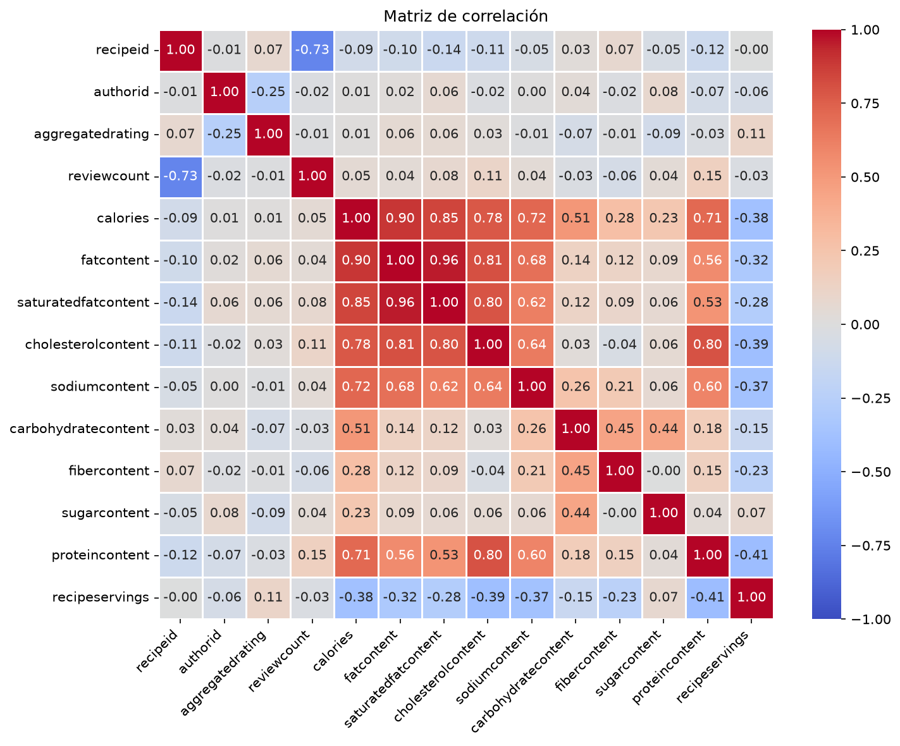

# Informe integral · SmartFood

Generado: 2026-10-26T14:30:29.860138+00:00 (UTC).

Estado del informe: **Evidencia disponible**. Estado del último maestro: **completado**.

Este documento reúne los archivos guardados; no ejecuta modelos ni certifica su utilidad. Las fechas y huellas del manifiesto permiten revisar su procedencia.

## Objetivo y configuración

SmartFood es un proyecto de ciencia de datos que explora cómo recomendar recetas a partir del historial de usuarios y del contenido del catálogo. Compara un baseline interpretable por perfil, un enfoque colaborativo con factores latentes y un clasificador de valoraciones positivas utilizado para ranking.

## Datos y preparación

Indicadores de [preparacion.json](../../reports/preparacion/preparacion.json):

| Indicador | Valor |
| --- | --- |
| recetas | 522517 |
| reviews | 1401982 |
| columnas_recetas | 28 |
| columnas_reviews | 8 |

La preparación guarda 522,517 recetas y 1,401,982 reseñas en data/intermediate. Las cifras describen los datos preparados y no una evaluación de modelos.

[Reporte de la etapa](../../reports/preparacion/preparacion.md).

## Hallazgos exploratorios

Indicadores de [metricas_eda.json](../../reports/eda/metricas_eda.json):

| Indicador | Valor |
| --- | --- |
| umbral | 270 |
| originales / recetas | 522517 |
| originales / filas_catalogo | 522517 |
| originales / reviews | 1401982 |
| originales / usuarios | 271907 |
| originales / items | 271678 |
| originales / pares | 1401982 |
| originales / pares_repetidos | 0 |
| originales / esparsidad | 99.9981 |
| originales / rating_5 | 72.1894 |
| originales / rating_0 | 5.43859 |
| originales / rating_positivo | 88.5389 |
| originales / nulos_reviews_claves | 0 |
| originales / items_fuera_catalogo | 19 |
| originales / calorias / count | 522517 |
| originales / calorias / mean | 484.439 |
| originales / calorias / std | 1397.12 |
| originales / calorias / min | 0 |
| originales / calorias / 25% | 174.2 |
| originales / calorias / 50% | 317.1 |
| originales / calorias / 75% | 529.1 |
| originales / calorias / max | 612855 |
| originales / rating_agregado / count | 269294 |
| originales / rating_agregado / mean | 4.63201 |

El archivo enlazado contiene el detalle restante.

##### Interpretación del catálogo de recetas

Hay **522.517 recetas distintas** en **522.517 filas**. Entre los **269.294 ratings agregados disponibles**, la mediana es **5,00**, la media **4,632** y la desviación estándar **0,642**.

Porcentaje de nulos: `aggregatedrating`: **48,46 %**; `reviewcount`: **47,36 %**; `recipeyield`: **66,61 %**; `recipeservings`: **35,01 %**.

Las calorías tienen mediana **317,10**, media **484,44** y máximo **612.854,6**. Los extremos requieren revisar unidades y procedencia.

Las cifras anteriores no validan cardinalidad ni redundancia de columnas con listas; revisa los errores del diagnóstico precedente. Seleccionar solo `int64/float64` tampoco incluye todos los tipos numéricos. El rating agregado difiere de una valoración individual y su uso requiere revisar la disponibilidad temporal.

##### Interpretación de las reseñas

Hay **1.401.982 reseñas**, **271.907 usuarios** y **271.678 recetas evaluadas**. El **72,19 %** de los ratings es 5 y el **5,44 %** es 0.

La esparsidad es **99,9981 %**, calculada con **1.401.982 pares únicos**. Los ceros cuentan como interacciones registradas; excluirlos cambia la definición de observación.

Se detectan **0 filas adicionales con pares usuario–receta repetidos**, **0 valores nulos** en usuario, receta o rating y **19 pares** cuya receta no aparece en el catálogo. Estos controles no validan semánticamente todos los campos.

Debe definirse el significado de rating cero y comparar modelos con baselines. La esparsidad no demuestra que NMF sea adecuado; centrar ratings puede generar negativos incompatibles con NMF. Los ingredientes necesitan preparación para TF-IDF y los IDs recodificados requieren mapeos persistidos.

##### Alcance del diagnóstico de viabilidad

`evaluar_viabilidad_modelo_general` aplica umbrales heurísticos, no valida desempeño. «Varianza aceptable» solo comprueba si la clase dominante está por debajo del 90 %; «Target con más de dos clases» describe el rating original, aunque el SVM usa `rating >= 4`.

Una matriz densa float64 de los usuarios y recetas observados ocuparía **590,97 GB** (unidades decimales), sin copias ni objetos adicionales. Conviene evaluar estructuras dispersas y documentar el muestreo.

##### Historial de usuarios

Para **271.907 usuarios con pares registrados**, la mediana es **1,00**, el tercer cuartil **2,00**, la media **5,16**, la desviación estándar **53,47** y el máximo **8.842**. Se cuentan recetas distintas por usuario y usuarios distintos por receta.

El catálogo contiene **522.517 recetas distintas**; las recetas sin reseñas no participan en la distribución de historiales. Un historial escaso limita la personalización; no demuestra ruido ni justifica excluir entidades sin evaluar cobertura y cold start.

##### Historial de recetas

Para **271.678 recetas con pares registrados**, la mediana es **2,00**, el tercer cuartil **4,00**, la media **5,16**, la desviación estándar **19,71** y el máximo **2.892**. Se cuentan recetas distintas por usuario y usuarios distintos por receta.

El catálogo contiene **522.517 recetas distintas**; las recetas sin reseñas no participan en la distribución de historiales. Un historial escaso limita la personalización; no demuestra ruido ni justifica excluir entidades sin evaluar cobertura y cold start.

##### Elección exploratoria del umbral

Se aplica el umbral **270** a los conteos originales antes de intersectar usuarios y recetas. No se ha demostrado que optimice error o ranking.

El resultado contiene **617 usuarios**, **190 recetas del catálogo** (**190 con reseñas**) y **10.343 reseñas**. Conserva el **0,227 %** de los usuarios observados, el **0,0364 %** del catálogo y el **0,738 %** de las reseñas.

Los mínimos finales de interacciones distintas son **1 por usuario** y **1 por receta observada**. El umbral previo no garantiza ese mínimo en el resultado. Las recetas del catálogo sin interacciones quedan fuera de estos mínimos. La cobertura no acredita representatividad.

##### Interpretación de las recetas filtradas

Hay **190 recetas distintas** en **190 filas**. Entre los **190 ratings agregados disponibles**, la mediana es **5,00**, la media **4,934** y la desviación estándar **0,191**.

Porcentaje de nulos: `aggregatedrating`: **0,00 %**; `reviewcount`: **0,00 %**; `recipeyield`: **67,37 %**; `recipeservings`: **40,00 %**.

Las calorías tienen mediana **322,95**, media **402,50** y máximo **3.343,8**. Los extremos requieren revisar unidades y procedencia.

La desviación estándar de `aggregatedrating` pasa de **0,642 a 0,191**. El **88,42 %** del catálogo filtrado tiene rating agregado 5. Estos cambios describen la selección; no demuestran mejora predictiva ni corrección de errores.

Las cifras anteriores no validan cardinalidad ni redundancia de columnas con listas; revisa los errores del diagnóstico precedente. Seleccionar solo `int64/float64` tampoco incluye todos los tipos numéricos. El rating agregado difiere de una valoración individual y su uso requiere revisar la disponibilidad temporal.

##### Correlación: `calories` y `proteincontent`

Método: **pearson**; **190 pares válidos**; **0 filas excluidas**.

El coeficiente es **0,713**: asociación **positiva, muy fuerte**, según los cortes descriptivos del proyecto para |r|: **0,10, 0,30, 0,50, 0,70**. Se clasifica con el coeficiente sin redondear; estos cortes son configurables, no universales. La magnitud no prueba significancia estadística, causalidad ni capacidad predictiva. Pearson describe asociación lineal y puede ser sensible a extremos; Spearman describe asociación monótona. Revisa también el gráfico, las unidades y la selección de datos.

##### Correlación: `calories` y `proteincontent`

Método: **spearman**; **190 pares válidos**; **0 filas excluidas**.

El coeficiente es **0,797**: asociación **positiva, muy fuerte**, según los cortes descriptivos del proyecto para |r|: **0,10, 0,30, 0,50, 0,70**. Se clasifica con el coeficiente sin redondear; estos cortes son configurables, no universales. La magnitud no prueba significancia estadística, causalidad ni capacidad predictiva. Pearson describe asociación lineal y puede ser sensible a extremos; Spearman describe asociación monótona. Revisa también el gráfico, las unidades y la selección de datos.

##### Interpretación de las reseñas filtradas

Hay **10.343 reseñas**, **617 usuarios** y **190 recetas evaluadas**. El **77,43 %** de los ratings es 5 y el **1,62 %** es 0.

La esparsidad es **91,1772 %**, calculada con **10.343 pares únicos**. Los ceros cuentan como interacciones registradas; excluirlos cambia la definición de observación.

Se detectan **0 filas adicionales con pares usuario–receta repetidos**, **0 valores nulos** en usuario, receta o rating y **0 pares** cuya receta no aparece en el catálogo. Estos controles no validan semánticamente todos los campos.

Antes del filtro, los ratings 5 representaban **72,19 %** y los ceros **5,44 %**. El target `rating >= 4` sería positivo en el **93,61 %** del subconjunto. Ese porcentaje sería la accuracy de predecir siempre positivo sobre este conjunto, no una evaluación del SVM.

Debe definirse el significado de rating cero y comparar modelos con baselines. La esparsidad no demuestra que NMF sea adecuado; centrar ratings puede generar negativos incompatibles con NMF. Los ingredientes necesitan preparación para TF-IDF y los IDs recodificados requieren mapeos persistidos.

[Reporte de la etapa](../../reports/eda/conclusiones_eda.md).

## Baseline

Indicadores de [baseline.json](../../reports/baseline/baseline.json):

| Indicador | Valor |
| --- | --- |
| top_n_solicitado | 5 |
| recetas_devueltas | 5 |

##### Resultado del baseline

Se solicitaron **5** recetas y se devolvieron **5**. La lista alcanza la cantidad solicitada. En este baseline se excluyen recetas vistas, candidatos con datos requeridos faltantes y categorías distintas de la más frecuente. La distancia calórica solo ordena; completar la lista no demuestra relevancia ni calidad nutricional.

[Reporte de la etapa](../../reports/baseline/baseline.md).

## Modelo y selección

Indicadores de [modelado.json](../../reports/modelado/modelado.json):

| Indicador | Valor |
| --- | --- |
| componentes_seleccionados | 70 |

##### Interpretación del grid NMF

El menor RMSE es **4,1996**, con **10 componentes**. La configuración seleccionada (70 componentes, RMSE 4,4884) no minimiza el error del grid. Este resultado compara las configuraciones evaluadas; no determina un óptimo universal. El grid reutiliza las interacciones ocultas: hace falta un test independiente y baselines. El RMSE de reconstrucción no mide la calidad del ranking por vecinos.

[Reporte de la etapa](../../reports/modelado/modelado.md).

## Evaluación y conclusiones

Indicadores de [evaluacion.json](../../reports/evaluacion/evaluacion.json):

| Indicador | Valor |
| --- | --- |
| casos | 2065 |
| baseline / accuracy | 0.938015 |
| modelo / accuracy | 0.938015 |
| modelo / f1_macro | 0.484008 |

##### Interpretación de clasificación

Accuracy: **93,80 %** sobre **2.065 casos**. El baseline constante de la clase mayoritaria de entrenamiento (**1**) obtiene **93,80 %** en el mismo test: el modelo iguala ese baseline en accuracy. Todas las predicciones pertenecen a la clase **1**.

Recall por clase: clase 0: **0,00 %** (128 casos); clase 1: **100,00 %** (1.937 casos). Si una clase no aparece en test, su recall no está definido. Revisa también F1 macro y la matriz de confusión; accuracy por sí sola no acredita discriminación. La comparación no mide calidad de ranking ni personalización: el clasificador utiliza atributos de receta.

[Reporte de la etapa](../../reports/evaluacion/evaluacion.md).

## Alertas y estado de ejecución

| Notebook | Tipos de aviso registrados |
| --- | --- |
| 00_configuracion_entorno | 0 |
| 01_preparacion_datos | 0 |
| 02_analisis_exploratorio | 0 |
| 03_baseline_perfil_usuario | 0 |
| 04_filtrado_colaborativo_nmf | 0 |
| 05_clasificacion_ranking_svm | 0 |

Una tabla vacía de warnings no demuestra ausencia de errores o validez del modelo. Consulta [alertas](../alertas/) y [resumen del maestro](../ejecucion/resumen.json).

| Notebook | Celdas ejecutadas guardadas | Última ejecución UTC | Errores guardados |
| --- | --- | --- | --- |
| 01_preparacion_datos.ipynb | 7/7 | 2026-10-26T14:29:24.885446Z | 0 |
| 02_analisis_exploratorio.ipynb | 32/32 | 2026-10-26T14:30:15.788327Z | 0 |
| 03_baseline_perfil_usuario.ipynb | 6/6 | 2026-10-26T14:30:17.864775Z | 0 |
| 04_filtrado_colaborativo_nmf.ipynb | 19/19 | 2026-10-26T14:30:26.044133Z | 0 |
| 05_clasificacion_ranking_svm.ipynb | 22/22 | 2026-10-26T14:30:29.206414Z | 0 |

## Limitaciones y próximos pasos

Las tareas de reconstrucción, clasificación y ranking tienen protocolos distintos. La accuracy no demuestra personalización. Revisa la disponibilidad temporal de aggregatedrating y reserva validación y test para seleccionar parámetros.

- Comprobar procedencia, condiciones de uso y disponibilidad temporal de las variables.
- Completar una pasada de 06 y revisar las alertas antes de publicar el informe.
- Definir relevancia y candidatos, y evaluar ranking con usuarios o interacciones independientes.

## Evidencia y reproducción

Desde la carpeta de este proyecto, ejecuta `python scripts/generate_report.py` para reunir los resultados guardados, o 06 para ejecutar los análisis y actualizar el informe.

Consulta el [README](../../README.md), la [guía del informe](../../docs/informe_final.md) y el [manifiesto con datos y huellas](informe_final.json). El informe conserva una versión vigente por proyecto.
