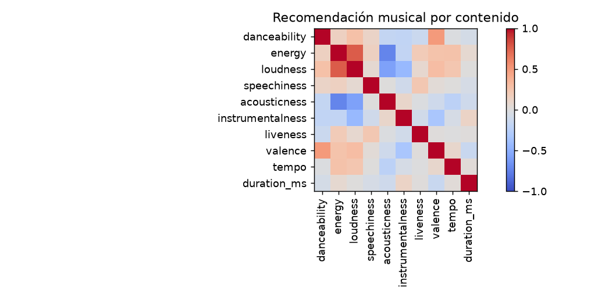

# Informe integral · Recomendación musical por contenido

Generado: 2026-10-07T16:39:29.647446+00:00 (UTC).

Estado del informe: **Resultados actualizados por etapas**. Estado del último maestro: **completado**.

Este documento reúne los archivos guardados; no ejecuta modelos ni certifica su utilidad. Las fechas y huellas del manifiesto permiten revisar su procedencia.

Hay archivos de resultados o notebooks actualizados después de la última ejecución completa del maestro. Los resultados corresponden a actualizaciones por etapa; ejecuta 06 para cerrar una nueva pasada completa.

## Objetivo y configuración

Recomendar canciones parecidas a una canción elegida usando sus características musicales.

| Indicador | Valor |
| --- | --- |
| title | Recomendación musical por contenido |
| kind | music_content |
| source | data/raw/Spotify Tracks Dataset.zip |
| seed | 42 |
| top_n | 10 |
| source_base | project |

## Datos y preparación

Indicadores de [preparacion.json](../../reports/preparacion/preparacion.json):

| Indicador | Valor |
| --- | --- |
| fuente | Spotify Tracks Dataset.zip |
| semilla | 42 |
| filas_originales | 114000 |
| duplicados_track_id | 24259 |
| filas_preparadas | 89741 |

### Recomendación musical por contenido: preparacion

Se prepararon **89,741 registros**. La fuente y sus huellas se registran en el JSON. Esta etapa construye un catálogo o una población descriptiva; no implica una evaluación supervisada.

[Reporte de la etapa](../../reports/preparacion/preparacion.md).

## Hallazgos exploratorios

Indicadores de [eda.json](../../reports/eda/eda.json):

| Indicador | Valor |
| --- | --- |
| poblacion | catalogo |
| filas | 89741 |
| columnas | 20 |
| nulos / track_id | 0 |
| nulos / artists | 1 |
| nulos / album_name | 1 |
| nulos / track_name | 1 |
| nulos / popularity | 0 |
| nulos / duration_ms | 0 |
| nulos / explicit | 0 |
| nulos / danceability | 0 |
| nulos / energy | 0 |
| nulos / key | 0 |
| nulos / loudness | 0 |
| nulos / mode | 0 |
| nulos / speechiness | 0 |
| nulos / acousticness | 0 |
| nulos / instrumentalness | 0 |
| nulos / liveness | 0 |
| nulos / valence | 0 |
| nulos / tempo | 0 |
| nulos / time_signature | 0 |
| nulos / track_genre | 0 |
| correlacion_destacada / pearson | 0.758774 |

El archivo enlazado contiene el detalle restante.

### Recomendación musical por contenido: eda

El análisis utiliza **89,741 registros de catalogo**, con **3 valores ausentes**. La mayor correlación absoluta es energy / loudness: **r=0.759**, asociación alta según los umbrales descriptivos del proyecto. No demuestra causalidad ni significancia estadística.

[Reporte de la etapa](../../reports/eda/eda.md).

## Baseline

Indicadores de [baseline.json](../../reports/baseline/baseline.json):

| Indicador | Valor |
| --- | --- |
| regla | popularity |
| catalogo | 89741 |

### Recomendación musical por contenido: baseline

El baseline ordena el catálogo por **popularity** y excluye el título consultado. No utiliza interacciones de usuarios.

[Reporte de la etapa](../../reports/baseline/baseline.md).

## Modelo y selección

Indicadores de [modelado.json](../../reports/modelado/modelado.json):

| Indicador | Valor |
| --- | --- |
| filas | 89741 |
| features | 10 |
| metrica | cosine |

### Recomendación musical por contenido: modelado

Se construyó un índice de **89,741 elementos** con **10 características**. El ajuste usa el catálogo disponible y mide similitud de contenido; no implica aprendizaje de preferencias ni accuracy predictiva.

[Reporte de la etapa](../../reports/modelado/modelado.md).

## Evaluación y conclusiones

Indicadores de [evaluacion.json](../../reports/evaluacion/evaluacion.json):

| Indicador | Valor |
| --- | --- |
| baseline / consultas | 30 |
| baseline / top_n_solicitado | 10 |
| baseline / cobertura_catalogo | 0.000111432 |
| baseline / categorias_distintas_promedio | 4 |
| baseline / coincidencia_categoria_descriptiva | 0.0133333 |
| modelo / consultas | 30 |
| modelo / top_n_solicitado | 10 |
| modelo / cobertura_catalogo | 0.00334295 |
| modelo / categorias_distintas_promedio | 7.56667 |
| modelo / coincidencia_categoria_descriptiva | 0.09 |
| limite | Sin interacciones ni juicios independientes de relevancia. La coincidencia de categoría no es accuracy ni satisfacción. |

### Recomendación musical por contenido: evaluacion

Se revisaron **30 consultas** con top 10. La cobertura del catálogo fue **0.33%**. Esta cifra depende de las consultas muestreadas. Sin interacciones ni juicios independientes de relevancia. La coincidencia de categoría no es accuracy ni satisfacción.

Si el catálogo tiene menos candidatos que el top solicitado, se devuelven los disponibles; se excluye la consulta y los IDs ya se deduplicaron durante preparación.

[Reporte de la etapa](../../reports/evaluacion/evaluacion.md).

### Comparación automática

La coincidencia de categorías y la cobertura son diagnósticos descriptivos; no demuestran satisfacción ni relevancia personal.

## Alertas y estado de ejecución

| Notebook | Tipos de aviso registrados |
| --- | --- |
| 00_configuracion_entorno | 0 |
| 01_preparacion_datos | 0 |
| 02_analisis_exploratorio | 0 |
| 03_baseline | 0 |
| 04_modelado | 0 |
| 05_evaluacion | 0 |
| 06_ejecucion_completa | 1 |

| Notebook | Tipo | Apariciones | Significado | Acción sugerida |
| --- | --- | --- | --- | --- |
| 06_ejecucion_completa | DeprecationWarning | 5 | Se está utilizando una función o comportamiento en retirada. | Consultar la alternativa indicada antes de actualizar dependencias. |

Una tabla vacía de warnings no demuestra ausencia de errores o validez del modelo. Consulta [alertas](../alertas/) y [resumen del maestro](../ejecucion/resumen.json).

| Notebook | Celdas ejecutadas guardadas | Última ejecución UTC | Errores guardados |
| --- | --- | --- | --- |
| 01_preparacion_datos.ipynb | 0/3 | No disponible | 0 |
| 02_analisis_exploratorio.ipynb | 2/3 | 2026-10-07T14:25:32.722785Z | 0 |
| 03_baseline.ipynb | 0/3 | No disponible | 0 |
| 04_modelado.ipynb | 0/3 | No disponible | 0 |
| 05_evaluacion.ipynb | 2/3 | 2026-10-07T14:25:36.562178Z | 0 |

## Limitaciones y próximos pasos

No hay interacciones ni relevancia personal para evaluar satisfacción. Similitud de contenido no implica preferencias aprendidas.

- Comprobar procedencia, condiciones de uso y disponibilidad temporal de las variables.
- Completar una pasada de 06 y revisar las alertas antes de publicar el informe.
- Definir relevancia y candidatos, y evaluar ranking con usuarios o interacciones independientes.

## Evidencia y reproducción

Desde la carpeta de este proyecto, ejecuta `python scripts/generate_report.py` para reunir los resultados guardados, o 06 para ejecutar los análisis y actualizar el informe.

Consulta el [README](../../README.md), la [guía del informe](../../docs/informe_final.md) y el [manifiesto con datos y huellas](informe_final.json). El informe conserva una versión vigente por proyecto.
