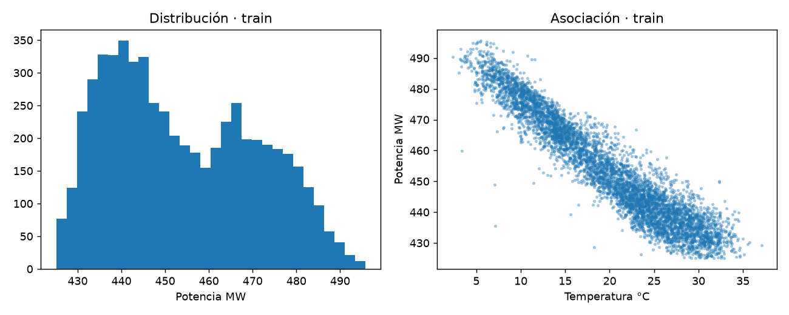
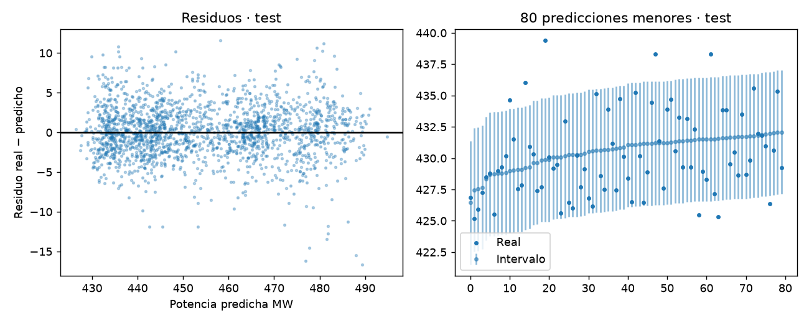

# Informe integral · Regresión de potencia eléctrica

Generado: 2026-10-26T14:18:15.376492+00:00 (UTC).

Estado del informe: **Evidencia disponible**. Estado del último maestro: **completado**.

Este documento reúne los archivos guardados; no ejecuta modelos ni certifica su utilidad. Las fechas y huellas del manifiesto permiten revisar su procedencia.

## Objetivo y configuración

Predecir la potencia eléctrica de una central a partir de sus condiciones contemporáneas, con selección del modelo e intervalos de predicción calibrados por separado.

| Indicador | Valor |
| --- | --- |
| title | Regresión de potencia eléctrica |
| kind | regression |
| seed | 42 |
| source_base | project |
| source | data/raw/CCPP.zip |
| interval_alpha | 0.1 |

## Datos y preparación

Indicadores de [preparacion.json](../../reports/preparacion/preparacion.json):

| Indicador | Valor |
| --- | --- |
| fuente | https://archive.ics.uci.edu/dataset/294/combined+cycle+power+plant |
| hoja_utilizada | Sheet1 |
| filas_hoja | 9568 |
| duplicados_exactos_retirados | 41 |
| objetivo_unidad | Potencia eléctrica PE en MW |
| particiones / train / filas | 5716 |
| particiones / valid / filas | 952 |
| particiones / calibration / filas | 953 |
| particiones / test / filas | 1906 |

### Regresión de potencia eléctrica: preparacion

Se utiliza **solo la primera hoja (Sheet1)**: las otras hojas son reordenamientos del mismo conjunto, no observaciones independientes. Se retiran **41 duplicados exactos** y se agrupan condiciones idénticas de entrada para que no crucen particiones. Separación aproximada por grupos: **60 % train, 10 % validación, 10 % calibración y 20 % test**. Objetivo: potencia eléctrica en **MW**. No se dispone de fecha para validar un pronóstico temporal.

[Reporte de la etapa](../../reports/preparacion/preparacion.md).

## Hallazgos exploratorios

Indicadores de [eda.json](../../reports/eda/eda.json):

| Indicador | Valor |
| --- | --- |
| filas_train | 5716 |
| potencia_media_mw | 453.926 |
| correlacion_temperatura_potencia | -0.948434 |
| criterios_correlacion | \\|r\\| >=0.7 fuerte; >=0.4 moderada; resto débil; criterio descriptivo |
| vif / AT | 6.06849 |
| vif / V | 3.98155 |
| vif / AP | 1.44596 |
| vif / RH | 1.74156 |
| vif_maximo | 6.06849 |
| vif_variable_maxima | AT |
| multicolinealidad | moderada |

### Regresión de potencia eléctrica: eda

Train contiene **5716 observaciones**. Correlación temperatura–potencia **-0.948**, asociación **fuerte** bajo la regla declarada. Esta clasificación se actualiza con los datos y no implica causalidad. Multicolinealidad entre AT, V, AP y RH: VIF máximo **6.07** en **AT**, nivel **moderada** (umbral descriptivo VIF>=10 alta, >=5 moderada). Un VIF alto afecta la interpretación de coeficientes en Ridge, no la capacidad predictiva del modelo elegido por MAE. El dataset corresponde a operación a plena carga; no acredita desempeño en otros regímenes.

[Reporte de la etapa](../../reports/eda/eda.md).

[Detalle: correlaciones.csv](../../reports/eda/correlaciones.csv)

[Detalle: vif.csv](../../reports/eda/vif.csv)

## Baseline

Indicadores de [baseline.json](../../reports/baseline/baseline.json):

| Indicador | Valor |
| --- | --- |
| casos | 952 |
| mae_mw | 15.1564 |
| rmse_mw | 17.5485 |
| r2 | -0.00630385 |

### Regresión de potencia eléctrica: baseline

Referencia: media de potencia de train, constante para validación. MAE **15.156 MW** y RMSE **17.549 MW**. Test y calibración no intervienen.

[Reporte de la etapa](../../reports/baseline/baseline.md).

## Modelo y selección

Indicadores de [modelado.json](../../reports/modelado/modelado.json):

| Indicador | Valor |
| --- | --- |
| criterio | MAE de validación |
| modelo_elegido | HGB_hojas_31 |
| calibracion_filas | 953 |
| radio_intervalo_mw | 4.94215 |
| cobertura_nominal | 0.9 |

### Regresión de potencia eléctrica: modelado

Se elige **HGB_hojas_31** por MAE de validación, entre Ridge y boosting. El modelo se ajusta exclusivamente en train y no se reentrena con validación. Una partición de calibración separada de **953 casos** fija un radio conformal de **±4.942 MW**, con cobertura nominal **90%**. Test permanece reservado. La cobertura marginal requiere intercambiabilidad; no garantiza cobertura condicional ni temporal.

[Reporte de la etapa](../../reports/modelado/modelado.md).

## Evaluación y conclusiones

Indicadores de [evaluacion.json](../../reports/evaluacion/evaluacion.json):

| Indicador | Valor |
| --- | --- |
| baseline / casos | 1906 |
| baseline / mae_mw | 14.8058 |
| baseline / rmse_mw | 17.0625 |
| baseline / r2 | -0.00301331 |
| modelo / casos | 1906 |
| modelo / mae_mw | 2.47052 |
| modelo / rmse_mw | 3.28212 |
| modelo / r2 | 0.962886 |
| modelo_elegido | HGB_hojas_31 |
| cobertura_nominal | 0.9 |
| cobertura_empirica_test | 0.883526 |
| ancho_medio_intervalo_mw | 9.88431 |
| residuos_corr_pred_abs | 0.0354411 |
| residuos_sesgo | -0.227706 |

### Regresión de potencia eléctrica: evaluacion

En **1906 casos de test**, MAE **2.471 MW**, frente a **14.806 MW**: **mejora** el baseline. R² **0.9629**. Cobertura empírica **88.35%**, nominal **90%**, con ancho **9.884 MW**. Se reporta la cobertura observada sin reajustar el intervalo con test. Diagnóstico de residuos: correlación entre residuo absoluto y predicción **0.035** (sin señal clara de heterocedasticidad); sesgo (skewness) **-0.228**. La galería representa las 80 predicciones menores, no una muestra aleatoria. No se demuestra generalización a plantas distintas, otros regímenes ni futuros periodos.

[Reporte de la etapa](../../reports/evaluacion/evaluacion.md).

[Detalle: metricas_test.csv](../../reports/evaluacion/metricas_test.csv)

[Detalle: predicciones_test.csv](../../reports/evaluacion/predicciones_test.csv)

### Comparación automática

- `mae_mw`: baseline **14.8058**, modelo **2.47052**; el modelo **mejora** este indicador en la evaluación guardada.
- `rmse_mw`: baseline **17.0625**, modelo **3.28212**; el modelo **mejora** este indicador en la evaluación guardada.
- `r2`: baseline **-0.00301331**, modelo **0.962886**; el modelo **mejora** este indicador en la evaluación guardada.

## Alertas y estado de ejecución

| Notebook | Tipos de aviso registrados |
| --- | --- |
| 00_configuracion_entorno | 0 |
| 01_preparacion_datos | 0 |
| 02_analisis_exploratorio | 0 |
| 03_baseline | 0 |
| 04_modelado | 0 |
| 05_evaluacion | 0 |
| 06_ejecucion_completa | 1 |

| Notebook | Tipo | Apariciones | Significado | Acción sugerida |
| --- | --- | --- | --- | --- |
| 06_ejecucion_completa | DeprecationWarning | 5 | Se está utilizando una función o comportamiento en retirada. | Consultar la alternativa indicada antes de actualizar dependencias. |

Una tabla vacía de warnings no demuestra ausencia de errores o validez del modelo. Consulta [alertas](../alertas/) y [resumen del maestro](../ejecucion/resumen.json).

| Notebook | Celdas ejecutadas guardadas | Última ejecución UTC | Errores guardados |
| --- | --- | --- | --- |
| 01_preparacion_datos.ipynb | 3/3 | 2026-10-26T14:18:03.718420Z | 0 |
| 02_analisis_exploratorio.ipynb | 3/3 | 2026-10-26T14:18:06.409905Z | 0 |
| 03_baseline.ipynb | 3/3 | 2026-10-26T14:18:08.942283Z | 0 |
| 04_modelado.ipynb | 3/3 | 2026-10-26T14:18:11.574306Z | 0 |
| 05_evaluacion.ipynb | 3/3 | 2026-10-26T14:18:14.475738Z | 0 |

## Limitaciones y próximos pasos

Regresión contemporánea en una central a plena carga. No es pronóstico temporal ni evaluación entre plantas. Los intervalos conformales suponen intercambiabilidad y su cobertura marginal no garantiza cobertura por grupo o periodo.

- Revisar fuentes, supuestos y alertas.
- Validar en otra planta o periodo y estudiar cobertura por subgrupo con una evaluación nueva.

## Evidencia y reproducción

Desde la carpeta de este proyecto, ejecuta `python scripts/generate_report.py` para reunir los resultados guardados, o 06 para ejecutar los análisis y actualizar el informe.

Consulta el [README](../../README.md), la [guía del informe](../../docs/informe_final.md) y el [manifiesto con datos y huellas](informe_final.json). El informe conserva una versión vigente por proyecto.
