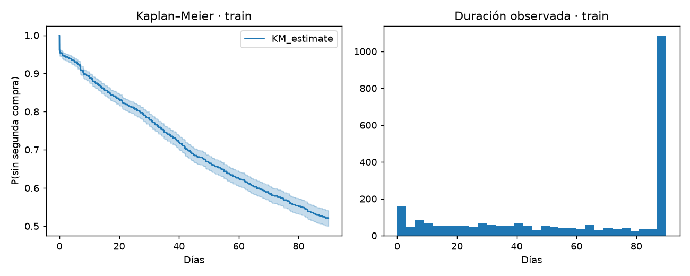

# Análisis de supervivencia de retorno
  

Estimar tiempo hasta una segunda ocasión de compra positiva observada, incorporando censura administrativa y un horizonte de 90 días.

Proyecto independiente, con comentarios calculados, alertas tabuladas y reportes por etapa.

## Ejecutar

Desde esta carpeta, con Python 3.11 o superior:

```powershell
python -m venv .venv
.\.venv\Scripts\python -m pip install -r requirements.txt
```

Selecciona ese Python como kernel. Ejecuta [00](notebooks/00_configuracion_entorno.ipynb) y después las tres celdas de [06](notebooks/06_ejecucion_completa.ipynb), que recorren 01–05. Si 00 instala bibliotecas, reinicia el kernel y repite la comprobación. Guarda y cierra 01–05 antes de ejecutar el maestro. Desde terminal: `python scripts/execute_notebooks.py`.

| Etapa | Propósito |
| --- | --- |
| 01 | Fuente, controles y preparación |
| 02 | Distribuciones y diagnóstico |
| 03 | Kaplan–Meier común como referencia |
| 04 | Cox y selección en validación |
| 05 | Concordancia reservada e incertidumbre |



## Resultados y documentación

- [Informe integral automático](reports/informe_final/informe_final.md).
- [Metodología y límites](docs/metodologia.md).
- [Fuentes y recuperación](docs/fuentes.md).
- [Estructura autónoma](docs/estructura.md).
- [Guía del informe](docs/informe_final.md).
- `reports/ejecucion/resumen.json`: avance y tiempos del maestro.
- `reports/alertas`: mensajes originales y descripciones genéricas.

Con resultados guardados, `python scripts/generate_report.py` regenera el informe sin recalcular modelos. Tests: `python -m unittest discover -s tests -v`. Cada proyecto conserva una versión vigente por reporte. Se puede copiar o renombrar con sus fuentes y crear un entorno nuevo sin los demás proyectos.

El evento es una segunda compra observada en 90 días; las suposiciones de censura y el histórico limitado condicionan las conclusiones.
