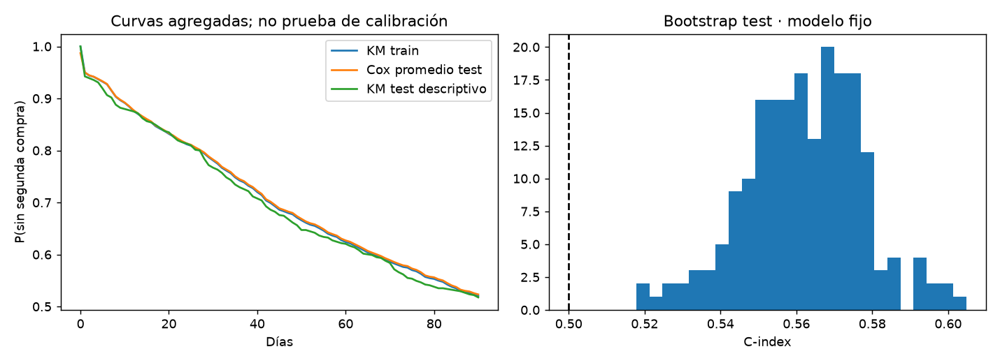

# Informe integral · Tiempo hasta una segunda compra

Generado: 2026-10-08T12:38:56.381385+00:00 (UTC).

Estado del informe: **Evidencia disponible**. Estado del último maestro: **completado**.

Este documento reúne los archivos guardados; no ejecuta modelos ni certifica su utilidad. Las fechas y huellas del manifiesto permiten revisar su procedencia.

## Objetivo y configuración

Estimar tiempo hasta una segunda ocasión de compra positiva observada, incorporando censura administrativa y un horizonte de 90 días.

| Indicador | Valor |
| --- | --- |
| title | Tiempo hasta una segunda compra |
| kind | survival_analysis |
| seed | 42 |
| source_base | project |
| source | data/raw/OnlineRetailUCI.zip |
| horizon_days | 90 |
| bootstrap_repetitions | 200 |

## Datos y preparación

Indicadores de [preparacion.json](../../reports/preparacion/preparacion.json):

| Indicador | Valor |
| --- | --- |
| cierre_observacion | 2011-12-09T12:50:00 |
| filas_originales | 541909 |
| filas_compras_positivas_identificadas | 397884 |
| ocasiones_compra | 18440 |
| clientes_sin_seguimiento_excluidos | 0 |
| fuente_sha256 | f5385cbb54bbebf7196389109c6b0621faab0c304e3702548165e71c84aede8b |
| clientes | 4338 |
| eventos | 1927 |
| censurados | 2411 |
| horizonte_dias | 90 |
| particiones / train | 2602 |
| particiones / valid | 868 |
| particiones / test | 868 |

### Tiempo hasta una segunda compra: preparacion

Se construye una cohorte de **4338 clientes**: **1927 segundas ocasiones de compra** y **2411 casos censurados**. Seguimiento hasta 90 días o cierre del registro. Compras al mismo instante se agrupan; se excluyen 0 casos sin seguimiento positivo. Features derivadas exclusivamente de la primera ocasión observada. Particiones por cliente 60/20/20, aleatorias y estratificadas por evento; no constituyen una validación temporal.

[Reporte de la etapa](../../reports/preparacion/preparacion.md).

## Hallazgos exploratorios

Indicadores de [eda.json](../../reports/eda/eda.json):

| Indicador | Valor |
| --- | --- |
| clientes_train | 2602 |
| eventos_train | 1156 |
| censura_train | 0.555726 |
| sin_segunda_compra_a_30_dias_km | 0.78091 |

### Tiempo hasta una segunda compra: eda

Train tiene **55.57% de censura**. Kaplan–Meier estima **78.09% sin segunda compra a 30 días**, bajo censura no informativa. La duración de un caso censurado no es su tiempo real de retorno. Primera compra observada puede corresponder a un cliente ya existente.

[Reporte de la etapa](../../reports/eda/eda.md).

[Detalle: tabla_riesgo.csv](../../reports/eda/tabla_riesgo.csv)

## Baseline

Indicadores de [baseline.json](../../reports/baseline/baseline.json):

| Indicador | Valor |
| --- | --- |
| c_index_referencia | 0.5 |
| sin_segunda_compra_30_dias | 0.78091 |
| tipo | Curva común Kaplan–Meier ajustada en train; ranking de riesgo constante |

### Tiempo hasta una segunda compra: baseline

Referencia: Kaplan–Meier común ajustada exclusivamente en train. No diferencia clientes; para pares comparables, un ranking constante tiene C-index 0,5. La curva incorpora los casos censurados.

[Reporte de la etapa](../../reports/baseline/baseline.md).

## Modelo y selección

Indicadores de [modelado.json](../../reports/modelado/modelado.json):

| Indicador | Valor |
| --- | --- |
| penalizacion_elegida | 0.01 |
| c_index_validacion | 0.540347 |
| variables_ph_p_menor_005 | 0 |
| criterio | C-index de validación; sin reentrenar con validación ni usar test |

### Tiempo hasta una segunda compra: modelado

Cox penalizado elegido por C-index en validación: **0.540**, penalización **0.01**. Diagnóstico exploratorio en train: **0 variables con p < 0,05**, sin ajuste por multiplicidad; sin evidencia exploratoria de violación del supuesto de riesgos proporcionales (no certifica el supuesto por falta de ajuste de multiplicidad). Los coeficientes describen asociaciones y no efectos causales.

[Reporte de la etapa](../../reports/modelado/modelado.md).

[Detalle: coeficientes_cox.csv](../../reports/modelado/coeficientes_cox.csv)

[Detalle: diagnostico_riesgos_proporcionales.csv](../../reports/modelado/diagnostico_riesgos_proporcionales.csv)

## Evaluación y conclusiones

Indicadores de [evaluacion.json](../../reports/evaluacion/evaluacion.json):

| Indicador | Valor |
| --- | --- |
| clientes_test | 868 |
| eventos_test | 386 |
| baseline_c_index | 0.5 |
| modelo_c_index | 0.561871 |
| ci_bootstrap95_inferior | 0.528863 |
| ci_bootstrap95_superior | 0.593726 |
| replicas_validas | 200 |
| diagnostico | Discriminación con censura; no mide calibración ni retorno comercial |

### Tiempo hasta una segunda compra: evaluacion

C-index de test **0.562**, IC bootstrap 95 % **[0.529, 0.594]**: supera la referencia de ranking constante 0,5. Se usan **868 clientes** y **386 eventos**. Bootstrap con modelo fijo; no incluye incertidumbre del ajuste o selección. Las curvas agregadas son un diagnóstico visual, no una prueba de calibración. El protocolo no acredita desempeño futuro, causalidad ni pérdida de clientes. La censura administrativa puede relacionarse con estacionalidad y fecha de entrada.

[Reporte de la etapa](../../reports/evaluacion/evaluacion.md).

[Detalle: bootstrap_concordancia.csv](../../reports/evaluacion/bootstrap_concordancia.csv)

[Detalle: curvas_agregadas.csv](../../reports/evaluacion/curvas_agregadas.csv)

## Alertas y estado de ejecución

| Notebook | Tipos de aviso registrados |
| --- | --- |
| 00_configuracion_entorno | 0 |
| 01_preparacion_datos | 0 |
| 02_analisis_exploratorio | 0 |
| 03_baseline | 0 |
| 04_modelado | 0 |
| 05_evaluacion | 0 |
| 06_ejecucion_completa | 1 |

| Notebook | Tipo | Apariciones | Significado | Acción sugerida |
| --- | --- | --- | --- | --- |
| 06_ejecucion_completa | DeprecationWarning | 5 | Se está utilizando una función o comportamiento en retirada. | Consultar la alternativa indicada antes de actualizar dependencias. |

Una tabla vacía de warnings no demuestra ausencia de errores o validez del modelo. Consulta [alertas](../alertas/) y [resumen del maestro](../ejecucion/resumen.json).

| Notebook | Celdas ejecutadas guardadas | Última ejecución UTC | Errores guardados |
| --- | --- | --- | --- |
| 01_preparacion_datos.ipynb | 3/3 | 2026-10-08T12:22:22.639239Z | 0 |
| 02_analisis_exploratorio.ipynb | 3/3 | 2026-10-08T12:22:28.664998Z | 0 |
| 03_baseline.ipynb | 3/3 | 2026-10-08T12:22:31.736247Z | 0 |
| 04_modelado.ipynb | 3/3 | 2026-10-08T12:22:35.052948Z | 0 |
| 05_evaluacion.ipynb | 3/3 | 2026-10-08T12:22:38.713632Z | 0 |

## Limitaciones y próximos pasos

Segunda ocasión de compra positiva observada en 90 días; no churn ni primera compra real. Censura administrativa, histórico corto y estacionalidad limitan la inferencia. Cox describe asociaciones y el C-index no demuestra calibración ni causalidad.

- Evaluar en cohortes posteriores y estudiar censura y estacionalidad.
- Complementar con calibración a horizontes y alternativas si falla riesgos proporcionales.

## Evidencia y reproducción

Desde la carpeta de este proyecto, ejecuta `python scripts/generate_report.py` para reunir los resultados guardados, o 06 para ejecutar los análisis y actualizar el informe.

Consulta el [README](../../README.md), la [guía del informe](../../docs/informe_final.md) y el [manifiesto con datos y huellas](informe_final.json). El informe conserva una versión vigente por proyecto.
