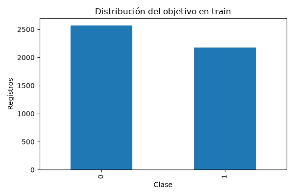
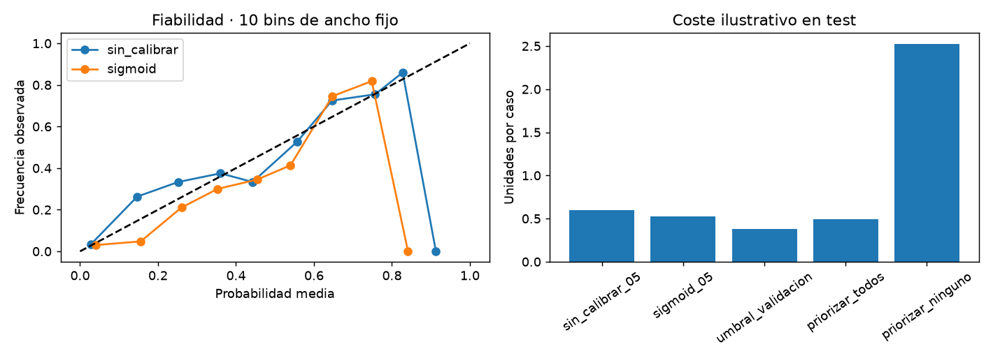

# Informe integral · Churn de actividad

Generado: 2026-10-26T14:06:54.228517+00:00 (UTC).

Estado del informe: **Evidencia disponible**. Estado del último maestro: **completado**.

Este documento reúne los archivos guardados; no ejecuta modelos ni certifica su utilidad. Las fechas y huellas del manifiesto permiten revisar su procedencia.

## Objetivo y configuración

Proyecto de clasificación binaria sobre una tabla de actividad con transacciones, puntos, frecuencia y recencia. Explora si estas variables permiten distinguir el objetivo `flagChurn` y superar una regla mayoritaria bajo una partición temporal.

| Indicador | Valor |
| --- | --- |
| title | Churn de actividad |
| source_zip | data/raw/Analytical Base Table Churn Tabela de modelagem preditiva no contexto de Churn em SaaS.zip |
| members / full | abt_churn.csv |
| target | flagChurn |
| id | idUsuario |
| date | dtRef |
| split | temporal |
| source_base | project |
| decision_costs / false_negative | 5 |
| decision_costs / false_positive | 1 |

## Datos y preparación

Indicadores de [preparacion.json](../../reports/preparacion/preparacion.json):

| Indicador | Valor |
| --- | --- |
| particion | temporal |
| semilla | 42 |
| datasets / train / filas | 4742 |
| datasets / train / columnas | 43 |
| datasets / train / positivos | 2173 |
| datasets / valid / filas | 451 |
| datasets / valid / columnas | 43 |
| datasets / valid / positivos | 262 |
| datasets / test / filas | 303 |
| datasets / test / columnas | 43 |
| datasets / test / positivos | 153 |
| ids_compartidos_train_test | 185 |

## Hallazgos exploratorios

Indicadores de [eda.json](../../reports/eda/eda.json):

| Indicador | Valor |
| --- | --- |
| filas_train | 4742 |
| positivos | 2173 |
| proporcion_positiva | 0.458245 |
| nulos / dtRef | 0 |
| nulos / idUsuario | 0 |
| nulos / qtdeTransacoes | 0 |
| nulos / qtdeDias | 0 |
| nulos / mediaTransacoesDias | 0 |
| nulos / saldoPontos | 0 |
| nulos / qtdePontosPos | 0 |
| nulos / qtdePontosNeg | 0 |
| nulos / qtdeDiasUltimaTransacao | 0 |
| nulos / qtdeDiasPrimeiraTransacao | 0 |
| nulos / qtdSkuDistintos | 0 |
| nulos / qtdeChatMessage | 0 |
| nulos / qtdePresença | 0 |
| nulos / qtdeTrocaStreamElements | 0 |
| nulos / qtdeChurn | 0 |
| nulos / qtdePonei | 0 |
| nulos / qtdeAirflowLover | 0 |
| nulos / qtdePresencaStreak | 0 |
| nulos / qtdeDailyLoot | 0 |
| nulos / qtdeRLover | 0 |
| nulos / qtdeVendaItemRPG | 0 |

El archivo enlazado contiene el detalle restante.

### EDA de entrenamiento

Registros: **4,742**. Churn positivo: **45.82%**. La clase positiva es minoritaria.

Se explora solo train: validación selecciona el modelo y test queda reservado. No se infiere causalidad ni representatividad de estas cifras.

#### Nulos por columna

```text
                            nulos
dtRef                           0
idUsuario                       0
qtdeTransacoes                  0
qtdeDias                        0
mediaTransacoesDias             0
saldoPontos                     0
qtdePontosPos                   0
qtdePontosNeg                   0
qtdeDiasUltimaTransacao         0
qtdeDiasPrimeiraTransacao       0
qtdSkuDistintos                 0
qtdeChatMessage                 0
qtdePresença                    0
qtdeTrocaStreamElements         0
qtdeChurn                       0
qtdePonei                       0
qtdeAirflowLover                0
qtdePresencaStreak              0
qtdeDailyLoot                   0
qtdeRLover                      0
qtdeVendaItemRPG                0
qtdeTransacoesD7                0
qtdeDiasD7                      0
saldoPontosD7                   0
qtdePontosPosD7                 0
qtdePontosNegD7                 0
qtdeTransacoesD14               0
qtdeDiasD14                     0
saldoPontosD14                  0
qtdePontosPosD14                0
qtdePontosNegD14                0
qtdeTransacoesD28               0
qtdeDiasD28                     0
saldoPontosD28                  0
qtdePontosPosD28                0
qtdePontosNegD28                0
propAvgQtdeTransacoes           0
propAvgQtdeDias                 0
propAvgMediaTransacoesDias      0
propAvgSaldoPontos              0
propAvgQtdePontosPos            0
propAvgQtdePontosNeg            0
flagChurn                       0
```

#### Atributos excluidos

idUsuario, dtRef, qtdeChurn

[Reporte de la etapa](../../reports/eda/eda.md).



## Baseline

Indicadores de [baseline_validacion.json](../../reports/baseline/baseline_validacion.json):

| Indicador | Valor |
| --- | --- |
| casos | 451 |
| accuracy | 0.419069 |
| average_precision | 0.580931 |
| roc_auc | 0.5 |

## Modelo y selección

Indicadores de [decisiones_validacion.json](../../reports/modelado/decisiones_validacion.json):

| Indicador | Valor |
| --- | --- |
| decision_protocol | Última fecha de train para calibración; ajuste solo fechas anteriores |
| decision_fit_cases | 4368 |
| decision_calibration_cases | 374 |
| decision_validation_cases | 451 |
| decision_threshold | 0.32 |
| decision_false_negative_cost | 5 |
| decision_false_positive_cost | 1 |
| decision_criterion | AP validación para modelo; sigmoid fijo en calibración; coste FN/FP en validación para umbral |
| decision_test_used_for_selection | False |

Indicadores de [modelos_validacion.json](../../reports/modelado/modelos_validacion.json):

| Indicador | Valor |
| --- | --- |
| criterio | average_precision_validacion |
| class_weight_elegido | No disponible |

### Calibración y política de decisión

Modelo adicional: **4368 filas para ajuste** y **374 para calibración**. Última fecha de train para calibración; ajuste solo fechas anteriores. Se comparan dos ponderaciones por AP de validación; calibración sigmoid fijada de antemano. El umbral **0.32** minimiza coste ilustrativo FN=5.0, FP=1.0 en la grilla de validación. Se conserva el modelo original para su comparación histórica; las métricas de decisiones corresponden a este ajuste adicional. Validación selecciona modelo y umbral: su rendimiento es optimista y el test queda reservado.

[Reporte de la etapa](../../reports/modelado/decisiones.md).

[Detalle: particion_calibracion.csv](../../reports/modelado/particion_calibracion.csv)

[Detalle: umbrales_validacion.csv](../../reports/modelado/umbrales_validacion.csv)

## Evaluación y conclusiones

Indicadores de [decisiones_test.json](../../reports/evaluacion/decisiones_test.json):

| Indicador | Valor |
| --- | --- |
| decision_cost_scope | Penalizaciones ilustrativas de clasificación, no coste real de campaña ni ahorro medido |

Indicadores de [evaluacion_test.json](../../reports/evaluacion/evaluacion_test.json):

| Indicador | Valor |
| --- | --- |
| baseline / casos | 303 |
| baseline / accuracy | 0.49505 |
| baseline / average_precision | 0.50495 |
| baseline / roc_auc | 0.5 |
| modelo / casos | 303 |
| modelo / accuracy | 0.772277 |
| modelo / average_precision | 0.821799 |
| modelo / roc_auc | 0.837407 |

### Evaluación final

Casos de test: **303**. El modelo **supera** el baseline en accuracy.

```text
          accuracy  average_precision   roc_auc
baseline  0.495050           0.504950  0.500000
modelo    0.772277           0.821799  0.837407
```

Las métricas describen esta partición. Revisar recall por clase y matriz de confusión en el JSON; no ajustar parámetros ni thresholds con este test. La definición del churn y la disponibilidad temporal de las features deben confirmarse en la fuente.

#### Probabilidades y decisiones

Brier sigmoid **0.1678**, mayor que sin calibrar **0.1643**. Brier y log loss combinan calibración y discriminación; ECE depende de los bins. Las tablas de fiabilidad incluyen soporte y omiten bins vacíos. Con umbral fijado en validación **0.32**, se priorizan **227 de 303 casos**: recall **95.42%**, precisión **64.32%**, coste de error **0.383 unidades por caso**. FN=5.0, FP=1.0 son supuestos ilustrativos, no importes reales ni ahorro de retención. Se muestran todas las políticas sin elegir una nueva con test. ActivityChurn registra 185 IDs compartidos entre train y test; la independencia por persona sigue pendiente de confirmar.

[Reporte de la etapa](../../reports/evaluacion/evaluacion.md).



[Detalle: calibracion_test.csv](../../reports/evaluacion/calibracion_test.csv)

[Detalle: fiabilidad_bins.csv](../../reports/evaluacion/fiabilidad_bins.csv)

[Detalle: politicas_test.csv](../../reports/evaluacion/politicas_test.csv)

### Comparación automática

- `accuracy`: baseline **0.49505**, modelo **0.772277**; el modelo **mejora** este indicador en la evaluación guardada.
- `average_precision`: baseline **0.50495**, modelo **0.821799**; el modelo **mejora** este indicador en la evaluación guardada.
- `roc_auc`: baseline **0.5**, modelo **0.837407**; el modelo **mejora** este indicador en la evaluación guardada.

## Alertas y estado de ejecución

| Notebook | Tipos de aviso registrados |
| --- | --- |
| 00_configuracion_entorno | 0 |
| 01_preparacion_datos | 0 |
| 02_analisis_exploratorio | 0 |
| 03_baseline | 0 |
| 04_modelado | 0 |
| 05_evaluacion | 0 |

Una tabla vacía de warnings no demuestra ausencia de errores o validez del modelo. Consulta [alertas](../alertas/) y [resumen del maestro](../ejecucion/resumen.json).

| Notebook | Celdas ejecutadas guardadas | Última ejecución UTC | Errores guardados |
| --- | --- | --- | --- |
| 01_preparacion_datos.ipynb | 3/3 | 2026-10-26T14:06:34.646697Z | 0 |
| 02_analisis_exploratorio.ipynb | 3/3 | 2026-10-26T14:06:46.372151Z | 0 |
| 03_baseline.ipynb | 3/3 | 2026-10-26T14:06:48.079259Z | 0 |
| 04_modelado.ipynb | 3/3 | 2026-10-26T14:06:51.101636Z | 0 |
| 05_evaluacion.ipynb | 3/3 | 2026-10-26T14:06:53.422709Z | 0 |

## Limitaciones y próximos pasos

La definición del churn y la disponibilidad temporal de las variables deben confirmarse. Revisa recall por clase y posibles diferencias entre train y test; las métricas de proyectos distintos no son directamente comparables.

- Comprobar procedencia, condiciones de uso y disponibilidad temporal de las variables.
- Completar una pasada de 06 y revisar las alertas antes de publicar el informe.
- Revisar métricas por clase y errores frecuentes; ajustar decisiones en validación, conservando test independiente.

## Evidencia y reproducción

Desde la carpeta de este proyecto, ejecuta `python scripts/generate_report.py` para reunir los resultados guardados, o 06 para ejecutar los análisis y actualizar el informe.

Consulta el [README](../../README.md), la [guía del informe](../../docs/informe_final.md) y el [manifiesto con datos y huellas](informe_final.json). El informe conserva una versión vigente por proyecto.
