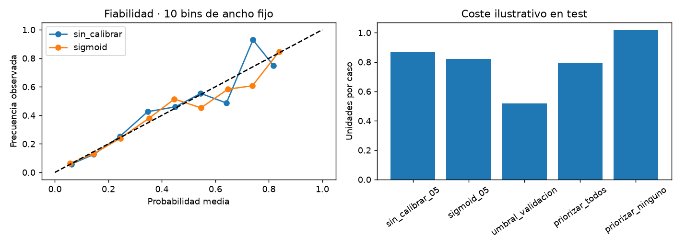

# BankChurn
  

**Contenido:** [Datos](#datos-y-particiones) · [Resultados](#resultado-de-test) · [Reproducción](#reproducción) · [Informe integral](#informe-integral)

## Clasificación de abandono de clientes bancarios

Proyecto de clasificación binaria que utiliza atributos del cliente y de su relación con el banco para estimar el objetivo `Exited`. Compara una regla mayoritaria con regresión logística y muestra por qué una accuracy elevada puede ocultar una baja detección de abandono.

**Estado:** el entorno 00 pasó sus comprobaciones y el maestro completó 01–05 el 6 de octubre de 2026. La primera evaluación supera ligeramente al baseline en accuracy, pero detecta una fracción pequeña de los casos positivos.

[Resultados](reports/evaluacion/evaluacion.md) · [Resumen de ejecución](reports/ejecucion/resumen.json) · [Metodología](docs/metodologia.md) · [Registro](docs/ejecuciones.md)

## Datos y particiones

El CSV contiene 10.000 registros y 14 columnas. Se utiliza uno de los tres ZIP bancarios de contenido idéntico; las copias no se combinan ni se cuentan como observaciones adicionales.

| Partición | Registros | Casos de churn |
| --- | ---: | ---: |
| Entrenamiento | 6.000 | 1.223 |
| Validación | 2.000 | 407 |
| Test | 2.000 | 407 |

Se aplica un split aleatorio estratificado 60/20/20 con semilla 42. Se excluyen `RowNumber`, `CustomerId` y `Surname` de las features. No hay IDs compartidos entre entrenamiento y test. Esta separación no mide evolución temporal ni generalización a otro banco.

## Selección del modelo

La regresión logística sin ponderación obtuvo average precision de **0,4630** en validación, frente a **0,4553** de la variante balanceada, y se seleccionó siguiendo el criterio predefinido.

Existe un compromiso entre detectar churn y generar falsas alertas. En validación, la variante balanceada detectó el 66,58 % de los positivos frente al 21,38 % de la no ponderada, pero su precisión de churn fue 37,64 % frente a 58,39 %. Estos valores pertenecen a validación; no son resultados de ambas variantes en test.

## Resultado de test

| Métrica | Baseline mayoritario | Modelo seleccionado |
| --- | ---: | ---: |
| Accuracy | 79,65 % | 81,00 % |
| Average precision | 0,2035 | 0,4806 |
| ROC-AUC | 0,5000 | 0,7752 |
| Recall de churn | 0,00 % | 19,41 % |
| F1 macro | 0,4434 | 0,5920 |

El modelo mejora la accuracy en **1,35 puntos porcentuales**, pero identifica solo **79 de los 407 casos positivos**. Omite 328 y genera 52 falsas alertas. La precisión de churn es 60,31 %.

El baseline predice siempre la clase 0 y obtiene 79,65 % de accuracy porque la mayoría de los clientes del test no tiene `Exited=1`. Por eso, el resultado del modelo debe leerse junto con recall, matriz de confusión y métricas de ordenamiento.

ROC-AUC y average precision muestran discriminación superior a la regla constante en esta partición, mientras que la decisión binaria actual tiene sensibilidad baja. La evaluación no demuestra impacto de negocio ni comportamiento en otro periodo o población.

## Reproducción

1. Selecciona el Python del proyecto y ejecuta [00](notebooks/00_configuracion_entorno.ipynb).
2. Guarda y cierra los notebooks individuales.
3. Ejecuta [06](notebooks/06_ejecucion_completa.ipynb), o recorre 01–05 manualmente.
4. Revisa reportes, métricas por clase y alertas.

La pasada actual duró aproximadamente 9,62 segundos, sin incluir 00, y no registró warnings. El maestro inicia kernels independientes y se detiene ante errores. Las salidas de los notebooks y reportes corresponden a esa pasada.

## Siguiente iteración

Confirmar procedencia, licencia, significado temporal de `Exited` y disponibilidad de las features. Definir después el coste de omitir churn frente al de generar falsas alertas, y seleccionar el criterio o threshold en validación. El test actual debe conservarse como evaluación; no utilizar sus resultados para ajustar y volver a declarar una medición independiente.

## Estructura local

Consulta la [estructura y comandos del proyecto](docs/estructura.md). Las funciones se importan desde su propio `src/`; los requisitos se instalan desde esta carpeta. Los datos de entrada están en `data/raw` y sus rutas se declaran en `config.json`.

## Independencia

El proyecto incluye su código, requisitos, datos de entrada e instrucciones. Se puede copiar o renombrar conservando esta carpeta completa; la ejecución no utiliza otros proyectos ni una carpeta temática. Los datos están excluidos del versionado: consulta las [fuentes](docs/fuentes.md) para preparar una copia nueva.

Los reportes están agrupados por etapa. Consulta su [distribución y archivos vigentes](docs/estructura.md#organización-de-reportes).

## Informe integral

Consulta el [informe integral](reports/informe_final/informe_final.md). Se actualiza con 06 y reúne cifras, conclusiones, limitaciones y próximos pasos. Para regenerarlo con resultados existentes usa `python scripts/generate_report.py`. Consulta la [guía del informe](docs/informe_final.md).

## Probabilidades y decisiones

04 incorpora un modelo adicional con calibración independiente del ajuste y umbral elegido en validación. 05 muestra fiabilidad, soporte y costes ilustrativos de varias políticas sobre test, sin reajustarlos. Consulta [protocolo y evidencia](docs/decisiones.md).
