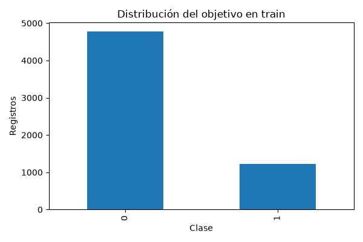

# Informe integral · Churn bancario

Generado: 2026-10-26T14:08:36.305013+00:00 (UTC).

Estado del informe: **Evidencia disponible**. Estado del último maestro: **completado**.

Este documento reúne los archivos guardados; no ejecuta modelos ni certifica su utilidad. Las fechas y huellas del manifiesto permiten revisar su procedencia.

## Objetivo y configuración

Proyecto de clasificación binaria que utiliza atributos del cliente y de su relación con el banco para estimar el objetivo `Exited`. Compara una regla mayoritaria con regresión logística y muestra por qué una accuracy elevada puede ocultar una baja detección de abandono.

| Indicador | Valor |
| --- | --- |
| title | Churn bancario |
| source_zip | data/raw/Banking Customer Churn Prediction Dataset.zip |
| members / full | Churn_Modelling.csv |
| target | Exited |
| id | CustomerId |
| split | stratified |
| source_base | project |
| decision_costs / false_negative | 5 |
| decision_costs / false_positive | 1 |

## Datos y preparación

Indicadores de [preparacion.json](../../reports/preparacion/preparacion.json):

| Indicador | Valor |
| --- | --- |
| particion | stratified |
| semilla | 42 |
| datasets / train / filas | 6000 |
| datasets / train / columnas | 14 |
| datasets / train / positivos | 1223 |
| datasets / valid / filas | 2000 |
| datasets / valid / columnas | 14 |
| datasets / valid / positivos | 407 |
| datasets / test / filas | 2000 |
| datasets / test / columnas | 14 |
| datasets / test / positivos | 407 |
| ids_compartidos_train_test | 0 |

## Hallazgos exploratorios

Indicadores de [eda.json](../../reports/eda/eda.json):

| Indicador | Valor |
| --- | --- |
| filas_train | 6000 |
| positivos | 1223 |
| proporcion_positiva | 0.203833 |
| nulos / RowNumber | 0 |
| nulos / CustomerId | 0 |
| nulos / Surname | 0 |
| nulos / CreditScore | 0 |
| nulos / Geography | 0 |
| nulos / Gender | 0 |
| nulos / Age | 0 |
| nulos / Tenure | 0 |
| nulos / Balance | 0 |
| nulos / NumOfProducts | 0 |
| nulos / HasCrCard | 0 |
| nulos / IsActiveMember | 0 |
| nulos / EstimatedSalary | 0 |
| nulos / Exited | 0 |

### EDA de entrenamiento

Registros: **6,000**. Churn positivo: **20.38%**. La clase positiva es minoritaria.

Se explora solo train: validación selecciona el modelo y test queda reservado. No se infiere causalidad ni representatividad de estas cifras.

#### Nulos por columna

```text
                 nulos
RowNumber            0
CustomerId           0
Surname              0
CreditScore          0
Geography            0
Gender               0
Age                  0
Tenure               0
Balance              0
NumOfProducts        0
HasCrCard            0
IsActiveMember       0
EstimatedSalary      0
Exited               0
```

#### Atributos excluidos

RowNumber, CustomerId, Surname

[Reporte de la etapa](../../reports/eda/eda.md).



## Baseline

Indicadores de [baseline_validacion.json](../../reports/baseline/baseline_validacion.json):

| Indicador | Valor |
| --- | --- |
| casos | 2000 |
| accuracy | 0.7965 |
| average_precision | 0.2035 |
| roc_auc | 0.5 |

## Modelo y selección

Indicadores de [decisiones_validacion.json](../../reports/modelado/decisiones_validacion.json):

| Indicador | Valor |
| --- | --- |
| decision_protocol | Separación 75/25 por ID de cliente dentro de train |
| decision_fit_cases | 4500 |
| decision_calibration_cases | 1500 |
| decision_validation_cases | 2000 |
| decision_threshold | 0.18 |
| decision_false_negative_cost | 5 |
| decision_false_positive_cost | 1 |
| decision_criterion | AP validación para modelo; sigmoid fijo en calibración; coste FN/FP en validación para umbral |
| decision_test_used_for_selection | False |

Indicadores de [modelos_validacion.json](../../reports/modelado/modelos_validacion.json):

| Indicador | Valor |
| --- | --- |
| criterio | average_precision_validacion |
| class_weight_elegido | No disponible |

### Calibración y política de decisión

Modelo adicional: **4500 filas para ajuste** y **1500 para calibración**. Separación 75/25 por ID de cliente dentro de train. Se comparan dos ponderaciones por AP de validación; calibración sigmoid fijada de antemano. El umbral **0.18** minimiza coste ilustrativo FN=5.0, FP=1.0 en la grilla de validación. Se conserva el modelo original para su comparación histórica; las métricas de decisiones corresponden a este ajuste adicional. Validación selecciona modelo y umbral: su rendimiento es optimista y el test queda reservado.

[Reporte de la etapa](../../reports/modelado/decisiones.md).

[Detalle: particion_calibracion.csv](../../reports/modelado/particion_calibracion.csv)

[Detalle: umbrales_validacion.csv](../../reports/modelado/umbrales_validacion.csv)

## Evaluación y conclusiones

Indicadores de [decisiones_test.json](../../reports/evaluacion/decisiones_test.json):

| Indicador | Valor |
| --- | --- |
| decision_cost_scope | Penalizaciones ilustrativas de clasificación, no coste real de campaña ni ahorro medido |

Indicadores de [evaluacion_test.json](../../reports/evaluacion/evaluacion_test.json):

| Indicador | Valor |
| --- | --- |
| baseline / casos | 2000 |
| baseline / accuracy | 0.7965 |
| baseline / average_precision | 0.2035 |
| baseline / roc_auc | 0.5 |
| modelo / casos | 2000 |
| modelo / accuracy | 0.81 |
| modelo / average_precision | 0.48062 |
| modelo / roc_auc | 0.775208 |

### Evaluación final

Casos de test: **2,000**. El modelo **supera** el baseline en accuracy.

```text
          accuracy  average_precision   roc_auc
baseline    0.7965            0.20350  0.500000
modelo      0.8100            0.48062  0.775208
```

Las métricas describen esta partición. Revisar recall por clase y matriz de confusión en el JSON; no ajustar parámetros ni thresholds con este test. La definición del churn y la disponibilidad temporal de las features deben confirmarse en la fuente.

#### Probabilidades y decisiones

Brier sigmoid **0.1350**, menor que sin calibrar **0.1350**. Brier y log loss combinan calibración y discriminación; ECE depende de los bins. Las tablas de fiabilidad incluyen soporte y omiten bins vacíos. Con umbral fijado en validación **0.18**, se priorizan **849 de 2000 casos**: recall **75.68%**, precisión **36.28%**, coste de error **0.518 unidades por caso**. FN=5.0, FP=1.0 son supuestos ilustrativos, no importes reales ni ahorro de retención. Se muestran todas las políticas sin elegir una nueva con test. BankChurn no encontró IDs compartidos entre train y test; esto por sí solo no acredita independencia por persona.

[Reporte de la etapa](../../reports/evaluacion/evaluacion.md).


[Detalle: calibracion_test.csv](../../reports/evaluacion/calibracion_test.csv)

[Detalle: fiabilidad_bins.csv](../../reports/evaluacion/fiabilidad_bins.csv)

[Detalle: politicas_test.csv](../../reports/evaluacion/politicas_test.csv)

### Comparación automática

- `accuracy`: baseline **0.7965**, modelo **0.81**; el modelo **mejora** este indicador en la evaluación guardada.
- `average_precision`: baseline **0.2035**, modelo **0.48062**; el modelo **mejora** este indicador en la evaluación guardada.
- `roc_auc`: baseline **0.5**, modelo **0.775208**; el modelo **mejora** este indicador en la evaluación guardada.

## Alertas y estado de ejecución

| Notebook | Tipos de aviso registrados |
| --- | --- |
| 00_configuracion_entorno | 0 |
| 01_preparacion_datos | 0 |
| 02_analisis_exploratorio | 0 |
| 03_baseline | 0 |
| 04_modelado | 0 |
| 05_evaluacion | 0 |

Una tabla vacía de warnings no demuestra ausencia de errores o validez del modelo. Consulta [alertas](../alertas/) y [resumen del maestro](../ejecucion/resumen.json).

| Notebook | Celdas ejecutadas guardadas | Última ejecución UTC | Errores guardados |
| --- | --- | --- | --- |
| 01_preparacion_datos.ipynb | 3/3 | 2026-10-26T14:08:21.192200Z | 0 |
| 02_analisis_exploratorio.ipynb | 3/3 | 2026-10-26T14:08:23.327061Z | 0 |
| 03_baseline.ipynb | 3/3 | 2026-10-26T14:08:28.216380Z | 0 |
| 04_modelado.ipynb | 3/3 | 2026-10-26T14:08:33.518394Z | 0 |
| 05_evaluacion.ipynb | 3/3 | 2026-10-26T14:08:35.599268Z | 0 |

## Limitaciones y próximos pasos

La definición del churn y la disponibilidad temporal de las variables deben confirmarse. Revisa recall por clase y posibles diferencias entre train y test; las métricas de proyectos distintos no son directamente comparables.

- Comprobar procedencia, condiciones de uso y disponibilidad temporal de las variables.
- Completar una pasada de 06 y revisar las alertas antes de publicar el informe.
- Revisar métricas por clase y errores frecuentes; ajustar decisiones en validación, conservando test independiente.

## Evidencia y reproducción

Desde la carpeta de este proyecto, ejecuta `python scripts/generate_report.py` para reunir los resultados guardados, o 06 para ejecutar los análisis y actualizar el informe.

Consulta el [README](../../README.md), la [guía del informe](../../docs/informe_final.md) y el [manifiesto con datos y huellas](informe_final.json). El informe conserva una versión vigente por proyecto.
