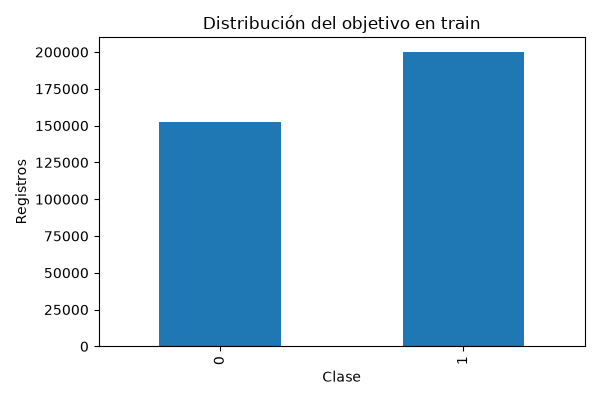

# SubscriptionChurn
  

**Contenido:** [Datos](#datos-y-particiones) · [Resultados](#selección-y-desempeño) · [Reproducción](#reproducción) · [Informe integral](#informe-integral)

## Clasificación de abandono en datos de suscripciones

Proyecto de clasificación binaria con atributos de uso, soporte, pagos y contratos. Compara un baseline mayoritario con regresión logística y analiza cómo cambia el desempeño entre validación interna y el archivo de prueba suministrado.

**Estado:** 00 pasó su comprobación de entorno y el maestro completó 01–05 el 6 de octubre de 2026. La primera evaluación mejora el baseline, pero presenta una caída marcada respecto de validación y muchas falsas alertas.

[Resultados](reports/evaluacion/evaluacion.md) · [Resumen de ejecución](reports/ejecucion/resumen.json) · [Metodología](docs/metodologia.md) · [Registro](docs/ejecuciones.md)

## Datos y particiones

El ZIP contiene dos CSV. Se conserva el test suministrado y se reserva un 20 % del entrenamiento para validación, con estratificación y semilla 42. Una fila sin objetivo se descarta y queda registrada; `CustomerID` no participa como feature.

| Partición | Registros | Casos de churn |
| --- | ---: | ---: |
| Entrenamiento | 352.665 | 199.999 |
| Validación | 88.167 | 50.000 |
| Test suministrado | 64.374 | 30.493 |

Hay **50.320 IDs compartidos entre train y test**. Debe confirmarse si representan los mismos clientes o son contadores locales: el nombre de los archivos no acredita independencia de las poblaciones.

## Selección y desempeño

Se seleccionó regresión logística con `class_weight="balanced"` por average precision de validación: 0,9739348 frente a 0,9739336 de la no ponderada. La diferencia es mínima y no demuestra una ventaja general de la ponderación.

| Métrica | Validación del modelo | Test del modelo | Baseline en test |
| --- | ---: | ---: | ---: |
| Accuracy | 89,46 % | 58,10 % | 47,37 % |
| Average precision | 0,9739 | 0,6389 | 0,4737 |
| ROC-AUC | 0,9590 | 0,6887 | 0,5000 |
| Recall de churn | 87,03 % | 98,75 % | 100,00 % |

En test, el modelo detecta **30.113 de los 30.493 casos positivos** y omite 380. Sin embargo, clasifica como churn **26.593 de los 33.881 casos negativos**. La precisión positiva es **53,10 %** y el recall de la clase negativa es **21,51 %**.

La accuracy mejora **10,73 puntos porcentuales** respecto del baseline. Este último predice siempre positivo, la clase mayoritaria de train, y obtiene 100 % de recall positivo a costa de no detectar ningún negativo. Por ello, un recall de churn elevado no basta para valorar el modelo.

## Diferencia entre validación y test

La validación se obtiene del CSV de entrenamiento y el test procede de otro archivo. Se observaron diferencias descriptivas:

| Atributo | Media en train | Media en test |
| --- | ---: | ---: |
| Llamadas a soporte | 3,61 | 5,40 |
| Retraso de pago | 12,97 | 17,13 |
| Gasto total | 631,89 | 541,02 |

La proporción de contratos mensuales pasa aproximadamente de 19,8 % a 34,4 %. Estas diferencias muestran que los archivos tienen distribuciones distintas; no prueban por sí solas la causa de la caída ni que los datos sean incorrectos. La [auditoría descriptiva](reports/eda/auditoria_distribuciones.json) conserva los valores observados.

Antes de ajustar modelos conviene confirmar procedencia, definición de `Churn`, significado de IDs y compatibilidad del archivo de prueba. El test debe seguir reservado: ajustar parámetros con sus resultados impediría presentarlo después como una evaluación independiente.

## Reproducción

Ejecuta [00](notebooks/00_configuracion_entorno.ipynb), guarda y cierra los notebooks individuales y utiliza [06](notebooks/06_ejecucion_completa.ipynb). El maestro actualiza salidas y reportes con un kernel nuevo por etapa. La pasada duró unos 15,03 segundos, sin incluir 00, y no registró warnings.

Consulta la [metodología](docs/metodologia.md) y la [documentación compartida](docs/ejecucion.md). El resultado es exploratorio: no acredita estabilidad en otra población ni impacto de negocio.

## Estructura local

Consulta la [estructura y comandos del proyecto](docs/estructura.md). Las funciones se importan desde su propio `src/`; los requisitos se instalan desde esta carpeta. Los datos de entrada están en `data/raw` y sus rutas se declaran en `config.json`.

## Independencia

El proyecto incluye su código, requisitos, datos de entrada e instrucciones. Se puede copiar o renombrar conservando esta carpeta completa; la ejecución no utiliza otros proyectos ni una carpeta temática. Los datos están excluidos del versionado: consulta las [fuentes](docs/fuentes.md) para preparar una copia nueva.

Los reportes están agrupados por etapa. Consulta su [distribución y archivos vigentes](docs/estructura.md#organización-de-reportes).

## Informe integral

Consulta el [informe integral](reports/informe_final/informe_final.md). Se actualiza con 06 y reúne cifras, conclusiones, limitaciones y próximos pasos. Para regenerarlo con resultados existentes usa `python scripts/generate_report.py`. Consulta la [guía del informe](docs/informe_final.md).

## Probabilidades y decisiones

04 incorpora un modelo adicional con calibración independiente del ajuste y umbral elegido en validación. 05 muestra fiabilidad, soporte y costes ilustrativos de varias políticas sobre test, sin reajustarlos. Consulta [protocolo y evidencia](docs/decisiones.md).
