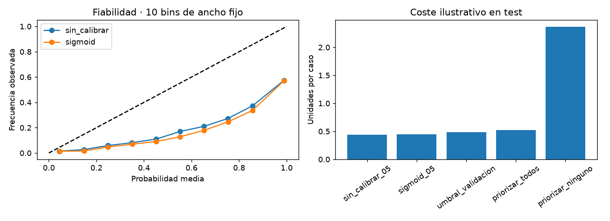

# Informe integral · Churn de suscripciones

Generado: 2026-10-26T14:10:02.548313+00:00 (UTC).

Estado del informe: **Evidencia disponible**. Estado del último maestro: **completado**.

Este documento reúne los archivos guardados; no ejecuta modelos ni certifica su utilidad. Las fechas y huellas del manifiesto permiten revisar su procedencia.

## Objetivo y configuración

Proyecto de clasificación binaria con atributos de uso, soporte, pagos y contratos. Compara un baseline mayoritario con regresión logística y analiza cómo cambia el desempeño entre validación interna y el archivo de prueba suministrado.

| Indicador | Valor |
| --- | --- |
| title | Churn de suscripciones |
| source_zip | data/raw/Customer Churn Dataset.zip |
| members / train | customer_churn_dataset-training-master.csv |
| members / test | customer_churn_dataset-testing-master.csv |
| target | Churn |
| id | CustomerID |
| split | provided |
| source_base | project |
| decision_costs / false_negative | 5 |
| decision_costs / false_positive | 1 |

## Datos y preparación

Indicadores de [preparacion.json](../../reports/preparacion/preparacion.json):

| Indicador | Valor |
| --- | --- |
| particion | provided |
| semilla | 42 |
| datasets / train / filas | 352665 |
| datasets / train / columnas | 12 |
| datasets / train / positivos | 199999 |
| datasets / valid / filas | 88167 |
| datasets / valid / columnas | 12 |
| datasets / valid / positivos | 50000 |
| datasets / test / filas | 64374 |
| datasets / test / columnas | 12 |
| datasets / test / positivos | 30493 |
| ids_compartidos_train_test | 50320 |

## Hallazgos exploratorios

Indicadores de [auditoria_distribuciones.json](../../reports/eda/auditoria_distribuciones.json):

| Indicador | Valor |
| --- | --- |
| alcance | Comparacion descriptiva de train y test; no establece causas del cambio de desempeno. |

Indicadores de [eda.json](../../reports/eda/eda.json):

| Indicador | Valor |
| --- | --- |
| filas_train | 352665 |
| positivos | 199999 |
| proporcion_positiva | 0.567108 |
| nulos / CustomerID | 0 |
| nulos / Age | 0 |
| nulos / Gender | 0 |
| nulos / Tenure | 0 |
| nulos / Usage Frequency | 0 |
| nulos / Support Calls | 0 |
| nulos / Payment Delay | 0 |
| nulos / Subscription Type | 0 |
| nulos / Contract Length | 0 |
| nulos / Total Spend | 0 |
| nulos / Last Interaction | 0 |
| nulos / Churn | 0 |

### EDA de entrenamiento

Registros: **352,665**. Churn positivo: **56.71%**. La clase negativa es minoritaria.

Se explora solo train: validación selecciona el modelo y test queda reservado. No se infiere causalidad ni representatividad de estas cifras.

#### Nulos por columna

```text
                   nulos
CustomerID             0
Age                    0
Gender                 0
Tenure                 0
Usage Frequency        0
Support Calls          0
Payment Delay          0
Subscription Type      0
Contract Length        0
Total Spend            0
Last Interaction       0
Churn                  0
```

#### Atributos excluidos

CustomerID

[Reporte de la etapa](../../reports/eda/eda.md).


## Baseline

Indicadores de [baseline_validacion.json](../../reports/baseline/baseline_validacion.json):

| Indicador | Valor |
| --- | --- |
| casos | 88167 |
| accuracy | 0.567106 |
| average_precision | 0.567106 |
| roc_auc | 0.5 |

## Modelo y selección

Indicadores de [decisiones_validacion.json](../../reports/modelado/decisiones_validacion.json):

| Indicador | Valor |
| --- | --- |
| decision_protocol | Separación 75/25 por ID de cliente dentro de train |
| decision_fit_cases | 264498 |
| decision_calibration_cases | 88167 |
| decision_validation_cases | 88167 |
| decision_threshold | 0.18 |
| decision_false_negative_cost | 5 |
| decision_false_positive_cost | 1 |
| decision_criterion | AP validación para modelo; sigmoid fijo en calibración; coste FN/FP en validación para umbral |
| decision_test_used_for_selection | False |

Indicadores de [modelos_validacion.json](../../reports/modelado/modelos_validacion.json):

| Indicador | Valor |
| --- | --- |
| criterio | average_precision_validacion |
| class_weight_elegido | balanced |

### Calibración y política de decisión

Modelo adicional: **264498 filas para ajuste** y **88167 para calibración**. Separación 75/25 por ID de cliente dentro de train. Se comparan dos ponderaciones por AP de validación; calibración sigmoid fijada de antemano. El umbral **0.18** minimiza coste ilustrativo FN=5.0, FP=1.0 en la grilla de validación. Se conserva el modelo original para su comparación histórica; las métricas de decisiones corresponden a este ajuste adicional. Validación selecciona modelo y umbral: su rendimiento es optimista y el test queda reservado.

[Reporte de la etapa](../../reports/modelado/decisiones.md).

[Detalle: particion_calibracion.csv](../../reports/modelado/particion_calibracion.csv)

[Detalle: umbrales_validacion.csv](../../reports/modelado/umbrales_validacion.csv)

## Evaluación y conclusiones

Indicadores de [decisiones_test.json](../../reports/evaluacion/decisiones_test.json):

| Indicador | Valor |
| --- | --- |
| decision_cost_scope | Penalizaciones ilustrativas de clasificación, no coste real de campaña ni ahorro medido |

Indicadores de [evaluacion_test.json](../../reports/evaluacion/evaluacion_test.json):

| Indicador | Valor |
| --- | --- |
| baseline / casos | 64374 |
| baseline / accuracy | 0.473685 |
| baseline / average_precision | 0.473685 |
| baseline / roc_auc | 0.5 |
| modelo / casos | 64374 |
| modelo / accuracy | 0.580995 |
| modelo / average_precision | 0.638912 |
| modelo / roc_auc | 0.688741 |

### Evaluación final

Casos de test: **64,374**. El modelo **supera** el baseline en accuracy.

```text
          accuracy  average_precision   roc_auc
baseline  0.473685           0.473685  0.500000
modelo    0.580995           0.638912  0.688741
```

Las métricas describen esta partición. Revisar recall por clase y matriz de confusión en el JSON; no ajustar parámetros ni thresholds con este test. La definición del churn y la disponibilidad temporal de las features deben confirmarse en la fuente.

#### Probabilidades y decisiones

Brier sigmoid **0.3836**, mayor que sin calibrar **0.3748**. Brier y log loss combinan calibración y discriminación; ECE depende de los bins. Las tablas de fiabilidad incluyen soporte y omiten bins vacíos. Con umbral fijado en validación **0.18**, se priorizan **61193 de 64374 casos**: recall **99.85%**, precisión **49.75%**, coste de error **0.481 unidades por caso**. FN=5.0, FP=1.0 son supuestos ilustrativos, no importes reales ni ahorro de retención. Se muestran todas las políticas sin elegir una nueva con test. SubscriptionChurn registra 50320 IDs compartidos entre train y test; la independencia por persona sigue pendiente de confirmar.

[Reporte de la etapa](../../reports/evaluacion/evaluacion.md).



[Detalle: calibracion_test.csv](../../reports/evaluacion/calibracion_test.csv)

[Detalle: fiabilidad_bins.csv](../../reports/evaluacion/fiabilidad_bins.csv)

[Detalle: politicas_test.csv](../../reports/evaluacion/politicas_test.csv)

### Comparación automática

- `accuracy`: baseline **0.473685**, modelo **0.580995**; el modelo **mejora** este indicador en la evaluación guardada.
- `average_precision`: baseline **0.473685**, modelo **0.638912**; el modelo **mejora** este indicador en la evaluación guardada.
- `roc_auc`: baseline **0.5**, modelo **0.688741**; el modelo **mejora** este indicador en la evaluación guardada.

## Alertas y estado de ejecución

| Notebook | Tipos de aviso registrados |
| --- | --- |
| 00_configuracion_entorno | 0 |
| 01_preparacion_datos | 0 |
| 02_analisis_exploratorio | 0 |
| 03_baseline | 0 |
| 04_modelado | 0 |
| 05_evaluacion | 0 |

Una tabla vacía de warnings no demuestra ausencia de errores o validez del modelo. Consulta [alertas](../alertas/) y [resumen del maestro](../ejecucion/resumen.json).

| Notebook | Celdas ejecutadas guardadas | Última ejecución UTC | Errores guardados |
| --- | --- | --- | --- |
| 01_preparacion_datos.ipynb | 3/3 | 2026-10-26T14:09:46.842790Z | 0 |
| 02_analisis_exploratorio.ipynb | 3/3 | 2026-10-26T14:09:49.095416Z | 0 |
| 03_baseline.ipynb | 3/3 | 2026-10-26T14:09:51.200511Z | 0 |
| 04_modelado.ipynb | 3/3 | 2026-10-26T14:09:56.443241Z | 0 |
| 05_evaluacion.ipynb | 3/3 | 2026-10-26T14:10:01.825374Z | 0 |

## Limitaciones y próximos pasos

La definición del churn y la disponibilidad temporal de las variables deben confirmarse. Revisa recall por clase y posibles diferencias entre train y test; las métricas de proyectos distintos no son directamente comparables.

- Comprobar procedencia, condiciones de uso y disponibilidad temporal de las variables.
- Completar una pasada de 06 y revisar las alertas antes de publicar el informe.
- Revisar métricas por clase y errores frecuentes; ajustar decisiones en validación, conservando test independiente.

## Evidencia y reproducción

Desde la carpeta de este proyecto, ejecuta `python scripts/generate_report.py` para reunir los resultados guardados, o 06 para ejecutar los análisis y actualizar el informe.

Consulta el [README](../../README.md), la [guía del informe](../../docs/informe_final.md) y el [manifiesto con datos y huellas](informe_final.json). El informe conserva una versión vigente por proyecto.
