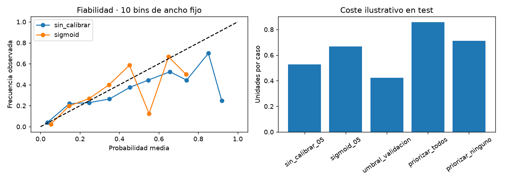

# TelecomChurn
  

**Contenido:** [Datos](#datos-y-particiones) · [Resultados](#resultados-de-la-ejecución) · [Reproducción](#reproducción) · [Informe integral](#informe-integral)

## Abandono de clientes de telecomunicaciones

Proyecto de clasificación de `Churn` con uso de llamadas, planes contratados y contactos con servicio al cliente. Se integra al portafolio con notebooks independientes, reportes estables y un maestro de ejecución.

**Estado:** 00 y la secuencia 01–05 ejecutados el 7 de octubre de 2026. Se revisaron los reportes y las salidas guardadas. La evaluación inicial detecta una parte limitada de los abandonos; todavía requiere mejoras y documentación de la fuente.

[Resultados](reports/evaluacion/evaluacion.md) · [Resumen de ejecución](reports/ejecucion/resumen.json) · [Metodología](docs/metodologia.md) · [Registro](docs/ejecuciones.md)

## Datos y particiones

El ZIP `Telecom Churn Dataset.zip` contiene:

| Archivo | Registros | Casos de churn | Uso |
| --- | ---: | ---: | --- |
| `churn-bigml-80.csv` | 2.666 | 388 | Entrenamiento y validación |
| `churn-bigml-20.csv` | 667 | 95 | Test suministrado |

Hay 20 columnas y no se encontraron valores vacíos ni filas exactamente duplicadas en estos archivos. Su contenido es distinto del resto de los datasets disponibles. `Churn` se carga como booleano y se convierte a 0/1 durante la preparación. La atribución a Orange y el significado temporal del objetivo deben confirmarse en la fuente; el nombre de descarga no sustituye esa documentación.

## Decisiones iniciales

- Conservar el archivo de 20 % para test y reservar 20 % del archivo de 80 % para validación estratificada, con semilla 42.
- Tratar `Area code` como categoría, junto con estado y planes; el código numérico no representa una magnitud continua.
- Excluir los cuatro cargos por periodo (`Total ... charge`) de las features iniciales. Su correlación con los minutos correspondientes supera 0,99999 en el archivo de entrenamiento suministrado; se mantienen los minutos para reducir redundancia.
- No inventar un ID: la fuente no trae uno. La preparación informa coincidencias de filas completas y deja el conteo de clientes compartidos como no disponible. No encontrar filas idénticas no prueba independencia por persona.

Consulta [config.json](config.json) y la [metodología](docs/metodologia.md).

## Reproducción

Ejecuta [00](notebooks/00_configuracion_entorno.ipynb) en el Python elegido; después guarda y cierra los notebooks individuales y ejecuta [06](notebooks/06_ejecucion_completa.ipynb). El maestro recorre preparación, EDA, baseline, modelado y evaluación con kernels nuevos.

Se compara un baseline mayoritario con dos variantes de regresión logística, seleccionadas por average precision en validación. Test queda reservado para la evaluación final. Los protocolos y la tabla de alertas se describen en la [guía del proyecto](docs/ejecucion.md).

## Resultados de la ejecución

La preparación genera 2.132 registros de entrenamiento, 534 de validación y 667 de test. Se seleccionó la regresión logística sin ponderación por su average precision en validación: 0,3565 frente a 0,3397 de la variante balanceada.

| Métrica en test | Baseline mayoritario | Modelo seleccionado |
| --- | ---: | ---: |
| Accuracy | 85,76 % | 85,91 % |
| Average precision | 0,1424 | 0,4220 |
| ROC-AUC | 0,5000 | 0,8117 |
| Recall de churn | 0,00 % | 29,47 % |
| Precisión de churn | 0,00 %* | 50,91 % |

*El baseline no predice ningún abandono; su precisión positiva es indefinida y el reporte la representa como cero mediante `zero_division=0`.

El modelo identifica **28 de los 95 abandonos**, omite 67 y genera 27 falsas alertas. Su matriz de confusión es `[[545, 27], [67, 28]]`, con filas reales y columnas predichas en orden 0/1. La mejora en accuracy es apenas 0,15 puntos porcentuales: esta cifra por sí sola no refleja la capacidad de detectar churn. Average precision y ROC-AUC muestran una mejora en el ordenamiento de riesgo, mientras que el recall con la regla de decisión actual sigue siendo bajo.

El maestro completó las cinco etapas en aproximadamente 12,82 segundos; 00 pasó sus imports y `pip check`. No se encontraron salidas de error ni avisos en los reportes de alertas de 00–05. Consulta el [registro de ejecución](docs/ejecuciones.md) y la [evaluación generada](reports/evaluacion/evaluacion.md).

## Siguiente revisión

Ajustar el umbral de decisión en validación según el coste de omitir abandonos y de generar falsas alertas. La variante balanceada obtuvo mayor recall en validación (62,82 % frente a 21,79 %), pero menor precisión (32,03 % frente a 42,50 %) y menor average precision; no se eligió con el criterio actual. Cambiar ese criterio requiere una nueva evaluación independiente si las decisiones se apoyan en los resultados del test ya observado.

El churn es minoritario; accuracy debe acompañarse de recall positivo, precisión, average precision y matriz de confusión. Los resultados no son directamente comparables con los de otras poblaciones de churn.

## Estructura local

Consulta la [estructura y comandos del proyecto](docs/estructura.md). Las funciones se importan desde su propio `src/`; los requisitos se instalan desde esta carpeta. Los datos de entrada están en `data/raw` y sus rutas se declaran en `config.json`.

## Independencia

El proyecto incluye su código, requisitos, datos de entrada e instrucciones. Se puede copiar o renombrar conservando esta carpeta completa; la ejecución no utiliza otros proyectos ni una carpeta temática. Los datos están excluidos del versionado: consulta las [fuentes](docs/fuentes.md) para preparar una copia nueva.

Los reportes están agrupados por etapa. Consulta su [distribución y archivos vigentes](docs/estructura.md#organización-de-reportes).

## Informe integral

Consulta el [informe integral](reports/informe_final/informe_final.md). Se actualiza con 06 y reúne cifras, conclusiones, limitaciones y próximos pasos. Para regenerarlo con resultados existentes usa `python scripts/generate_report.py`. Consulta la [guía del informe](docs/informe_final.md).

## Probabilidades y decisiones

04 incorpora un modelo adicional con calibración independiente del ajuste y umbral elegido en validación. 05 muestra fiabilidad, soporte y costes ilustrativos de varias políticas sobre test, sin reajustarlos. Consulta [protocolo y evidencia](docs/decisiones.md).
