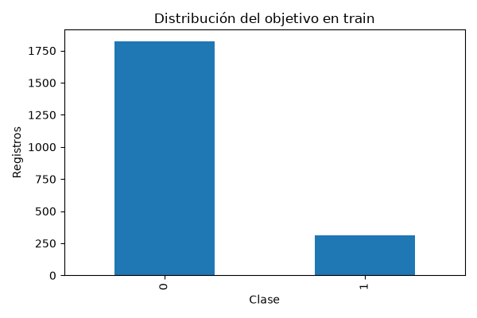

# Informe integral · Churn de telecomunicaciones

Generado: 2026-10-26T14:10:48.662706+00:00 (UTC).

Estado del informe: **Evidencia disponible**. Estado del último maestro: **completado**.

Este documento reúne los archivos guardados; no ejecuta modelos ni certifica su utilidad. Las fechas y huellas del manifiesto permiten revisar su procedencia.

## Objetivo y configuración

Proyecto de clasificación de `Churn` con uso de llamadas, planes contratados y contactos con servicio al cliente. Se integra al portafolio con notebooks independientes, reportes estables y un maestro de ejecución.

| Indicador | Valor |
| --- | --- |
| title | Churn de telecomunicaciones |
| source_zip | data/raw/Telecom Churn Dataset.zip |
| members / train | churn-bigml-80.csv |
| members / test | churn-bigml-20.csv |
| target | Churn |
| id | No disponible |
| split | provided |
| source_base | project |
| decision_costs / false_negative | 5 |
| decision_costs / false_positive | 1 |

## Datos y preparación

Indicadores de [preparacion.json](../../reports/preparacion/preparacion.json):

| Indicador | Valor |
| --- | --- |
| particion | provided |
| semilla | 42 |
| datasets / train / filas | 2132 |
| datasets / train / columnas | 20 |
| datasets / train / positivos | 310 |
| datasets / valid / filas | 534 |
| datasets / valid / columnas | 20 |
| datasets / valid / positivos | 78 |
| datasets / test / filas | 667 |
| datasets / test / columnas | 20 |
| datasets / test / positivos | 95 |
| ids_compartidos_train_test | No disponible |
| limitacion_identidad | Sin ID de cliente: no se puede comprobar independencia por persona. |
| filas_identicas_train_test | 0 |
| filas_identicas_valid_test | 0 |

## Hallazgos exploratorios

Indicadores de [eda.json](../../reports/eda/eda.json):

| Indicador | Valor |
| --- | --- |
| filas_train | 2132 |
| positivos | 310 |
| proporcion_positiva | 0.145403 |
| nulos / State | 0 |
| nulos / Account length | 0 |
| nulos / Area code | 0 |
| nulos / International plan | 0 |
| nulos / Voice mail plan | 0 |
| nulos / Number vmail messages | 0 |
| nulos / Total day minutes | 0 |
| nulos / Total day calls | 0 |
| nulos / Total day charge | 0 |
| nulos / Total eve minutes | 0 |
| nulos / Total eve calls | 0 |
| nulos / Total eve charge | 0 |
| nulos / Total night minutes | 0 |
| nulos / Total night calls | 0 |
| nulos / Total night charge | 0 |
| nulos / Total intl minutes | 0 |
| nulos / Total intl calls | 0 |
| nulos / Total intl charge | 0 |
| nulos / Customer service calls | 0 |
| nulos / Churn | 0 |

### EDA de entrenamiento

Registros: **2,132**. Churn positivo: **14.54%**. La clase positiva es minoritaria.

Se explora solo train: validación selecciona el modelo y test queda reservado. No se infiere causalidad ni representatividad de estas cifras.

#### Nulos por columna

```text
                        nulos
State                       0
Account length              0
Area code                   0
International plan          0
Voice mail plan             0
Number vmail messages       0
Total day minutes           0
Total day calls             0
Total day charge            0
Total eve minutes           0
Total eve calls             0
Total eve charge            0
Total night minutes         0
Total night calls           0
Total night charge          0
Total intl minutes          0
Total intl calls            0
Total intl charge           0
Customer service calls      0
Churn                       0
```

#### Atributos excluidos

Total day charge, Total eve charge, Total night charge, Total intl charge

[Reporte de la etapa](../../reports/eda/eda.md).



## Baseline

Indicadores de [baseline_validacion.json](../../reports/baseline/baseline_validacion.json):

| Indicador | Valor |
| --- | --- |
| casos | 534 |
| accuracy | 0.853933 |
| average_precision | 0.146067 |
| roc_auc | 0.5 |

## Modelo y selección

Indicadores de [decisiones_validacion.json](../../reports/modelado/decisiones_validacion.json):

| Indicador | Valor |
| --- | --- |
| decision_protocol | Separación estratificada 75/25 dentro de train; sin ID no se comprueba independencia por persona |
| decision_fit_cases | 1599 |
| decision_calibration_cases | 533 |
| decision_validation_cases | 534 |
| decision_threshold | 0.17 |
| decision_false_negative_cost | 5 |
| decision_false_positive_cost | 1 |
| decision_criterion | AP validación para modelo; sigmoid fijo en calibración; coste FN/FP en validación para umbral |
| decision_test_used_for_selection | False |

Indicadores de [modelos_validacion.json](../../reports/modelado/modelos_validacion.json):

| Indicador | Valor |
| --- | --- |
| criterio | average_precision_validacion |
| class_weight_elegido | No disponible |

### Calibración y política de decisión

Modelo adicional: **1599 filas para ajuste** y **533 para calibración**. Separación estratificada 75/25 dentro de train; sin ID no se comprueba independencia por persona. Se comparan dos ponderaciones por AP de validación; calibración sigmoid fijada de antemano. El umbral **0.17** minimiza coste ilustrativo FN=5.0, FP=1.0 en la grilla de validación. Se conserva el modelo original para su comparación histórica; las métricas de decisiones corresponden a este ajuste adicional. Validación selecciona modelo y umbral: su rendimiento es optimista y el test queda reservado.

[Reporte de la etapa](../../reports/modelado/decisiones.md).

[Detalle: particion_calibracion.csv](../../reports/modelado/particion_calibracion.csv)

[Detalle: umbrales_validacion.csv](../../reports/modelado/umbrales_validacion.csv)

## Evaluación y conclusiones

Indicadores de [decisiones_test.json](../../reports/evaluacion/decisiones_test.json):

| Indicador | Valor |
| --- | --- |
| decision_cost_scope | Penalizaciones ilustrativas de clasificación, no coste real de campaña ni ahorro medido |

Indicadores de [evaluacion_test.json](../../reports/evaluacion/evaluacion_test.json):

| Indicador | Valor |
| --- | --- |
| baseline / casos | 667 |
| baseline / accuracy | 0.857571 |
| baseline / average_precision | 0.142429 |
| baseline / roc_auc | 0.5 |
| modelo / casos | 667 |
| modelo / accuracy | 0.85907 |
| modelo / average_precision | 0.421966 |
| modelo / roc_auc | 0.811704 |

### Evaluación final

Casos de test: **667**. El modelo **supera** el baseline en accuracy.

```text
          accuracy  average_precision   roc_auc
baseline  0.857571           0.142429  0.500000
modelo    0.859070           0.421966  0.811704
```

Las métricas describen esta partición. Revisar recall por clase y matriz de confusión en el JSON; no ajustar parámetros ni thresholds con este test. La definición del churn y la disponibilidad temporal de las features deben confirmarse en la fuente.

#### Probabilidades y decisiones

Brier sigmoid **0.1012**, menor que sin calibrar **0.1048**. Brier y log loss combinan calibración y discriminación; ECE depende de los bins. Las tablas de fiabilidad incluyen soporte y omiten bins vacíos. Con umbral fijado en validación **0.17**, se priorizan **186 de 667 casos**: recall **66.32%**, precisión **33.87%**, coste de error **0.424 unidades por caso**. FN=5.0, FP=1.0 son supuestos ilustrativos, no importes reales ni ahorro de retención. Se muestran todas las políticas sin elegir una nueva con test. Sin ID de cliente: no se puede comprobar independencia por persona.

[Reporte de la etapa](../../reports/evaluacion/evaluacion.md).


[Detalle: calibracion_test.csv](../../reports/evaluacion/calibracion_test.csv)

[Detalle: fiabilidad_bins.csv](../../reports/evaluacion/fiabilidad_bins.csv)

[Detalle: politicas_test.csv](../../reports/evaluacion/politicas_test.csv)

### Comparación automática

- `accuracy`: baseline **0.857571**, modelo **0.85907**; el modelo **mejora** este indicador en la evaluación guardada.
- `average_precision`: baseline **0.142429**, modelo **0.421966**; el modelo **mejora** este indicador en la evaluación guardada.
- `roc_auc`: baseline **0.5**, modelo **0.811704**; el modelo **mejora** este indicador en la evaluación guardada.

## Alertas y estado de ejecución

| Notebook | Tipos de aviso registrados |
| --- | --- |
| 00_configuracion_entorno | 0 |
| 01_preparacion_datos | 0 |
| 02_analisis_exploratorio | 0 |
| 03_baseline | 0 |
| 04_modelado | 0 |
| 05_evaluacion | 0 |

Una tabla vacía de warnings no demuestra ausencia de errores o validez del modelo. Consulta [alertas](../alertas/) y [resumen del maestro](../ejecucion/resumen.json).

| Notebook | Celdas ejecutadas guardadas | Última ejecución UTC | Errores guardados |
| --- | --- | --- | --- |
| 01_preparacion_datos.ipynb | 3/3 | 2026-10-26T14:10:36.134364Z | 0 |
| 02_analisis_exploratorio.ipynb | 3/3 | 2026-10-26T14:10:38.355382Z | 0 |
| 03_baseline.ipynb | 3/3 | 2026-10-26T14:10:43.224926Z | 0 |
| 04_modelado.ipynb | 3/3 | 2026-10-26T14:10:45.327578Z | 0 |
| 05_evaluacion.ipynb | 3/3 | 2026-10-26T14:10:47.750898Z | 0 |

## Limitaciones y próximos pasos

La definición del churn y la disponibilidad temporal de las variables deben confirmarse. Revisa recall por clase y posibles diferencias entre train y test; las métricas de proyectos distintos no son directamente comparables.

- Comprobar procedencia, condiciones de uso y disponibilidad temporal de las variables.
- Completar una pasada de 06 y revisar las alertas antes de publicar el informe.
- Revisar métricas por clase y errores frecuentes; ajustar decisiones en validación, conservando test independiente.

## Evidencia y reproducción

Desde la carpeta de este proyecto, ejecuta `python scripts/generate_report.py` para reunir los resultados guardados, o 06 para ejecutar los análisis y actualizar el informe.

Consulta el [README](../../README.md), la [guía del informe](../../docs/informe_final.md) y el [manifiesto con datos y huellas](informe_final.json). El informe conserva una versión vigente por proyecto.
