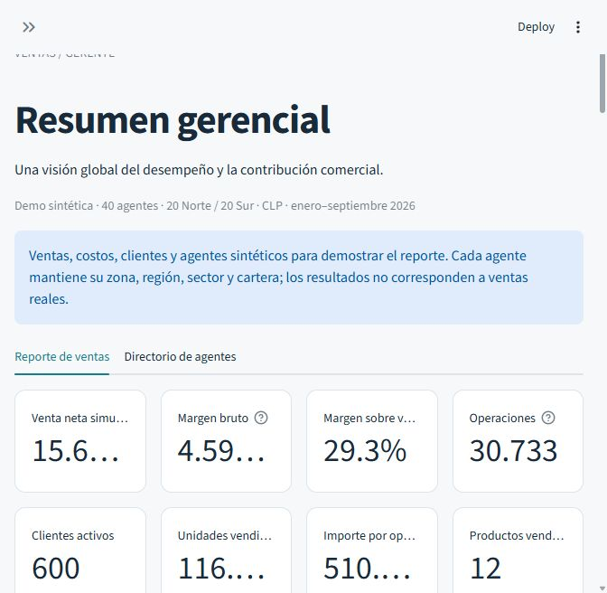
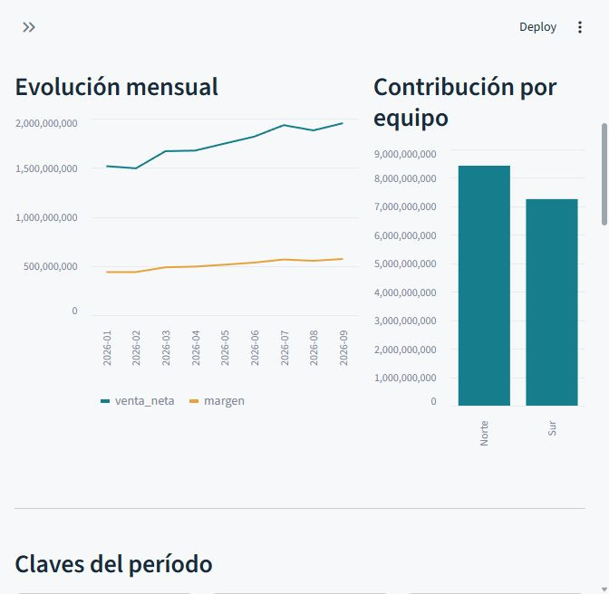

# SalesAccess · Portal de ventas en Streamlit
  

Demo de BI con autenticación local, cuatro niveles de acceso y segmentación de ventas. La fuente activa es una **demo completamente sintética** con **40 agentes (20 Norte y 20 Sur), 30.733 operaciones, 600 clientes y 12 productos**, expresada en CLP para enero–septiembre de 2026. También conserva el adaptador y una copia de las 2.523 ventas completas de Kaggle utilizadas inicialmente. Si no existe `data/ventas.csv`, genera la misma demo ampliada en memoria.




Más capturas (rankings, directorio de agentes) en el [manual del dashboard](docs/manual_dashboard_salesaccess.md).

## Contenido

- [Vistas y cuentas](#vistas-y-cuentas)
- [Ejecutar en Windows](#ejecutar-en-windows)
- [Perfilamiento](#perfilamiento)
- [Datos reales y Kaggle](#datos-reales-y-kaggle)
- [Validación y límites](#validación-y-límites)
- [Organización](#organización)
- [Exploración visual por rol](#exploración-visual-por-rol)
- [Herramientas del analista · etapa 1 de 5](#herramientas-del-analista--etapa-1-de-5)
- [Fichas de agentes](#fichas-de-agentes)

## Vistas y cuentas

| Cuenta | Rol | Datos permitidos | Vista |
| --- | --- | --- | --- |
| `gerente` | Gerente | Todos | Indicadores, evolución y resumen por equipo/región; exportación agregada |
| `analista` | Analista | Todos | Exploración y detalle de cada operación; exportación de detalle |
| `supervisor_norte` | Supervisor | Equipo Norte | Comparación de agentes y detalle del equipo |
| `supervisor_sur` | Supervisor | Equipo Sur | Comparación de agentes y detalle del equipo |
| `agente_1` | Agente | Solo agente_1, equipo Norte | Resultados y operaciones propias |
| `agente_2` | Agente | Solo agente_2, equipo Sur | Resultados y operaciones propias |

Hay **44 cuentas**: gerente, analista, dos supervisores y `agente_1` a `agente_40`. Los agentes impares pertenecen a Norte y los pares a Sur; cada agente ve únicamente sus operaciones. `data/agentes_demo.csv` documenta equipo, región y sector de cada agente. El gerente y el analista tienen el mismo alcance, pero diferentes niveles de detalle en pantalla y descarga. Las cuentas existentes conservaron sus contraseñas al ampliar la demo.

Cada agente tiene una cartera exclusiva de 15 clientes, un sector y una región fijos. Las regiones del Norte son Antofagasta, Tarapacá, Atacama y Coquimbo; las del Sur, Biobío, Los Lagos, La Araucanía y Los Ríos. Hay dos sectores: Retail y Empresas. Cada producto tiene precio de catálogo y costo unitario fijo; se aplican descuentos según sector. La capacidad comercial y la mezcla de productos varían entre agentes, hay crecimiento mensual simulado y menor actividad los fines de semana. La semilla 42 permite reproducir los datos sin duplicar ventas de Kaggle ni atribuirles origen real.

Los rankings de vendedores muestran **Top 5 y Bottom 5**, sin repetir agentes, tanto globalmente como dentro de la zona del supervisor. Los filtros pueden reducir la población: se muestran menos de cinco por extremo cuando no hay suficientes agentes para ambos grupos.

## Ejecutar en Windows

Desde esta carpeta:

```powershell
python -m venv .venv
.\.venv\Scripts\python.exe -m pip install -r requirements.txt
.\.venv\Scripts\python.exe scripts/setup_demo.py
.\.venv\Scripts\python.exe scripts/generate_demo.py
.\.venv\Scripts\python.exe -m streamlit run app.py
```

Abre http://localhost:8501 e ingresa con una de las cuentas anteriores. Las contraseñas aleatorias se generan individualmente y se guardan **solo para la prueba local** en `.local/credenciales_demo.txt`. No se muestran en el formulario de ingreso ni se incluyen en el repositorio. El script no reemplaza cuentas existentes. El archivo contiene contraseñas en claro: retíralo cuando termine la prueba y restringe el acceso a `.local`.

Si Windows falla al crear el entorno durante `ensurepip`, se puede completar la instalación usando el pip del Python principal:

```powershell
python -m pip --python .venv/Scripts/python.exe install -r requirements.txt
```

## Perfilamiento

El perfil se guarda en SQLite (`.local/users.sqlite3`) y se consulta nuevamente en cada ejecución. Ningún filtro de pantalla permite ampliar el alcance. El reporte, las opciones de filtros, las gráficas y las exportaciones reciben únicamente filas autorizadas. No hay un selector de rol para el usuario.

En `sales_access.security.Profile`, un supervisor admite equipos, sectores y regiones:

```python
Profile("supervisor_retail_norte", "Supervisión Retail Norte", "supervisor",
        teams=("Norte",), sectors=("Retail",), regions=("Antofagasta", "Tarapacá"))
```

Los valores dentro de un mismo eje se unen (Antofagasta **o** Tarapacá). Los ejes configurados se intersectan (Norte **y** Retail **y** alguna de esas regiones). Se puede perfilar solo por sector o solo por región dejando los otros ejes vacíos. Un supervisor sin alcance, un agente sin identificador o un rol desconocido no ve filas. La asignación de agentes se basa en `agente_id`, no en su nombre visible. Los identificadores y segmentos distinguen mayúsculas, minúsculas y acentos.

Para crear una cuenta adicional, utiliza `add_user(profile, password)` desde un script local de administración. Los cambios de perfil o `active=0` en SQLite se aplican en la siguiente ejecución de la sesión. La administración queda fuera de la interfaz del reporte.

## Datos reales y Kaggle

Fuente opcional anterior: DataRegina, [Datasets para Proyecto BI – Análisis de Ventas](https://www.kaggle.com/datasets/dataregina/datasets-para-proyecto-bi), licencia **CC BY-NC-SA 4.0** según sus metadatos públicos. Respeta atribución, uso no comercial y compartir las adaptaciones bajo esa licencia. Se conserva el ZIP original fuera del repositorio en `.local/kaggle_dataregina.zip`; el CSV y sus metadatos de importación quedaron preservados en `.local/source_backups/20261007_130912_656226/`. El archivo activo `data/ventas.metadata.json` ahora describe la demo sintética. Los resultados de validación anteriores contra Kaggle son evidencia histórica, no el tamaño de la fuente actual.

Se verificaron cinco archivos: ventas, clientes, productos, categorías y métodos de pago. El adaptador une ventas con productos y regiones de clientes, interpreta codificación UTF-8 o Windows-1252, fechas día/mes/año y precios con coma decimal. No incorpora nombres ni correos de clientes al reporte.

De las 3.029 filas originales, se retiraron **29 duplicados exactos** y **477 ventas no completas**, quedando 2.523 operaciones. Los identificadores repetidos con contenidos distintos producen un error para revisión manual. Las uniones exigen productos y clientes válidos, sin multiplicar filas.

La fuente no contiene agentes, equipos, costos ni una moneda declarada. Para demostrar permisos se asigna cada cliente a `agente_(ID_Cliente % 4 + 1)`; agentes 1/3 pertenecen a Norte y 2/4 a Sur. Los equipos son etiquetas simuladas y no describen la ubicación real del cliente. El importe estimado es `Cantidad × Precio_Unitario` del catálogo, almacenado en el campo normalizado `venta_neta` por compatibilidad. **No equivale a facturación histórica neta confirmada**. La aplicación muestra U.M. y deja los márgenes sin calcular, porque no hay costos. La asignación real de vendedores, precios históricos, descuentos y moneda deberá reemplazar estos supuestos antes de usar el reporte operativamente.

Para reproducir la importación desde una copia limpia:

```powershell
.\.venv\Scripts\python.exe scripts/import_kaggle.py --download
# Alternativa sin red:
.\.venv\Scripts\python.exe scripts/import_kaggle.py --archive ruta/al/dataset.zip
```

El importador conserva archivos anteriores: si ya existe `data/ventas.csv`, pide renombrarlo. Su adaptación original genera cuatro agentes simulados, mientras que la fuente sintética ampliada genera cuarenta. Para activar o regenerar la demo ampliada, ejecuta `scripts/generate_demo.py`: copia primero el CSV y sus metadatos anteriores a un directorio nuevo dentro de `.local/source_backups/` y luego escribe la demo. También puedes renombrar el CSV activo y sus metadatos para usar la generación en memoria.

Para usar datos reales, prepara `data/ventas.csv` con UTF-8, separador coma y estos campos:

| Columna | Contenido |
| --- | --- |
| venta_id | Identificador único por fila/operación |
| fecha | Fecha ISO `YYYY-MM-DD` |
| agente_id | ID que corresponde al perfil del agente |
| equipo, sector, region | Segmentos usados en la autorización |
| producto, cliente_id | Producto e identificador del cliente |
| unidades | Entero positivo |
| venta_neta, costo | Valores finitos, no negativos, en CLP, sin separadores de miles; costo puede quedar vacío si no está disponible |

La aplicación detecta este archivo automáticamente; si falta, usa la demo sintética. Un CSV presente pero inválido muestra un error y no se reemplaza silenciosamente por la demo. Un CSV manual sin metadatos se considera CLP: si está en otra moneda, crea sus metadatos con `source`, `currency` y `revenue_label` o normaliza los montos antes de utilizarlo. Al reemplazar datos, reemplaza también los metadatos para evitar conservar etiquetas de otra fuente. No cargues directamente archivos de Kaggle sin mapear sus columnas y relaciones. Las devoluciones y notas de crédito requieren extender el modelo: el contrato inicial no admite montos negativos.

Cada fila representa una operación y un producto, por lo que el indicador cuenta **operaciones**, no pedidos. Margen bruto = venta neta − costo; porcentaje de margen = margen bruto / venta neta. Estos indicadores solo se calculan cuando todas las operaciones seleccionadas tienen costos conocidos. Las gráficas mensuales respetan el rango elegido y pueden incluir meses parciales. No hay metas de ventas ni variaciones contra períodos anteriores inventadas.

## Validación y límites

```powershell
.\.venv\Scripts\python.exe -m pytest -q
```

Las pruebas verifican aislamiento entre agentes, alcance de supervisores, intersección de segmentos, exportaciones, roles sin permisos, autenticación, bloqueo, revocación, validación del CSV, vistas completas y cambio de cuenta tras cerrar sesión.

Validación actual: **55 pruebas aprobadas**, incluyendo consistencia y reproducibilidad de los 40 agentes, carteras exclusivas, costos unitarios fijos, rankings Top 5/Bottom 5 por zona, reinicio de filtros al cambiar de fuente, acceso por rol a las fichas y contactos ficticios, selección desde rankings e indicadores individuales. Se comprobó la autenticación de las 40 cuentas de agente y ocho vistas representativas; los resúmenes están en `reports/expanded_demo_verification.json` y `reports/agent_profiles_verification.json`. La ficha de Mariana Cáceres y sus importes individuales se verificaron con la cuenta de gerente en `reports/agent_detail_verification.json`.

Los reportes `reports/verification.json`, `reports/dashboard_verification.json` y `reports/comparator_verification.json` conservan las comprobaciones anteriores sobre las 2.523 filas importadas de Kaggle. `requirements.lock.txt` registra las versiones exactas del entorno comprobado; se puede instalar con `-r requirements.lock.txt` para reproducirlo. La validación acredita el prototipo y sus casos de prueba, no una auditoría de seguridad de producción.

Las contraseñas se almacenan con PBKDF2-SHA256, sal individual y 600.000 iteraciones. Las consultas son parametrizadas; cinco intentos fallidos bloquean la cuenta durante cinco minutos. La sesión vence una hora después del ingreso y cerrar sesión limpia sus filtros y estado. Las exportaciones neutralizan fórmulas en campos de texto.

Esta implementación es una **demo local**, escuchando solo en 127.0.0.1. El bloqueo por cuenta no sustituye controles de abuso distribuidos. SQLite y el CSV están disponibles al proceso de la aplicación; el aislamiento se implementa en la aplicación, sin políticas de filas en una base de datos. Para uso empresarial: HTTPS, proveedor de identidad, auditoría, gestión de usuarios y secretos, y políticas de acceso en la base de datos. Streamlit ofrece [autenticación OIDC](https://docs.streamlit.io/develop/concepts/connections/authentication); los permisos de ventas siguen siendo responsabilidad de la aplicación.

## Organización

- `app.py`: ingreso, filtros, cuatro vistas y descarga.
- `sales_access/security.py`: autenticación, perfiles y autorización.
- `sales_access/data.py`: datos reproducibles, contrato del CSV y exportación.
- `scripts/setup_demo.py`: creación de cuentas de prueba.
- `scripts/generate_demo.py`: generación de las ventas sintéticas ampliadas y respaldo de la fuente anterior.
- `scripts/import_kaggle.py` y `sales_access/kaggle_import.py`: importación y limpieza de la fuente seleccionada.
- `tests/`: pruebas de seguridad y ejecución de la interfaz.
- `.streamlit/config.toml`: tema visual y servicio local.

El proyecto se puede copiar y ejecutar por separado del resto del portafolio.

## Exploración visual por rol

Todas las vistas incluyen ocho indicadores: importe, margen cuando existe costo, porcentaje de margen, operaciones, clientes activos, unidades, importe por operación y cantidad de productos vendidos. Los rangos rápidos de 30 y 90 días terminan en la última fecha disponible del perfil, no en la fecha de hoy. El período se puede ajustar manualmente.

El importe, las operaciones, los clientes activos y las unidades muestran variaciones frente al período anterior de igual duración, con los mismos filtros y permisos. Se exige cobertura temporal completa dentro del segmento seleccionado; con historia insuficiente o una base de cero no se muestra un porcentaje. Los días sin operaciones dentro de ese rango se consideran días sin ventas, no prueba de que la fuente esté completa.

| Rol | Contenido adicional |
| --- | --- |
| Gerente | Mayor y menor aporte de vendedores/productos, concentración en los tres principales vendedores, mezcla por sector, importe regional y clientes destacados |
| Analista | Rankings con métrica seleccionable y exportación, matriz producto × región, mezcla y frecuencia de operaciones por cliente |
| Supervisor | Rankings de agentes dentro de su alcance, resumen descargable de rankings y oportunidades por producto, sector y cliente |
| Agente | Rankings de sus productos, concentración en sus principales clientes, mezcla y frecuencia de operaciones en su cartera |

Los rankings se ordenan por importe, unidades u operaciones. Se muestran hasta cinco elementos por extremo, sin repetirlos; con un único elemento no hay extremo inferior. Se consideran únicamente elementos con ventas, por lo que no se puede inferir desempeño de vendedores sin operaciones ni productos ausentes del período. Menor aporte no implica incumplimiento de metas. En Kaggle, el ranking de vendedores sigue basado en asignaciones simuladas.

## Herramientas del analista · etapa 1 de 5

El **comparador de períodos** aparece únicamente en la vista del analista. Usa el período actual de la barra lateral y permite elegir como referencia el período anterior de igual duración o un intervalo personalizado anterior al actual. Ambos períodos respetan los mismos filtros y permisos; un intervalo personalizado de distinta duración muestra un aviso y compara totales sin normalizarlos por día.

El desglose por producto, región o vendedor muestra importes actuales y de referencia, diferencia absoluta, variación porcentual y aporte al cambio global en puntos porcentuales. La unión de ambos períodos conserva elementos sin importe actual y elementos sin importe de referencia. Una base de cero deja el porcentaje vacío. La suma de diferencias equivale al cambio total y la suma de aportes equivale a su variación porcentual cuando hay base positiva. La gráfica resalta los diez cambios de mayor magnitud y el CSV incluye todo el desglose.

Con historial insuficiente no se calculan comparaciones parciales como si fueran completas. La descomposición explica matemáticamente el resultado; no demuestra causas comerciales. En Kaggle se comparan importes estimados y vendedores simulados.

Orden acordado de las próximas etapas: 2) Pareto de productos y clientes; 3) explorador de operaciones; 4) alertas de cambios; 5) calidad de datos. Estas cuatro herramientas todavía están pendientes de implementación.

## Fichas de agentes

Los 40 agentes tienen una identidad ficticia estable vinculada a `agente_id`: nombre, correo de ejemplo, móvil corporativo de ejemplo, teléfono de oficina, anexo, sucursal, región, zona y sector. Los correos usan el dominio reservado `ventas.example`; los teléfonos contienen `X` para identificarlos como ejemplos sin números operativos. Las imágenes son avatares con iniciales generados en la interfaz, sin fotografías de personas reales.

El gerente y el analista pueden seleccionar cualquiera de las 40 fichas. El supervisor ve únicamente agentes que cumplen todos sus ejes de autorización; el agente ve solo su propia ficha. Las opciones del directorio siguen el alcance del perfil, para conservar el acceso a agentes sin ventas en el período. La ficha está visible con sus contactos sin desplegables adicionales. Incluye un resumen individual de importe, margen bruto cuando se conocen los costos, operaciones, clientes activos, unidades e importe por operación, respetando todos los filtros del reporte. Si un agente no tiene ventas bajo esos filtros, se indica explícitamente. En CLP los montos individuales se muestran con el símbolo `$`.

El directorio está en una pestaña separada de **Reporte de ventas**. Gerente, analista y supervisor pueden filtrar por zona, sucursal y buscar por nombre o código, incluso sin acentos. Las opciones se construyen solo con agentes autorizados; las sucursales dependen de la zona seleccionada. Cambiar a una zona incompatible restablece la sucursal. La búsqueda del directorio no altera los filtros ni los indicadores del reporte de ventas. El agente dispone de la pestaña **Mi ficha**, sin búsqueda de compañeros.

Los rankings muestran nombre, avatar y sucursal y un botón **Ver ficha de…** que abre la pestaña del directorio con el agente seleccionado. Este acceso restablece los filtros de búsqueda del directorio para que la ficha elegida sea visible, conservando siempre los permisos y los filtros del reporte. Los identificadores de las cuentas y sus contraseñas permanecen iguales.

`sales_access/agents.py` conserva la fuente reproducible de estas identidades. `data/agentes_demo.csv` documenta sus campos; actualmente se genera desde el módulo, no se usa como un formulario de edición ni como fuente de datos personales reales.

La validación de pestañas, filtros del directorio y alcance por rol se registra en `reports/directory_tabs_verification.json`.
