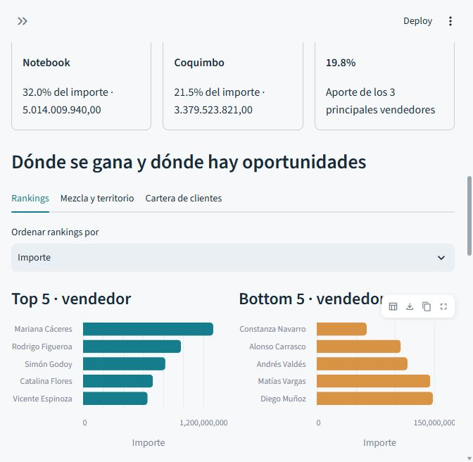
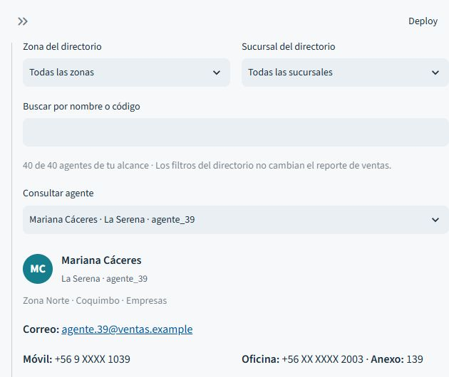

# Manual del dashboard comercial

SalesAccess

Guía de uso por rol · Versión documentada el 7 de octubre de 2026

Este manual explica las opciones implementadas del portal de ventas, cómo consultarlas y cómo interpretar sus resultados. Está dirigido a gerentes, analistas, supervisores y agentes.

## Datos de la demostración

La fuente activa es sintética: 40 agentes, 20 en Norte y 20 en Sur, 600 clientes, 12 productos y 30.733 operaciones entre el 1 de enero y el 30 de septiembre de 2026. Los importes se expresan en pesos chilenos CLP. Los nombres, contactos y ventas son ficticios.

Cada agente conserva su zona, región, sector y cartera. Los datos permiten probar permisos y análisis con resultados consistentes. El adaptador del conjunto original de Kaggle es opcional; ese conjunto no es la fuente de las cifras ilustradas en esta guía.

## Cómo recorrer la guía

| Página | Contenido |
| --- | --- |
| 2 | Acceso y permisos por rol |
| 3 | Navegación y filtros del reporte |
| 4 | Indicadores y variaciones |
| 5 | Evolución y claves del período |
| 6 | Rankings de vendedores y productos |
| 7 | Mezcla territorial y cartera de clientes |
| 8 | Comparador de períodos del analista |
| 9 | Directorio y ficha comercial |
| 10 | Tablas, descargas y preguntas frecuentes |

Las capturas muestran la aplicación real en una ventana compacta. Los valores completos y la explicación de los controles se presentan en el texto y las tablas. Los resultados cambian al modificar filtros.

# 1 Acceso y permisos

Abre http://localhost:8501/ mientras el servicio local esté disponible. Ingresa tu usuario y contraseña y pulsa Entrar al reporte. Las credenciales se entregan por separado; este manual no contiene contraseñas.

| Rol y cuentas | Información visible | Uso principal |
| --- | --- | --- |
| Gerente gerente | Todas las ventas y los 40 agentes. | Resumen global, contribución por equipo, rankings y resultados por equipo y región. |
| Analista analista | Todas las ventas y los 40 agentes. | Detalle de operaciones, matriz producto por región, desglose de rankings y comparador de períodos. |
| Supervisor supervisor_norte supervisor_sur | Solo su segmento autorizado. En la demo, 20 agentes de su zona. | Ventas por agente, prioridades del equipo, detalle y directorio dentro de su alcance. |
| Agente agente_1 a agente_40 | Sus propias ventas y su propia ficha. | Evolución personal, productos, clientes y detalle de sus operaciones. |

## Cómo se aplica el alcance

El perfil limita los datos antes de mostrar filtros, gráficos, fichas o exportaciones. Elegir un filtro no amplía los permisos. Un supervisor puede estar restringido además por sector o región; si se configuran varios ejes, debe cumplir todos los ejes asignados.

En la demo, los códigos impares pertenecen a Norte y los pares a Sur. El agente no puede consultar fichas de otros vendedores ni acceder a sus rankings.

## Sesión y cierre

El panel lateral muestra tu nombre, rol y alcance. Cerrar sesión vuelve a la pantalla de ingreso. La sesión expira una hora después de iniciar sesión. Cinco intentos fallidos bloquean temporalmente la cuenta durante cinco minutos.

# 2 Navegación y filtros

La pestaña Reporte de ventas contiene los indicadores y análisis. Directorio de agentes permite buscar contactos y consultar fichas; para el rol agente se llama Mi ficha. Dentro del reporte aparecen Rankings, Mezcla y territorio y Cartera de clientes.

| Control del panel lateral | Qué hace |
| --- | --- |
| Rango rápido | Todo el historial, Últimos 30 días o Últimos 90 días. Los últimos días se cuentan desde la fecha más reciente disponible, no desde la fecha de hoy. |
| Período | Selecciona una fecha inicial y una final. Incluye ambos días. Debe quedar completo para mostrar el reporte. |
| Equipo | Limita a Norte, Sur o los equipos disponibles dentro de tu perfil. |
| Sector | Selecciona Retail, Empresas o ambos. |
| Región | Limita a las regiones disponibles en tu alcance. |
| Agente | Selecciona códigos de vendedores autorizados. La búsqueda por nombre se encuentra en el directorio. |
| Producto | Limita el reporte a uno o varios productos. |

## Cómo combinar filtros

Un selector vacío significa todos los valores permitidos. Varias opciones de un mismo selector se suman como alternativas; distintos selectores se intersectan. Por ejemplo, Equipo Norte y Región Coquimbo muestra ventas que cumplen ambas condiciones.

Los filtros afectan indicadores, gráficos, tablas, descargas y el resumen estadístico de las fichas. Si no hay coincidencias, se muestra un aviso. Para recuperar una vista amplia, quita las selecciones y elige Todo el historial.

Para localizar personas por La Serena o Concepción, utiliza Sucursal del directorio. Ese control filtra la búsqueda de agentes y no altera el reporte de ventas.

# 3 Indicadores principales

Todas las tarjetas describen únicamente las ventas autorizadas que cumplen los filtros y el período actual.

| Indicador | Cálculo e interpretación |
| --- | --- |
| Venta neta simulada | Suma de venta_neta. Mide el importe registrado en CLP. En esta demo no corresponde a ventas reales. |
| Margen bruto | Venta neta menos costo. Se calcula solo cuando todas las operaciones seleccionadas tienen costo; en otro caso indica Sin costos. |
| Margen sobre ventas | Margen bruto dividido por venta neta. Se muestra como porcentaje; si el importe es cero, aparece un guion. |
| Operaciones | Cantidad de filas del reporte. No representa necesariamente pedidos o facturas únicos. |
| Clientes activos | Cantidad de códigos de cliente distintos con operaciones en el período. |
| Unidades vendidas | Suma de unidades de las operaciones seleccionadas. |
| Importe por operación | Venta neta dividida por cantidad de operaciones. Es un promedio por registro. |
| Productos vendidos | Cantidad de productos distintos presentes en las ventas filtradas. |

## Cómo leer las variaciones

Venta neta, operaciones, clientes y unidades pueden mostrar un cambio porcentual frente al período anterior de igual cantidad de días, con los mismos filtros y permisos. Fórmula: 100 × (actual - anterior) / anterior.

Si el historial no cubre el intervalo anterior, no se muestra el porcentaje. Tampoco se calcula cuando la base es cero. Es normal que Todo el historial no tenga comparación; prueba Últimos 30 días o Últimos 90 días.

Ejemplo sin filtros, enero a septiembre de 2026: venta neta 15.682.901.166 CLP, margen bruto 4.594.947.320 CLP, margen 29,3 %, 30.733 operaciones y 600 clientes. Estas cifras son una referencia de la demo, no objetivos comerciales.

# 4 Evolución y claves del período

| Opción | Qué muestra y para qué sirve |
| --- | --- |
| Evolución mensual | Líneas de venta neta y margen cuando hay costos completos. Permite observar cambios a través de los meses. Si filtras parte de un mes, ese mes muestra solo los días incluidos. |
| Contribución por equipo | Vista del gerente. Compara el importe acumulado de los equipos autorizados y filtrados. |
| Ventas por agente | Vista del supervisor. Compara vendedores dentro de su segmento. |
| Ventas por producto | Vista del analista y del agente. Compara la contribución de los productos del alcance seleccionado. |
| Producto con mayor aporte | Producto líder en importe y porcentaje del total filtrado. |
| Región con mayor aporte | Región líder en importe y porcentaje del total filtrado. |
| Concentración de ventas | Participación de los tres principales vendedores. Para el agente, participación de sus tres principales clientes. |

## Lectura de ejemplo

Con todo el historial, Notebook aporta 32,0 % del importe y Coquimbo 21,5 %. Los tres principales vendedores concentran 19,8 %. Estos porcentajes permiten identificar dependencia de productos, territorios o vendedores.

Una concentración alta sirve para orientar preguntas sobre diversificación. Los gráficos describen resultados; por sí solos no explican sus causas ni evalúan cumplimiento de metas.

Figura 1. Evolución y contribución en el reporte gerencial.

# 5 Rankings y fichas desde el reporte

Abre Rankings dentro de Reporte de ventas. Ordenar rankings por permite elegir Importe, Unidades u Operaciones. El orden se recalcula con la medida seleccionada y los filtros actuales.

| Opción | Funcionamiento |
| --- | --- |
| Top 5 de vendedores | Hasta cinco agentes con mayor resultado. Disponible para gerente, analista y supervisor dentro de su alcance. |
| Bottom 5 de vendedores | Hasta cinco agentes con menor resultado entre quienes tienen ventas en el período. No incluye agentes sin operaciones. |
| Top y Bottom de productos | Los extremos de la medida seleccionada por producto. Disponible para todos los roles. |
| Ver ficha de una persona | Abre Directorio de agentes y selecciona al vendedor. Limpia los filtros de búsqueda del directorio y mantiene los filtros del reporte. |
| Desglose del ranking | Analista y supervisor pueden elegir Vendedor o Producto y consultar la tabla completa con importe, unidades, operaciones y participación. |
| Descargar ranking CSV | Exporta el desglose completo autorizado y filtrado para analista y supervisor. |

Los extremos no repiten elementos. Con menos de diez elementos se muestran menos de cinco por extremo; con uno solo no hay un segundo grupo para comparar. Un menor importe no equivale a bajo desempeño: no hay metas, cuotas ni ajuste por tamaño de cartera en esta comparación.

Figura 2. Top 5 y Bottom 5 de vendedores ordenados por importe.

# 6 Mezcla territorial y clientes

## Mezcla y territorio

| Visualización | Cómo interpretarla |
| --- | --- |
| Mezcla por sector | Gráfico de anillo con la participación de Retail y Empresas sobre el importe filtrado. Al pasar sobre un sector se consultan importe y participación. |
| Importe por región | Barras de contribución territorial. Permiten comparar regiones dentro del alcance y los filtros. |
| Matriz producto por región | Disponible para analista. Cada celda representa la venta neta de un producto en una región; un color más intenso indica mayor importe. Consulta el valor al pasar sobre la celda. |

Ejemplo para el analista: filtra un período, abre Mezcla y territorio y consulta dónde se concentra la venta de Notebook. La matriz permite contrastar esa distribución con la de otros productos sin cambiar de región manualmente.

## Cartera de clientes

| Opción | Qué aporta |
| --- | --- |
| Principales clientes | Hasta cinco clientes con mayor importe, identificados por código. Usa sus barras para observar concentración de cartera. |
| Frecuencia de compra | Número y proporción de clientes que tienen más de una operación en el período filtrado. La barra representa esa proporción. |

La frecuencia cuenta operaciones, no pedidos únicos ni visitas. Un cliente con dos registros ya se considera repetido. El módulo no contiene nombres, teléfonos ni fichas de clientes.

## Uso según el rol

Gerente y analista analizan toda la cartera filtrada; el supervisor revisa los clientes de su segmento; el agente consulta su cartera propia. Los mismos límites se mantienen al interactuar con los gráficos.

# 7 Comparador de períodos del analista

El módulo 1 · Comparador de períodos aparece exclusivamente para el analista, debajo de los análisis del reporte. Permite descomponer la diferencia de importe entre dos intervalos.

| Paso u opción | Qué hacer o interpretar |
| --- | --- |
| 1 Elegir período actual | Usa Período en el panel lateral. Mantén los filtros del segmento que quieres analizar. |
| 2 Elegir referencia | Usa el período anterior automático de igual duración o define una referencia personalizada anterior y sin solapamiento. |
| 3 Revisar cobertura | Si no hay historial suficiente para cubrir la referencia, el comparador muestra un aviso. Si las duraciones son distintas, compara totales sin normalizarlos por día. |
| 4 Leer resumen | Importe actual, importe de referencia, diferencia total y variación porcentual cuando existe base. |
| 5 Explicar la variación por | Selecciona Producto, Región o Vendedor para identificar los segmentos que aportan al cambio total. |
| 6 Revisar gráfico y tabla | El gráfico muestra los diez mayores cambios por magnitud. Verde indica aumento y naranja disminución. La tabla contiene todos los segmentos de ambos períodos. |
| 7 Descargar comparación CSV | Exporta el desglose completo con los filtros y permisos vigentes. |

## Diferencia entre porcentaje y aporte

Diferencia = importe actual - importe de referencia. Variación del segmento = 100 × diferencia / importe de referencia del segmento. Aporte al cambio en puntos porcentuales = 100 × diferencia / importe total de referencia.

Ejemplo: si la referencia global es 1.000.000 CLP y un producto aumenta 100.000 CLP, aporta 10 puntos porcentuales al cambio global. Eso no significa que el producto creció 10 %; su porcentaje depende de su propia base.

La tabla incluye segmentos que aparecen o desaparecen entre períodos y su situación. Si no existe base, deja el porcentaje vacío. La suma de diferencias explica el cambio total; esta descomposición no prueba causas.

# 8 Directorio y ficha comercial

Gerente y analista pueden buscar los 40 agentes. El supervisor consulta su segmento. El agente ve Mi ficha y no dispone de búsqueda de otras personas.

| Control o contenido | Uso |
| --- | --- |
| Zona del directorio | Elige todas las zonas o una zona autorizada. |
| Sucursal del directorio | Elige una sucursal de la zona seleccionada. Si cambias de zona y la sucursal deja de ser válida, se restablece la selección. |
| Buscar por nombre o código | Admite parte del nombre o código, sin distinguir mayúsculas ni tildes. Confirma la edición con Enter o saliendo del campo. |
| Consultar agente | Selecciona una coincidencia por nombre, sucursal y código. |
| Datos de contacto | Nombre, código, iniciales, zona, región, sector, correo, móvil, oficina, anexo y sucursal. Los avatares son iniciales; no son fotografías. |
| Resumen de ventas | Venta neta, margen bruto, operaciones, clientes, unidades e importe por operación del agente con todos los filtros vigentes del reporte. |

Ejemplo: elige Norte y La Serena, busca Mariana y consulta a Mariana Cáceres, agente_39. Para buscar Concepción, elige Sur y Concepción. Para volver al directorio completo, selecciona todas las zonas y sucursales y borra el texto.

El directorio no modifica el reporte. Si el filtro Agente del reporte excluye a la persona consultada, su ficha conserva los contactos, pero avisa que no tiene operaciones con los filtros actuales.

Figura 3. Filtros del directorio y contactos de Mariana Cáceres.

# 9 Descargas y ayuda

| Rol o herramienta | Tabla y exportación |
| --- | --- |
| Gerente | Resultados por equipo y región con venta neta, margen cuando hay costos y operaciones. Descargar resumen CSV exporta esta agregación. |
| Analista | Detalle de operaciones. Además, descarga del ranking y del comparador. |
| Supervisor | Resumen del equipo por agente y detalle de operaciones. Puede descargar el detalle y el ranking de su segmento. |
| Agente | Detalle de sus propias operaciones y Descargar detalle CSV. |
| Herramientas de tablas y gráficos | Cuando estén visibles, permiten buscar, mostrar u ocultar columnas, ampliar y descargar datos o gráficos. La búsqueda de una tabla afecta su exploración; los filtros laterales definen el reporte. |

El detalle contiene código de venta, fecha, agente, equipo, sector, región, producto, cliente, unidades, venta neta, costo y margen. Las descargas corresponden al conjunto autorizado y filtrado del módulo; para registrar un análisis, conserva también período y filtros utilizados.

## Problemas frecuentes

| Situación | Qué revisar |
| --- | --- |
| No aparecen resultados | Completa ambas fechas y quita filtros incompatibles. |
| No encuentro un agente | Revisa tu alcance, zona, sucursal y texto del directorio. Un supervisor no puede buscar fuera de su segmento. |
| La ficha no muestra ventas | Revisa Período, Agente y los demás filtros del reporte. |
| No aparece una variación | El historial anterior puede ser insuficiente o su base cero. Prueba un rango corto. |
| No aparece el comparador | Es una opción exclusiva del analista. |
| Los números se cortan | Amplía la ventana o consulta la tabla y la descarga para leer el importe completo. |

## Mejoras pendientes

De las cinco mejoras propuestas para el analista, está implementado el comparador. Quedan pendientes el análisis de Pareto, un explorador avanzado de operaciones, alertas de cambios y una vista de calidad de datos. Las tablas actuales permiten consultar detalle, pero esos cuatro módulos todavía no están disponibles.
