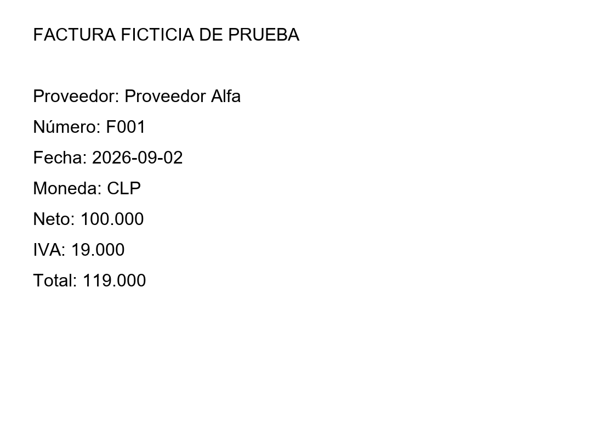

# DocumentAnalyzer — Analizador documental
    

## Contenido
- [Demostración local](#demostración-local)
- [Conversión con MarkItDown](#conversión-con-markitdown)
- [Imágenes y PDF escaneados](#imágenes-y-pdf-escaneados)
- [Extracción generativa opcional](#extracción-generativa-opcional)
- [Validación y alcance](#validación-y-alcance)
- [Evaluación prevista](#evaluación-prevista)

MVP para convertir archivos, extraer campos con evidencia y comprobar consistencia de importes. Combina una ruta de texto local, un adaptador MarkItDown, un adaptador PaddleOCR y un conector opcional de extracción con IA generativa.

**Estado:** demostración local sobre Markdown, extracción por etiquetas, citas por línea, validación de importes, detección de posibles duplicados y separación de totales por moneda. Los adaptadores externos están implementados, pero no se han ejecutado contra MarkItDown/PaddleOCR reales en esta entrega. La extracción con LLM también está pendiente de conexión real. No se declara una precisión de OCR ni un desempeño generativo medido.

## Demostración local

Desde esta carpeta, con Python 3.10 o superior y sin dependencias externas:

```powershell
python scripts/analyze.py
python -m unittest discover -s tests -v
```

Los [cuatro documentos ficticios](examples/factura_001.md) incluyen una factura consistente, una discrepancia de 500, una factura sin IVA declarado y una copia de la primera. La suma validada es **119.000 CLP**, correspondiente a un documento. Los casos con avisos y las copias se excluyen del total validado; no se consideran automáticamente errores fiscales ni fraude.

El [resultado de demostración](reports/demo.md) resume avisos y totales. Su [reporte JSON](reports/demo.json) conserva texto, método de extracción, hash, campos, citas, avisos y política de agregación. Se generan además versiones Markdown en `reports/document_*.md`. Si un archivo falla, el lote termina y no publica un resultado nuevo; revisa el error y la fecha de cualquier reporte anterior.

## Conversión con MarkItDown

Crea un entorno independiente para este proyecto e instala sus dependencias opcionales:

```powershell
python -m venv .venv
.\.venv\Scripts\python.exe -m pip install -r requirements-conversion.txt
.\.venv\Scripts\python.exe scripts/analyze.py ruta/documento.pdf
```

La ruta de conversión admite PDF, DOCX, XLSX y PPTX. TXT y Markdown se leen directamente. Se desactivan plugins y no se habilita una descripción de imagen generativa automáticamente. Una conversión vacía falla y no produce campos supuestos. El extractor local solo reconoce etiquetas como `Proveedor:`, `Número:` y `Total:`; otros diseños requieren adaptar reglas o conectar extracción generativa.

[MarkItDown](https://github.com/microsoft/markitdown) normaliza contenido a Markdown. La conversión no garantiza preservar todas las tablas, páginas ni la posición original. En esta ruta la página puede ser `null`, y las líneas citadas pertenecen al texto convertido.

## Imágenes y PDF escaneados

[factura_imagen.png](examples/factura_imagen.png) es una imagen sintética para probar OCR.



Instala un motor PaddlePaddle compatible con tu sistema siguiendo su guía y después `requirements-ocr.txt`. El adaptador utiliza `PaddleOCR(lang="es")` y conserva texto, página y detalles de reconocimiento.

```powershell
.\.venv\Scripts\python.exe scripts/analyze.py examples/factura_imagen.png
.\.venv\Scripts\python.exe scripts/analyze.py ruta/escaneo.pdf --ocr
```

Las imágenes se procesan con OCR; para PDF debe elegirse `--ocr` explícitamente. En esta primera versión no hay selección automática por página ni reconstrucción fiable de tablas. Los modelos pueden descargarse durante el primer uso; el adaptador no implica que el motor esté instalado. Consulta la [documentación de PaddleOCR](https://github.com/PaddlePaddle/PaddleOCR/blob/main/docs/version3.x/pipeline_usage/OCR.en.md) y sus instrucciones de instalación.

OCR produce evidencia de lectura, no garantiza que la lectura coincida con el documento original. Una cita válida en texto OCR puede conservar un error visual. Para comprobantes reales se necesita revisión contra la imagen.

## Extracción generativa opcional

Configura `OPENAI_API_KEY` y `OPENAI_MODEL` en el entorno sin guardarlos en archivos del proyecto ni pegarlos en el chat. El modelo debe admitir Responses y JSON estructurado:

```powershell
python scripts/analyze.py examples/factura_001.md --provider openai
```

Se envía el texto convertido con página y número de línea, no la imagen original. La solicitud consume uso de API; lleva `store=false`, sin prometer retención cero. La implementación sigue la [documentación oficial de salidas estructuradas](https://developers.openai.com/api/docs/guides/structured-outputs?api-mode=responses).

Los valores deben aparecer literalmente en la cita y la línea. Un campo faltante permanece `null`. La validación comprueba la existencia de la evidencia; no acredita por sí sola que el modelo asignó el valor al campo correcto. No se generan ni corrigen importes usando el modelo.

## Validación y alcance

- Importes con formato chileno: punto de miles y coma decimal. Las reglas aritméticas utilizan `Decimal`.
- Revisión de `neto + IVA = total`, sin deducir tasa de impuesto. Documentos con descuentos, varios impuestos o cargos requieren otra regla.
- Fechas esperadas en formato ISO `AAAA-MM-DD`. No hay normalización automática de otros formatos.
- Posibles duplicados por proveedor, número y moneda. La primera versión se conserva y las siguientes se excluyen; una corrección legítima debe revisarse antes de aplicar esta política.
- Totales agrupados por moneda, sin conversión. Un documento con datos faltantes o avisos queda fuera de la suma validada.

La extracción de productos por fila, gasto por categoría, anomalías estadísticas y preguntas sobre un conjunto de documentos son etapas posteriores. El primer objetivo es separar texto, campos y cálculos con trazabilidad.

## Evaluación prevista

Etiquetar campos, páginas y valores en documentos reales permitidos o sintéticos variados. Separar evaluación de desarrollo. Medir exactitud por campo, omisiones, falsas extracciones y calidad del OCR; comparar la imagen original con texto reconocido y medir el efecto de los errores en totales. Las pruebas locales actuales verifican lógica y contratos simulados; no acreditan calidad de los motores externos.
