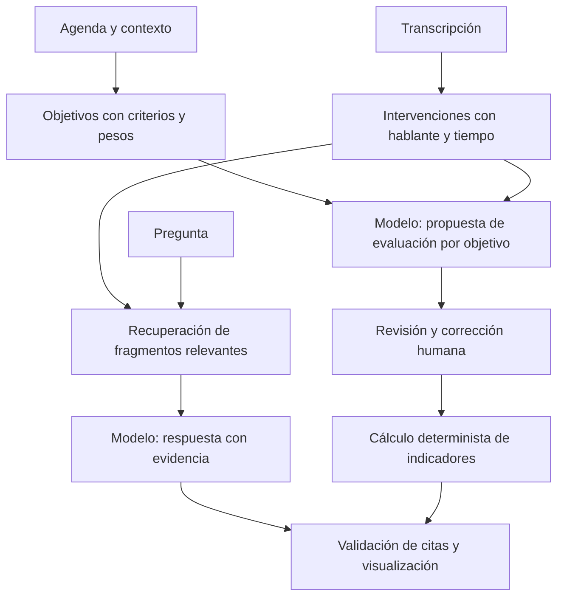

# Ruta de implementación

## Objetivo del primer MVP

Recibir una transcripción y una agenda, responder preguntas con evidencia y proponer una revisión de cumplimiento editable. La IA interpreta los textos y propone estados; el código valida la estructura, comprueba referencias y calcula porcentajes.

## Etapas y criterios de avance

| Etapa | Entregable | Criterio para avanzar | Estado |
| --- | --- | --- | --- |
| 0. Contrato y caso de prueba | Agenda, intervenciones, respuestas y revisión de referencia; cálculo local | Identificadores válidos, evidencia literal y fórmulas verificadas | Incluido en esta entrega. |
| 1. Ingesta de texto | Importación de TXT, Markdown o JSON a intervenciones normalizadas | Conservar hablante, orden y tiempo; indicar tiempos ausentes sin inventarlos | Pendiente. |
| 2. Búsqueda y preguntas | Recuperación textual inicial y respuestas de un LLM con citas | Identificar decisiones finales, rechazar premisas falsas y abstenerse ante evidencia insuficiente | Implementados búsqueda léxica y conector con citas; prueba real y evaluación semántica pendientes. |
| 3. Agenda y revisión | Evaluación por objetivo con criterios y evidencia; edición humana | Estados y citas válidos; correcciones recalculan los indicadores | Pendiente. |
| 4. Interfaz y trazabilidad | Pantallas de carga, chat, agenda y resultados | Abrir el fragmento citado y registrar revisiones sin perder la versión previa | Pendiente. |
| 5. Audio y documentos | Transcripción con tiempos, identificación de hablantes e ingesta de contexto | Medir errores de transcripción y su efecto en acuerdos, cifras y cumplimiento | Pendiente. |

## Flujo propuesto

La agenda expresa intención; la transcripción documenta lo observado. Un documento previo no demuestra que un tema se haya tratado. Las citas para acreditar cumplimiento deben señalar la reunión y el resultado correspondiente.

## Contratos de información

- **Agenda:** identificador, título, contexto, tema, objetivo, peso y criterios de cumplimiento/parcialidad definidos antes del análisis.
- **Transcripción:** intervenciones con identificador, hablante, inicio, fin y texto; metadatos de origen y segmentos faltantes.
- **Respuesta:** texto, referencias a intervenciones, citas y condición de información insuficiente. Conservar contexto alrededor de los fragmentos para resolver negaciones y correcciones posteriores.
- **Revisión:** cobertura del tema, estado de cumplimiento, evidencia, motivo y procedencia de la evaluación. Registrar cambios del revisor.
- **Ejecución futura:** versión de datos, modelo, prompt, parámetros, tiempos, errores y costos.

## Recuperación y generación

La implementación inicial está en `app/questions.py`, `app/providers.py` y `scripts/ask.py`. Para reuniones pequeñas usa la transcripción completa; para reuniones grandes selecciona coincidencias, vecinos y cierre, declarando el alcance parcial. Valida JSON y citas literales antes de mostrar una respuesta. Consulta la [guía de ejecución](preguntas.md). El cumplimiento automático por objetivo no forma parte todavía de este conector.

Comenzar con un comparador léxico y después evaluar embeddings. Recuperar varios fragmentos, incluyendo intervenciones posteriores relacionadas: una propuesta inicial puede ser corregida al cierre. El modelo debe responder solo desde las fuentes permitidas, distinguir propuestas de acuerdos y devolver referencias estructuradas.

Validar que cada referencia existe y que la cita aparece literalmente. Esto comprueba trazabilidad, pero no demuestra por sí solo que la evidencia respalde la conclusión; la revisión semántica sigue siendo necesaria. El texto de documentos y transcripciones se trata como contenido, no como instrucciones del sistema.

El enfoque de localizar pasajes relevantes antes de resumir tiene antecedentes en [QMSum](https://aclanthology.org/2021.naacl-main.472/). Ese conjunto puede servir para evaluar preguntas sobre reuniones; no aporta directamente nuestras etiquetas de cumplimiento de agenda en español.

## Audio y contexto documental

Para audio/video, agregar reconocimiento de voz y, cuando sea necesario, separación de hablantes. No asociar automáticamente una etiqueta de voz con una identidad real. Una captura de audio con errores en cantidades o nombres puede cambiar la interpretación: mostrar el origen y permitir corregir la transcripción.

Para documentos de contexto, evaluar conversión a Markdown con MarkItDown y OCR para escaneos. Preservar página y origen; no pasar una transcripción ya disponible por OCR. Los motores y proveedores se elegirán al implementar, después de probar idioma, exactitud y requisitos de ejecución.

## Alcance inicial

Trabajar con reuniones cargadas por el usuario, sin grabación en vivo, mensajería automática ni ejecución de tareas. Las tareas extraídas se muestran para revisión. No deducir que un compromiso se cumplió fuera de la reunión si no existe evidencia posterior.

Una vez que este flujo sea verificable, añadir comparación entre reuniones, seguimiento de pendientes y un panel de tendencias. El [protocolo de evaluación](evaluacion.md) separa los indicadores de la reunión de los indicadores de calidad de IA.
