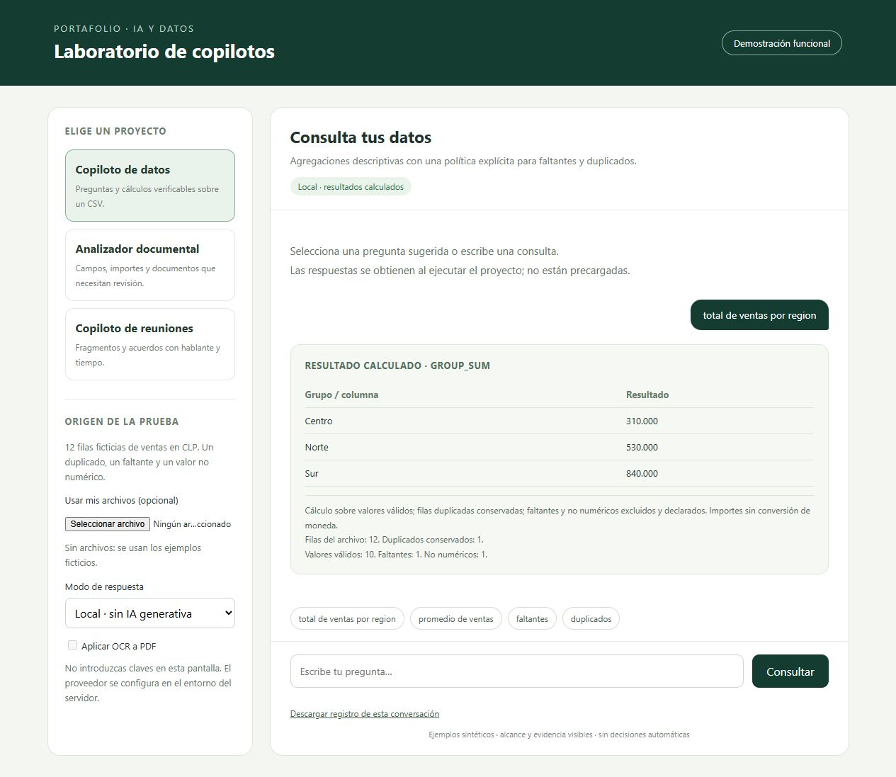
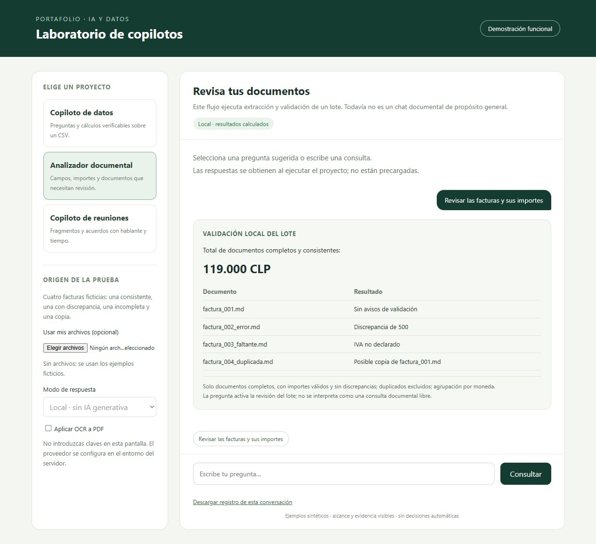
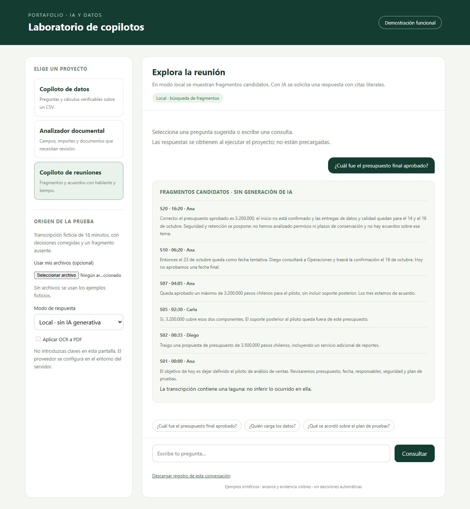

# Demostración funcional de los copilotos

Fecha de verificación: 7 de octubre de 2026. Las capturas proceden de consultas ejecutadas desde la interfaz local del portafolio. Todos los datos usados son ficticios. Se documenta el modo local; estas imágenes no acreditan llamadas a un modelo generativo.

## Copiloto de datos

**Objetivo:** responder consultas descriptivas sobre ventas y mostrar la política de calidad que afecta al resultado.

**Entrada:** [ventas.csv](../../DataCopilot/examples/ventas.csv), con doce filas, un duplicado completo, una venta ausente y una venta no numérica.

**Pregunta ejecutada:** `total de ventas por region`.

**Resultado:** Centro 310.000, Norte 530.000 y Sur 840.000 CLP. Se suman diez ventas numéricas, incluyendo el duplicado; las dos filas sin un importe numérico se omiten. Total de los grupos: 1.680.000 CLP.

[Resultado completo de la ejecución](registros/datos.json).

**Alcance:** operaciones controladas sobre columnas del archivo. En modo local reconoce plantillas de preguntas; no es interpretación libre mediante IA. El conector generativo propone una operación permitida y el programa calcula los importes.

## Analizador documental

**Objetivo:** extraer campos y detectar documentos que necesitan revisión antes de consolidar importes.

**Entrada:** las [cuatro facturas Markdown de ejemplo](../../DocumentAnalyzer/examples). La consulta `Revisar las facturas y sus importes` activa la validación del lote.

**Resultado:** una factura completa y consistente aporta 119.000 CLP. Otra presenta una diferencia de 500; la tercera no declara IVA y la cuarta es una copia de la primera. Estos tres documentos quedan excluidos del total validado.

[Resultado completo de la ejecución](registros/documentos.json).

**Alcance:** esta prueba usa Markdown y extracción por reglas. No demuestra OCR, conversión de PDF/Office ni conversación libre sobre documentos. Esas capacidades requieren pruebas adicionales o desarrollo, según el caso.

## Copiloto de reuniones

**Objetivo:** localizar evidencia para responder preguntas sobre una reunión sin perder hablante y momento.

**Entrada:** [transcripción sintética](../../MeetingCopilot/examples/transcript.json) y [agenda previa](../../MeetingCopilot/examples/agenda.json). La reunión incluye una corrección de presupuesto y un tramo sin transcripción.

**Pregunta ejecutada:** `¿Cuál fue el presupuesto final aprobado?`.

**Resultado:** se recuperan fragmentos candidatos. S07, a las 04:05, y S20, a las 16:20, contienen la aprobación de 3.200.000 CLP. También aparece la propuesta anterior de 3.500.000; el modo local no sintetiza automáticamente una respuesta ni elimina todo fragmento irrelevante.

[Resultado completo de la ejecución](registros/reuniones.json).

**Alcance:** búsqueda léxica. El conector generativo está implementado para solicitar respuestas con citas y validar su correspondencia literal, pero no se ejecutó con un proveedor real en esta demostración. La evaluación de cumplimiento de agenda tiene un flujo separado, documentado en MeetingCopilot.

## Estado de las capacidades

| Capacidad | Evidencia disponible |
| --- | --- |
| Consultas locales de datos | Ejecutadas en navegador; captura y JSON |
| Validación de facturas Markdown | Ejecutada en navegador; captura y JSON |
| Recuperación de fragmentos de reuniones | Ejecutada en navegador; captura y JSON |
| Entrada propia de CSV | Prueba de integración con un archivo distinto al ejemplo |
| IA generativa | Conectores implementados y pruebas simuladas; llamada real pendiente |
| Conversión MarkItDown y OCR | Adaptadores y pruebas simuladas; motores reales pendientes |
| Chat con memoria entre preguntas | Pendiente; las consultas actuales son independientes |
| Descarga JSON desde el navegador | Botón implementado; descarga no verificada en el navegador integrado |

Los JSON enlazados son copias de las salidas de los motores que se ejecutaron al tomar las capturas. No se modificaron sus resultados. Los registros futuros del servidor incluyen también proyecto, pregunta, proveedor e identificador de ejecución.

## Reproducir y publicar

Sigue la [guía de ejecución](../README.md). En GitHub, este documento usa enlaces e imágenes relativos para mostrarse junto con el código y los ejemplos. Para conservar la evidencia deben publicarse la carpeta `docs`, la interfaz, el servidor y los proyectos que este invoca.

La publicación está pendiente: la carpeta de trabajo no tiene un repositorio Git configurado y todavía falta identificar el repositorio de destino. Publicar estas capturas documenta el comportamiento local; la acreditación del flujo generativo requiere una nueva prueba y sus propios registros.
