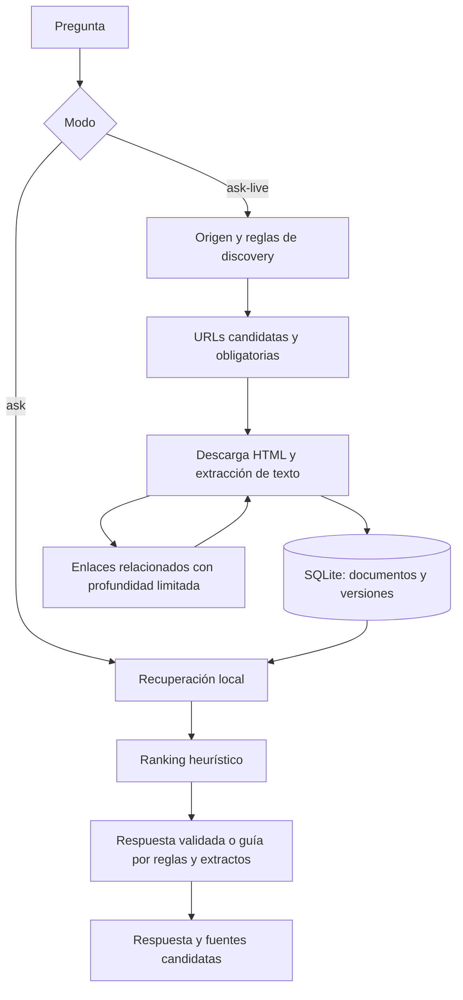

# Arquitectura del MVP

## Flujo principal

`ask-live` intenta seleccionar primero las URLs ingeridas durante la ejecución. Si no obtiene documentos, recurre a la búsqueda local. Después puede agregar fuentes obligatorias presentes en la base. Esta prioridad reduce mezclas entre temas, pero no garantiza aislamiento completo.

## Módulos y responsabilidades

Los componentes de dominio usan nombres genéricos: **seguimiento web** para captura de actividad, **mensajería** para el canal de interacción, **reglas de acción** para las condiciones y respuestas automáticas, y **enrutamiento** para los destinos y colas. Las guías no suponen rutas de interfaz de un producto específico. La fuente de `ask-live` se obtiene exclusivamente del tag registrado que indica el usuario.

| Módulo | Responsabilidad | Decisión relevante |
| --- | --- | --- |
| `app/main.py` | Interfaz CLI, ingesta, consultas y retroalimentación | Usa `argparse`; cada subcomando coordina módulos y transacciones. |
| `app/db.py` | Ruta, conexión, esquema y migración ligera | SQLite local con FTS5 y WAL; no requiere servidor. |
| `app/scraper.py` | Descarga HTTP, extracción HTML y enlaces | `requests` y BeautifulSoup/lxml; no ejecuta JavaScript. |
| `app/live_discovery.py` | Consultas web, búsqueda de Learn, semillas y puntuación de enlaces | Mezcla reglas por tema y búsqueda genérica. |
| `app/retrieval.py` | Tokenización, recuperación, ranking, extractos y respuesta | Reglas explícitas sin modelo de lenguaje. |
| `app/models.py` | Archivo reservado | No contiene modelos de datos ni modelos de aprendizaje automático. |

## Descubrimiento y extracción

Discovery agrega primero semillas conocidas por tema, intenta el endpoint de búsqueda de Microsoft Learn cuando corresponde y consulta DuckDuckGo HTML. Algunas semillas pueden ocupar todo el cupo antes de buscar nuevos resultados. Los fallos de buscadores se capturan sin mostrarlos necesariamente en consola.

El scraper elimina elementos como navegación, scripts y pie de página. Busca contenido principal en `main`, `article`, un contenedor relacionado con contenido o el cuerpo del HTML y extrae encabezados, párrafos, listas y celdas de tabla. Calcula SHA-256 sobre el texto limpio y extrae enlaces del mismo dominio sin fragmentos. Excluye enlaces a ciertos formatos, incluidos PDF e imágenes; no existe un lector de PDF ni de informes locales.

## Modelo de almacenamiento

| Tabla | Contenido y relaciones |
| --- | --- |
| `sources` | Tag único, URL base, filtros, notas y fecha de registro. |
| `documents` | URL única, un tag, título, dominio, última revisión, hash, estado HTTP y tipo de contenido. |
| `document_versions` | Texto y hash por versión; referencia a `documents.id`. |
| `document_fts` | Índice FTS5 con título y texto; incluye URL e identificadores de documento y versión. |
| `validated_qa` / `validated_qa_fts` | Pregunta, respuesta y fuentes registradas manualmente, con índice textual. |
| `error_cases` / `error_cases_fts` | Pregunta, respuesta errónea, motivo y búsqueda alternativa, con índice textual. |
| `search_strategies` | Consultas registradas como exitosas o alternativas asociadas a errores. |
| `change_log` | Hash anterior, nuevo hash, fecha y resumen fijo de detección. |

Cuando cambia el texto, `upsert_page` añade una versión y una fila FTS. No elimina versiones anteriores del índice. Una URL tiene un solo `source_tag`; ingerirla con otro tag puede cambiar su clasificación. Las tablas de feedback no tienen tag. El esquema declara claves foráneas y ejecuta `PRAGMA foreign_keys=ON` durante la inicialización; `connect` no vuelve a habilitarlo explícitamente en cada conexión posterior.

## Recuperación y construcción de respuesta

En `ask`, los tokens de la pregunta se filtran con una lista de palabras comunes y se unen con `OR`, hasta 12 tokens. FTS5/BM25 obtiene candidatos y luego las reglas reordenan por intención, términos positivos/negativos y patrones de URL. Un menor BM25 es mejor; se utiliza como un ajuste pequeño dentro del score heurístico.

La búsqueda por URLs en `ask-live` no ejecuta BM25: toma las filas FTS de esas URLs y aplica el ranking por reglas. En ambos caminos pueden aparecer versiones anteriores de una misma URL. No hay fragmentación persistente ni búsqueda vectorial.

Una respuesta validada similar se devuelve primero. Si no existe y faltan documentos, se devuelve un aviso de información insuficiente. Con documentos, se construye una guía predefinida para intenciones conocidas o una lista de frases relevantes para el caso genérico; después se agregan checklist, extractos, errores conocidos y fuentes. La extracción inspecciona solo parte del texto y no comprueba que cada afirmación se desprenda de una fuente específica.

## Decisiones y alcance

SQLite y reglas reducen dependencias y permiten explorar el flujo local. A cambio, la coincidencia léxica y los pasos escritos a mano limitan la adaptación a preguntas nuevas. Los tags ayudan a organizar documentos, pero no son una frontera completa para la respuesta. El versionado permite conservar historia, aunque falta separar el índice vigente del histórico.

La [evolución hacia IA](evaluacion_ia.md) propone resolver estas limitaciones antes de comparar la generación con el MVP actual.
