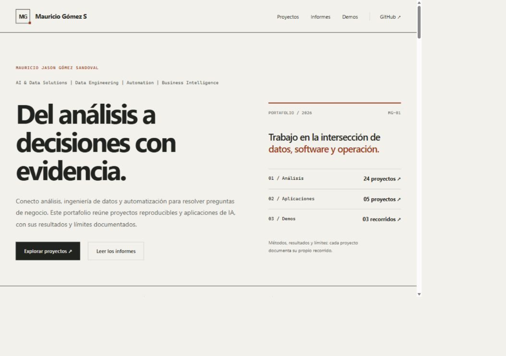

# Sitio de presentación del portafolio
 

Web estática en español para presentar los proyectos, consultar sus informes y mostrar demos. Vive en esta carpeta independiente; lee documentación y reportes ya guardados y **no ejecuta notebooks, entrena modelos ni inicia los MVP**.

## Contenido

- [Vista previa local](#vista-previa-local)
- [Personalizar](#personalizar)
- [Demos y videos](#demos-y-videos)
- [Publicar en GitHub Pages](#publicar-en-github-pages)
- [Organización y alcance](#organización-y-alcance)

El catálogo se obtiene de las tablas del README general. Los estados publicados conservan las limitaciones que allí se describen. Las páginas de proyecto y los informes se convierten desde Markdown, con figuras y documentos enlazados. Los proyectos siguen funcionando con sus propios entornos.

En la exploración, el selector de áreas muestra solo las áreas de la línea elegida. «Todos» reúne las áreas del catálogo completo. Al cambiar de línea, se conserva el área seleccionada si sigue disponible; en caso contrario se vuelve a «Todas las áreas». «Limpiar filtros» restaura todo el catálogo.

La navegación tiene páginas propias para **Informes** (`informes/index.html`) y **Demos** (`demos/index.html`). Los informes se agrupan y filtran por **Análisis**, **Business Intelligence** e **IA y MVP**, según la carpeta del proyecto. RetailKPIAnalysis pertenece a Análisis aunque su área sea BI. Las líneas sin informes integrales muestran su estado y enlaces a la documentación disponible.

Para incorporar un informe de una aplicación, guarda su documento en `reports/informe_final/informe_final.md` dentro del proyecto y reconstruye. El generador lo incorpora automáticamente a su línea; no crea un informe ni acredita resultados si ese archivo no existe.



## Vista previa local

Desde la raíz del portafolio, en PowerShell:

```powershell
python -m venv SitioWeb/.venv
& SitioWeb/.venv/Scripts/python.exe -m pip install -r SitioWeb/requirements.txt
& SitioWeb/.venv/Scripts/python.exe SitioWeb/scripts/build_site.py
& SitioWeb/.venv/Scripts/python.exe SitioWeb/scripts/check_site.py
& SitioWeb/.venv/Scripts/python.exe SitioWeb/scripts/serve.py
```

Abre http://127.0.0.1:8767/ y conserva esa terminal mientras revisas. Detén la vista previa con Ctrl+C. Si el puerto está ocupado, añade `--port 8768` al último comando.

Repite la construcción después de modificar documentación, informes o configuración. El generador reemplaza únicamente `SitioWeb/dist`; esta salida es derivada y no se versiona. Se necesita Python 3.10 o posterior y las dependencias de esta carpeta.

## Personalizar

Edita `data/perfil.json`:

- `brand` y `brand_mark`: nombre del sitio e iniciales del emblema. La identidad actual es **Mauricio Gómez S**, con el emblema **MG**, utilizada en la navegación de todas las páginas.

- `name`, `role`, `headline`, `description` y `about`: identidad, presentación y perfil profesional.
- `expertise`, `experience` y `education`: áreas de trabajo, trayectoria y formación seleccionada.

`experience` alimenta «Mi recorrido»: cuatro etapas cronológicas con responsabilidades y aportes, en lugar de una lista de empleadores. Cada entrada utiliza `period`, `role`, `description` y, opcionalmente, `achievement`. Los logros proceden del CV y se distinguen de las métricas de los proyectos publicados.
- `github_url`: perfil público; ya configurado como `https://github.com/mauriciojgomezs-ds`.
- `repository_url`: URL completa del repositorio cuando exista. En GitHub Actions se detecta automáticamente mediante `GITHUB_REPOSITORY`.
- `repository_branch`: rama para enlaces locales hacia el código. En Actions se utiliza la rama de ejecución.
- `featured`: nombres de carpetas de los proyectos destacados.

El nombre, la presentación, el correo profesional y la selección de experiencia y formación se personalizaron a partir del CV de octubre de 2026. `email` añade un enlace de contacto y `linkedin_url`, si contiene una dirección HTTPS, añade LinkedIn. Este último queda vacío hasta confirmar el enlace exacto. Las fechas y la condición de egresado se conservan; los antecedentes laborales no se presentan como resultados de los proyectos publicados.

La línea de especialidades conserva los encabezados del CV: **AI & Data Solutions | Data Engineering | Automation | Business Intelligence**. El diseño editorial utiliza tipografía sans serif, líneas, secciones numeradas y un acento terracota. Consulta la [guía de diseño](docs/diseno.md) para mantener la composición al ampliar el sitio.

La [guía del perfil profesional](docs/perfil_profesional.md) documenta la selección. El PDF original no se incluye entre los archivos descargables del sitio.

Sin una URL de repositorio, el sitio local muestra documentos y evidencia exportados; los archivos de código que no se exportan aparecen como texto. Al publicar desde Actions, añade enlaces al código y a los notebooks versionados en GitHub.

## Demos y videos

`data/demos.json` configura las tres demos iniciales. Actualmente muestra capturas de ejecuciones locales con datos ficticios y un enlace al recorrido documentado. Las leyendas distinguen reglas locales, búsqueda léxica y capacidades externas pendientes.

Las capturas y los reproductores se muestran exclusivamente en la página Demos. Los enlaces antiguos a `index.html#demos` redirigen a esa página cuando JavaScript está activo.

Para agregar un video a una demo, utiliza **una** de estas opciones:

1. `video_url`: enlace `https://www.youtube.com/watch?v=ID` o `https://youtu.be/ID`. El reproductor se carga al pulsar el botón, sin reproducción automática.
2. `video_file`: ruta como `assets/media/mi-demo.mp4`. Coloca el MP4 en esa carpeta y deja `video_url` vacío. Se publica junto con el sitio.

Mantén los videos locales pequeños para no inflar el repositorio. Antes de grabar, usa datos ficticios y evita mostrar contraseñas, claves o información personal. Las aplicaciones Streamlit y los proveedores de IA no se ejecutan dentro de esta web estática.

## Publicar en GitHub Pages

Sube la estructura del portafolio y esta carpeta al **mismo repositorio**, conservando los informes Markdown, las figuras y las capturas. No se necesitan los datasets para construir el sitio.

1. En el repositorio, abre **Settings → Pages → Build and deployment** y selecciona **GitHub Actions**.
2. Abre **Actions → Publicar portafolio → Run workflow** y elige la rama que contiene tus archivos.
3. Cuando termine, GitHub mostrará la URL en el despliegue `github-pages`.

El flujo está en `../.github/workflows/portfolio-pages.yml`. Se inicia manualmente y publica solamente `SitioWeb/dist`. Para actualizar, sube los cambios y vuelve a ejecutarlo. El repositorio debe permitir GitHub Pages y Actions; consulta la [documentación de workflows de Pages](https://docs.github.com/en/pages/getting-started-with-github-pages/using-custom-workflows-with-github-pages).

Si el repositorio se llama `mauriciojgomezs-ds.github.io`, la dirección usa la raíz de ese dominio. Con otro nombre, Pages utiliza normalmente una subruta con el nombre del repositorio. Los enlaces del sitio son relativos para admitir ambas opciones.

## Organización y alcance

```text
SitioWeb/
├── data/                 # Perfil y demos editables
├── src/                  # Estilos y filtros del catálogo
├── assets/media/         # Videos MP4 opcionales
├── scripts/              # Construcción, comprobación y vista previa
├── requirements.txt      # Dependencias exclusivas de la web
└── dist/                 # Sitio generado; no versionar
```

Se exportan los documentos enlazados y archivos de evidencia de `docs` y `reports` en formatos permitidos y de hasta 8 MB por archivo. Los datasets, entornos, modelos, respaldos y registros `runs` quedan fuera del sitio generado. La revisión de lo que subes al **repositorio** sigue siendo independiente: el generador no decide qué archivos versionas.

La construcción comprueba las rutas de salida y el validador revisa los enlaces locales y archivos excluidos. El informe original se publica con su contexto; no se recalculan ni reinterpretan sus métricas. Una captura de demo no acredita llamadas reales a un proveedor externo.

La [verificación local](docs/verificacion.json) registra las comprobaciones y su alcance. Puedes repetir las pruebas de publicación con `python SitioWeb/scripts/test_site.py`, utilizando el intérprete del entorno de la web. La [captura de la portada](docs/portada.jpg) documenta la presentación inicial.

Los documentos de cada proyecto incluyen botones al inicio y al final para regresar al informe integral y a su ficha. Los enlaces JSON abren el archivo original en una nueva pestaña y ofrecen una opción Descargar junto al enlace. Los CSV abren una vista dentro del sitio con la misma navegación y una descarga del original. La vista previa muestra como máximo 200 líneas y 30.000 caracteres; los archivos originales se conservan completos.


Al regresar desde un reporte de etapa con Volver al informe, se recupera la posición de lectura guardada en esa pestaña. Se utiliza almacenamiento de sesión del navegador y una referencia a la sección para mantener la ubicación si cambia la altura del contenido anterior. Las visitas directas sin una posición guardada abren el informe normalmente.
